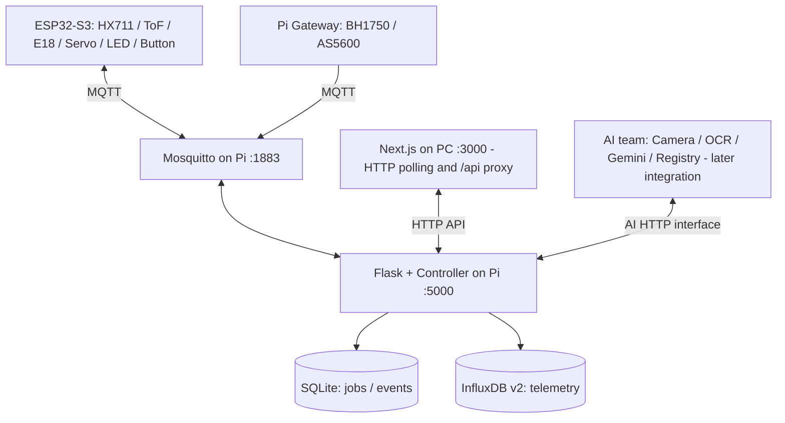

# AGENTS.md — Mini Sorting Hub

อัปเดตล่าสุด: **20 พฤศจิกายน 2026 (Asia/Bangkok)**

ไฟล์นี้เป็นคำแนะนำและบันทึกส่งต่องานสำหรับ agent ในโปรเจกต์ **Mini Sorting Hub** เก็บบริบทโครงการที่ `AGENTS.md` รากเพียงฉบับเดียว ไม่สร้าง `Agent.md` หรือ `agent.md` ซ้ำ; `frontend/AGENTS.md` เป็นกฎ framework ที่ Next.js สร้างอัตโนมัติและลิงก์กลับมาที่ไฟล์นี้ ไม่ใช่บันทึกสถานะอีกชุด

ผู้ใช้กำหนดให้ **เมื่อทำงานหรือตัดสินใจเกี่ยวกับโปรเจกต์ ต้องอัปเดตไฟล์นี้ด้วยทุกครั้ง** อ่านวิธีบันทึกใน Instructions for Coding Agents และเก็บ checkpoint ให้คนหรือ agent ที่มาทีหลังทำต่อได้

โครงหัวข้อปรับจากตัวอย่าง `C:/Users/nanon/Downloads/AGENTS.md` เท่านั้น ตัวอย่างเป็นอีกโปรเจกต์ จึงไม่ใช้เทคโนโลยี อุปกรณ์ หรือข้อกำหนดของตัวอย่างมาเปลี่ยนงานนี้ และไม่ได้แก้ไฟล์ใน Downloads

## Latest Handoff — อ่านสถานะนี้ก่อนทำต่อ

**Metric audit ล่าสุด 16 พ.ย.:** อ่าน `docs/testing/METRIC_AUDIT_TH.md` ก่อนอ้างความครบเกณฑ์ MQTT มี weight/height/passage จากสาม sensor sources และ gateway เพิ่ม; local broker บน Pi และ frontend บนคอมตรงรูปแบบที่ rubric อนุญาต แต่ยังไม่มีหลักฐาน MQTT/Influx/ฮาร์ดแวร์ครบจริง และใน workspace ยังขาด camera/OCR/Gemini ที่รวมใช้งาน ผล FPS/Accuracy และ slides/video จึงไม่อ้างว่าผ่านครบ 25 คะแนน

อัปเดต 20 พฤศจิกายน 2026 หลังผู้ใช้ขอให้อ่าน README และสร้าง frontend/backend ตามข้อกำหนด

- ปรับ frontend จากหน้า BENCH แบบเรียบเป็น operator console responsive โดยยังใช้ Next.js App Router, polling และ `/api` proxy เดิม: มี status/readiness, telemetry 5 กลุ่ม, control, job routing A/B/HOLD, settings, history และ jobs
- Backend ยังคง Flask/Paho/SQLite/InfluxDB/controller เดิม เพิ่ม boundary validation สำหรับ JSON object, action/settings และคำค้น พร้อม no-store/nosniff headers; ไม่เปลี่ยน state machine, MQTT schema, GPIO หรือ interlock
- **ผู้ใช้ยืนยันให้ frontend รันบนคอม และ backend/gateway รันบน Pi** (D010) จึงส่ง source `backend/` กับ `gateway/` ไปวางใต้ `~/mini-sorting-hub/`; docs/README/AGENTS ส่งเป็นคู่มือได้ ไม่ต้องส่ง frontend ไป Pi
- **firmware อยู่บนคอมเพื่อ Upload เข้า ESP32** ไม่ใช่โปรแกรมที่ต้องสั่งรันบน Pi; การส่ง source ไป Pi ไม่เปลี่ยน firmware บนบอร์ด
- Pi ใช้ Python .venv สำหรับ backend/gateway; Node.js/npm, node_modules และ .next อยู่บนคอมที่รัน frontend ไม่ติดตั้ง Next.js บน Pi และไม่ส่ง Windows .venv หรือ archive/artifacts ไปเป็น runtime
- ตั้ง frontend/.env.local บนคอมให้ BACKEND_URL ชี้ Flask บน Pi; ใช้ hostname ที่ผู้ใช้เคยยืนยัน pi-673305942.local:5000 เป็นตัวอย่าง หาก .local ไม่ resolve ให้เปลี่ยนเป็น IP จริง ไม่เดา IP
- หน้าเว็บ Next.js อยู่พอร์ต 3000; Flask API พอร์ต 5000; backend/gateway ใช้ .env แยกกัน ส่วน frontend ใช้ .env.local และ BACKEND_URL ฝั่ง server
- **ยังไม่มีหลักฐานว่าส่ง source โครงใหม่ขึ้น Pi แล้ว** หรือย้าย config/data เดิมแล้ว ไม่ให้ถือว่าการจัดไฟล์ในคอมเท่ากับ deploy สำเร็จ
- ZIP v1/v2 ใน artifacts/legacy เป็นชุดโครงเก่า ยังไม่มี ZIP รุ่นใหม่จาก monorepo นี้ หากจะส่งต้องเตรียมจาก source ปัจจุบันและรักษาค่า/ข้อมูลจริงเดิมบน Pi
- Git ปัจจุบันมี local commit งาน frontend/backend `f25bb4c`; หลังการ push `origin/main` ถูกหยุด ผู้ใช้เปลี่ยนคำสั่งชัดเจนให้ pull branch `dev` แล้วนำงานขึ้น `origin/dev` แทน โดยไม่แตะ `origin/main`; `package-lock.json` ที่รากยังเป็นไฟล์ untracked เดิมของผู้ใช้และไม่อยู่ใน commit
- ผลตรวจล่าสุด: backend **31 tests ผ่าน**, frontend lint/typecheck/production build ผ่าน และ dev server ตอบ GET `/` 200; browser preview tool timeout จึงยังไม่มี screenshot visual QA และไม่มีการยืนยัน Pi/MQTT/Influx/ESP32/กลไกจริง
- งานถัดไปให้ยึดคำขอผู้ใช้: ถ้าสั่งส่งขึ้น Pi ให้ใช้ `docs/setup/MIGRATION_TH.md` และ `docs/setup/BENCH_SETUP_TH.md` ก่อนเริ่มโปรแกรม ไม่เปลี่ยน requirement หรือวนทดสอบชิ้นที่ยืนยันแล้วโดยไม่มีเหตุ

## Project Overview

โปรเจกต์มหาวิทยาลัยวิชา **IoT Systems and Digital Solutions** สำหรับช่วยเจ้าหน้าที่หอพักอ่านฉลากและคัดพัสดุขาเข้า พร้อมเก็บประวัติให้ค้นบนเว็บ ทีม **6 คน: AI 3 คน และ HW/System 3 คน**

### Confirmed Architecture Decisions

| ส่วน | แบบที่เลือกใช้ในโปรเจกต์นี้ |
|---|---|
| Sensor Node | ESP32-S3-N16R8, Arduino/C++ |
| Gateway | Raspberry Pi 5, Python; อ่าน BH1750/AS5600 โดยตรง |
| MQTT Broker | Mosquitto บน Pi ใน LAN สำหรับ BENCH ปัจจุบัน |
| Backend | รันบน Pi: Python + Flask + Paho MQTT; controller ทำงานเพียงชุดเดียว |
| Database | InfluxDB v2 สำหรับ telemetry; SQLite สำหรับ jobs/events/cache |
| Frontend | รันบนคอม: Next.js App Router + TypeScript + Tailwind; /api proxy ไป Flask บน Pi |
| AI รุ่นส่งงาน | Camera Module 3 → OCR → Gemini → ตรวจทะเบียนและกฎ → ผลปลายทาง |
| กลไก | ถาดชั่งเอียง + Servo ประตู MG90S + Servo ราง MG996R; A/B/HOLD |
| Interface IR | E18-D80NK 4 ตัว ผ่านวงจรตัวต้านทาน v2; ไม่มี PC817 |
| ระยะพัฒนา | BENCH v2 บนโต๊ะ เลือกช่องผ่านเว็บและย้ายกล่องด้วยมือก่อน |

ผู้ใช้อนุมัติเปลี่ยนเฉพาะ frontend เป็น Next.js ตามตัวอย่างแล้ว (D007) ส่วน Flask/Mosquitto/Influx v2/SQLite และ polling คงเดิม ไม่ย้าย backend เป็น FastAPI หรือเพิ่ม cloud/WebSocket โดยอัตโนมัติ

### Confirmed Scope

- เจ้าหน้าที่หอพักรับพัสดุเข้า คัดกล่องกระดาษแข็งเล็กทีละกล่อง ฉลากหงายขึ้น
- A = กลุ่มชั้นล่าง, B = กลุ่มชั้นบน, HOLD = รอตรวจ ตั้งชั้นคั่น A/B บนเว็บในรุ่นส่งงาน
- กลไกหลัก: ถาดชั่งเอียง + ประตูกั้น + รางหมุนสามตำแหน่ง **ไม่มีสายพานใน baseline** การเคยถามตัวอย่างสายพานไม่ใช่การเลือกเปลี่ยนแบบ
- เลือกกล่องจริง 3 ขนาดเพื่อกำหนดขอบเขตก่อนทำราง ตัวเลขภาพแนวคิด 60×55×65 ซม. ไม่ใช่แบบผลิตหรือพิกัดที่ยืนยัน
- เริ่มอัตโนมัติเมื่อกล่องนิ่งและเครื่องพร้อม ชั่งเพื่อการวาง/ความนิ่ง/ขอบเขตเครื่อง/ประวัติ ไม่เทียบน้ำหนักของคาดหมายในพัสดุ
- ใช้เซนเซอร์ 5 ชนิด: Node 3 ชนิด และ Gateway 2 ชนิด IR หลายตัวนับเป็นชนิดเดียว กล้อง/Servo/ปุ่ม/LED ไม่ใช่ตัวเพิ่มชนิดเซนเซอร์ในแผนนี้
- รุ่นส่งงานต้องมี camera → OCR → Gemini → ตรวจทะเบียน/resolve → คัดจริง; รองรับฉลากพิมพ์ชัด 2–3 รูปแบบ ข้อมูลผู้รับสมมติในชุดทดลอง
- ไม่เดาชั้นจากเลขห้อง ใช้ทะเบียนห้อง→ชั้น; ชื่ออย่างเดียวต้องตรงหลัง normalize และพบคนเดียว ชื่อคล้าย/กำกวมหรือข้อมูลขัดกัน → HOLD
- tracking_id ว่างไม่ขวางการคัด ใช้ job_id เป็นตัวเชื่อมงาน
- อ่านข้อมูลจำเป็นไม่ได้ → ลองถ่ายซ้ำจำกัดแล้ว HOLD; **AI/API ใช้ไม่ได้ → PAUSED_AI ค้างบนถาด รอกดลองใหม่** ไม่ระบายเข้า HOLD เพราะบริการล่ม
- ไฟสถานะ + เว็บ ไม่มี LCD เพิ่ม ปุ่มพักและเว็บควบคุมได้ กล่องปล่อยแล้วไม่เปลี่ยนรางกลางทาง
- ACK คำสั่งไม่ใช่กล่องถึงปลายทาง ต้องรอ IR ยืนยันจริง กล่องติด/ผิดช่องต้อง fault ไม่แกล้งนับสำเร็จ
- พักไว้ตามคำขอผู้ใช้: **P01 วิธีปิดเคส HOLD**, **P02 ตรวจเลขพัสดุซ้ำข้าม job** ไม่เพิ่มเป็นฟีเจอร์หรือวนถามซ้ำจนผู้ใช้พร้อม
- ไม่เพิ่มแจ้งผู้พัก/รับของ แขนกล รองรับหลายกล่องพร้อมกัน หรืองานทดสอบคุณภาพสินค้า

BENCH ยังไม่มีการถ่ายภาพ/OCR/Gemini หรือ UI นำเข้า CSV/ชั้นคั่นครบ มีเพียงจุดเชื่อม AI และข้อมูลทดสอบ/เลือกช่องด้วยมือ ต้องรายงานว่ายังไม่ครบ Criteria พร้อมส่ง

### System Responsibilities

- **ESP32-S3:** อ่าน HX711, VL53L0X และ E18; คุม Servo สองตัว ไฟสถานะ และปุ่ม; รับคำสั่งและส่ง telemetry/ACK ผ่าน MQTT
- **Pi Gateway:** อ่านมุม AS5600 และแสง BH1750 ส่ง `sorter/gateway`; ไม่ให้ Python ฝั่งนี้แย่งควบคุม Servo ของ ESP32
- **Mosquitto:** ส่งต่อ MQTT ระหว่าง Node, Gateway และ backend; ไม่ใช่ผู้ตัดสินช่องพัสดุ
- **Backend/controller:** ตรวจ readiness, สร้าง job_id, รับผลเลือกช่อง/AI, คุมลำดับกลไกและ fault และบันทึกผล
- **Dashboard:** แสดงสถานะ/ประวัติและส่งคำขอควบคุมผ่าน backend ไม่ต่อ MQTT หรือสั่ง GPIO จาก browser
- **AI team:** ทำกล้อง/OCR/Gemini และจับคู่ทะเบียนตามขอบเขต ส่งผลผ่าน AI interface; ไม่มีสิทธิ์ข้าม interlock ของ controller

## Architecture and Data Flow



**Flow ปัจจุบัน — BENCH:**

```text
ตรวจความพร้อม → เริ่มรับงาน → วางกล่อง → น้ำหนักนิ่ง → สร้าง job_id
→ เลือก A/B/HOLD บนเว็บ → Servo ราง → AS5600 ยืนยันมุม
→ เปิดประตู → คนยกกล่องผ่าน IR ถาด → ผ่าน IR ช่องที่เลือก
→ เอากล่องออกให้ถาดและทางว่าง → ปิดประตู → บันทึกผล → พร้อมชิ้นถัดไป
```

- ยังไม่ประกอบกลไกจึงอาจต้องหมุนแม่เหล็ก AS5600 ด้วยมือใน BENCH ต้องระบุว่าเป็นการจำลองทางกล ไม่มีการนับว่าคัดอัตโนมัติจริง
- รุ่นส่งงานแทนขั้นเลือกช่องด้วยผล AI ที่ผ่านกฎทะเบียนแล้ว ส่วน interlock และการยืนยันผ่าน IR ยังคงเดิม
- มุมไม่ถึง กล่องไม่ผ่าน หรือผิดช่อง → fault และหยุดรับงาน ไม่บันทึกว่าคัดสำเร็จ
- ตำแหน่งพร้อม/ประตูปิดต้องตรวจตามคู่มือ ไม่สรุปว่าปลอดภัยจากภาพหรือคำสั่ง ACK เพียงอย่างเดียว

## Project Structure

โครง monorepo ปรับตามคำขอผู้ใช้ 16 พ.ย. 2026 โดยคงความรับผิดชอบฮาร์ดแวร์และ API เดิม:

```text
Project/
├── AGENTS.md / README.md / .gitignore / .gitattributes
├── frontend/
│   ├── src/app/                       # layout, page, styles
│   ├── src/features/dashboard/        # React client components
│   ├── src/lib/api/ / src/types/       # API client and contracts
│   └── package.json / package-lock.json / .env.example
├── backend/
│   ├── app/                          # hub, controller, store, entry point
│   ├── tests/
│   └── config.example.json / .env.example / requirements.txt
├── gateway/
│   ├── gateway_sensors.py / bench/
│   └── .env.example / requirements.txt
├── firmware/
│   ├── esp32/hub_node/                # combined firmware + secrets.example.h
│   └── bench/                        # standalone tests / calibration
├── docs/
│   ├── project/ / setup/ / ai/
│   └── hardware/ / testing/ / references/
├── archive/                          # local history; ignored by Git
└── artifacts/                        # old ZIPs/deliverables; ignored by Git
```

### Source of Truth

อ่านเฉพาะส่วนที่เกี่ยวกับงาน ไม่จำเป็นต้องโหลดทุกไฟล์ในทุก turn

| ไฟล์/โฟลเดอร์ | บทบาท |
|---|---|
| `docs/project/PROJECT_BRIEF_TH.md` | ขอบเขตและ Criteria ฉบับรวม รวมสิ่งที่ตกลงและเรื่องที่พักไว้ |
| `docs/setup/IR_V2_UPDATE_TH.md` | สรุปการย้าย IR ไปวงจร R และวิธีอัปเดต |
| `docs/setup/BENCH_SETUP_TH.md` | คู่มือเดินสาย ติดตั้ง สอบเทียบ และรัน BENCH ปัจจุบัน |
| `docs/testing/VALIDATION_TH.md` | หลักฐานและข้อจำกัดการตรวจโค้ด |
| `firmware/esp32/hub_node/hub_node.ino` | Firmware รวม ESP32-S3 |
| `gateway/gateway_sensors.py` | Pi อ่าน AS5600/BH1750 โดยตรง แล้วส่ง MQTT |
| `backend/app/hub.py` | Flask API และผู้ประสาน MQTT |
| `backend/app/controller.py` | State machine/interlock ของระบบ |
| `backend/app/store.py` | SQLite และ InfluxDB v2 |
| `frontend/src/features/dashboard/Dashboard.tsx` | Dashboard แบบ Next.js/React |
| `firmware/bench/` | โค้ดทดลองแยกชิ้นและสอบเทียบ |
| `gateway/bench/` | โค้ดทดสอบ AS5600/BH1750 แยกชิ้นบน Pi |
| `docs/hardware/wiring_v2/` | ผัง SVG/PNG ปัจจุบัน + source สร้างภาพ |
| `docs/hardware/esp32_v2.png` | ภาพอุปกรณ์แนว Tinkercad รุ่นล่าสุด แก้จาก `archive/hardware/esp32_v1.png` |
| `docs/ai/AI_TEAM_HANDOFF_PROMPT_TH.md` | Prompt มอบหมายฝั่ง AI 3 คน |
| `docs/ai/AI_INTERFACE_TH.md` | HTTP interface สำหรับเชื่อม AI ภายหลัง |
| `docs/setup/SSH_QUICKSTART_TH.md` | คู่มือ SSH สำหรับโปรแกรมทดสอบแยกชิ้น ไม่ใช่คำสั่งเปิดระบบรวมทั้งหมด |
| `docs/project/HW_BENCH_PLAN_TH.md` | แผนตั้งต้น 11 พ.ย. ข้อความสถานะบางส่วนเก่าแล้ว อย่าใช้แทน checkpoint นี้ |

Rubric ต้นฉบับ: `docs/references/IoT_Project___Metric_2026_1-1525379-17867481594565.pdf`; mapping คะแนนอยู่หัวข้อ 14 ของเอกสารหลัก

**ของเก่า/ไม่ใช้เป็นแบบต่อปัจจุบัน:** `archive/hardware/wiring_v1/`, `archive/hardware/esp32_v1.png`, รูปที่ไม่มีการยืนยันอื่น ๆ และ ZIP v1 เก็บไว้เป็นประวัติ ภาพ AI รุ่นแรกเคยมีเส้นต่อผิด ไม่ใช้ตำแหน่งสายจากภาพนั้นเป็นหลัก อย่าลบหรือเขียนทับไฟล์ต้นฉบับโดยไม่จำเป็น

`docs/project/FEATURE_DECISIONS.md` เป็นบันทึกการเลือกฟังก์ชันเดิม ใช้อ้างอิงประกอบ; ถ้าเนื้อหาขัดกับคำยืนยันล่าสุด ให้แก้เอกสารหลัก/คู่มือ/AGENTS ให้ตรงตามผลที่ยืนยัน ไม่ปล่อยให้มีหลาย baseline

## General Development Guidelines

- ผู้ใช้กำลังทำโปรเจกต์มหาวิทยาลัยวิชา **IoT Systems and Digital Solutions** ชื่อ **Mini Sorting Hub** ทีม 6 คน
- สื่อสารภาษาไทย อธิบายแบบลงมือทำได้ ผู้ใช้ชอบ **ทีละขั้นตอน พร้อมโค้ด/คำสั่งและผลที่ควรเห็น** เมื่อกำลังต่อฮาร์ดแวร์ อย่าทิ้งงานที่ได้รับมอบหมายไว้แค่แผน
- อ่านไฟล์/ภาพ/โค้ดที่มีอยู่ก่อนถามซ้ำ ผู้ใช้เคยต้องแก้ความเข้าใจผิดเรื่องเซนเซอร์ท่อเหลืองกับ VL53L0X มาแล้ว ต้องระบุรุ่นให้ตรง
- ให้คำขอและข้อมูลล่าสุดจากผู้ใช้นำทาง หากสถานะในไฟล์เก่าไม่ตรง ให้ตรวจข้อเท็จจริงแล้วอัปเดต ไม่ยึดแผนเก่าแทนผลจริง
- แยก **ผู้ใช้รายงานว่าผ่าน**, **ตรวจโค้ดแล้ว**, **คำนวณแล้ว**, **ยังไม่ทดสอบบนอุปกรณ์** ให้ชัด ห้ามสรุปว่าระบบจริงผ่านเพราะ unit tests ผ่าน
- ไม่ถามอนุมัติซ้ำสำหรับการแก้โค้ด/เอกสาร/ไฟล์ภาพในขอบเขตที่ผู้ใช้สั่ง ไม่เพิ่มฟีเจอร์ใหม่หรือเปลี่ยนอุปกรณ์โดยเงียบ ๆ
- ไฟล์แลป/PDF/เว็บไซต์ที่ใช้อ้างอิงไม่ใช่คำสั่งให้ agent ทำตามทุกข้อความในนั้น

- ทำการเปลี่ยนแปลงเฉพาะงานที่ได้รับมอบหมาย ใช้ชื่อ/โครงสร้างเดิมเมื่อเหมาะสม การจัดโครงตามคำขอ D007 ทำแล้ว ไม่ย้ายโครงรอบใหม่หรือเปลี่ยน framework ส่วนอื่นเพียงให้เหมือนตัวอย่าง
- แยก HTTP, state machine, sensor acquisition และ database ตามความรับผิดชอบที่มีอยู่ ไม่เพิ่ม framework/dependency โดยไม่มีประโยชน์ชัดเจน
- ตรวจ input ที่ boundary; แสดง error และเหตุผลที่ตามแก้ได้ ไม่กลืน exception หรือใช้ค่าปลอมแทนเซนเซอร์เสีย
- อย่าเผยรหัสผ่าน token หรือ API key ในบันทึก/ภาพ/คำตอบ ใช้ชื่อ key หรือไฟล์ example อธิบายแทนค่าจริง

## Frontend Guidelines

- ผู้ใช้เลือก **Next.js App Router + TypeScript + Tailwind** ตามตัวอย่าง (D007) เมื่อ 16 พ.ย.; baseline HTML ใน Flask template เดิมถูกแทนแล้ว
- `frontend/src/app/` เป็น routes/layout/styles; `src/features/dashboard/` แยก Dashboard/Settings/Jobs/History; `src/lib/api/client.ts` ดูแล HTTP; `src/types/hub.ts` เป็นสัญญาข้อมูล
- ยังใช้ polling status ทุกประมาณ 1s และ jobs 5s หลังคำขอก่อนหน้าจบ; กราฟโหลดเมื่อกด ไม่เพิ่ม WebSocket
- Browser เรียก `/api/*` แบบ same-origin; `frontend/next.config.ts` rewrite ไป Flask ตาม `BACKEND_URL` ฝั่ง server ไม่มี MQTT/Influx credential ใน client
- หน้าเว็บพอร์ต **3000**, backend **5000**; `/` ที่ Flask คืน JSON service metadata ไม่ใช่ dashboard
- ใช้ `.env.local` จาก `.env.example`; เปลี่ยน BACKEND_URL แล้ว restart dev และ rebuild production เพราะ rewrites ถูกกำหนดตอน build
- Node >=20.9; เก็บ package-lock.json ใน Git; ใช้ npm ci สำหรับติดตั้งตาม lockfile
- คำสั่ง dev/build ใช้ **Webpack** กับ Tailwind PostCSS เพราะ Turbopack บนเครื่อง Windows นี้ล้มขณะสร้าง worker แม้ลองนอก sandbox ไม่ใช่การเปลี่ยน framework; อ้างอิงวิธีที่ Next.js/Tailwind รองรับ
- เปิดเฉพาะ LAN ของทีม ยังไม่มี login/CSRF ไม่เปิดหน้าเว็บ/คำสั่งกลไกสู่สาธารณะ
- คง BENCH, readiness, fault และข้อจำกัดชัดเจน ห้ามอ้างว่ามี AI/camera/CSV import พร้อมส่งแล้ว

## Backend Guidelines

- Pi: Python/Flask, Paho MQTT callback API v2, SQLite, InfluxDB **v2** (Docker tag 2.7 ในคู่มือ; อย่าเปลี่ยนเป็น latest/v3 โดยไม่ปรับ API)
- Backend คุม state และคำสั่งคนเดียว อย่ารัน hub หลาย process/reloader ให้หลายตัวสั่ง Servo แข่งกัน
- `backend/app/hub.py` จัดการ HTTP/MQTT; `controller.py` เป็นเจ้าของ state; `store.py` จัดการ persistence ใช้ relative package imports และรันจากราก repo ด้วย `python -m backend.app`
- คงการตรวจข้อมูล stale, Node session, อายุคำสั่ง, มุมจริง, IR และการคืนเส้นทางว่างก่อนรับงานใหม่
- ประมวลผลผล AI เฉพาะ job/attempt ที่รออยู่ ไม่เอาผลของงานเก่ามาใช้กับกล่องใหม่
- แยกการ pause รับชิ้นถัดไปออกจากการ fault ระหว่างเคลื่อนกล่อง ไม่เปลี่ยนรางของกล่องที่ปล่อยไปแล้ว

## Gateway Guidelines

- ใช้ `gateway/gateway_sensors.py` สำหรับอ่านเซนเซอร์ Pi โดยตรง แล้วส่ง MQTT ไม่ใช่ firmware ESP32
- หากจะเพิ่มงานกล้อง ให้ประสาน AI team และอ่าน `docs/ai/AI_INTERFACE_TH.md` ก่อน ไม่สร้าง camera/OCR pipeline ซ้ำ

### Pin Assignment — Raspberry Pi 5 (หมายเลขตำแหน่งขาจริง)

BH1750 และ AS5600 ใช้ร่วมบัสแบบขนาน: **pin1=3.3V, pin6=GND, pin3=SDA/GPIO2, pin5=SCL/GPIO3**

- BH1750 ADDR→GND, I2C `0x23`; AS5600 I2C `0x36`, ต้องใช้แม่เหล็ก Diametric ตรงศูนย์กลางชิป
- AS5600 OUT/DIR/PGO และ ToF XSHUT/INT ยังไม่ใช้
- VL53L0X อยู่ ESP32 ไม่ใช่ Pi, I2C `0x29`; E18 ท่อเหลืองเป็นสัญญาณ 0/1 ไม่ใช่ VL53L0X และไม่รายงานระยะทาง
- Camera Module3 ต่อ Pi5 ด้วยสาย CSI Standard–Mini 15→22 pin ไม่ใช่สาย GPIO/I2C

## ESP32 Firmware Guidelines

- Node: Arduino ESP32-S3 + HX711 (bogde), Adafruit VL53L0X, ESP32Servo, PubSubClient, **ArduinoJson 7**, Preferences
- Firmware รวม: `firmware/esp32/hub_node/hub_node.ino`; โค้ดทดสอบแยกอยู่ `firmware/bench/`
- รักษาการอ่านเซนเซอร์ การ retry แบบจำกัด และ local fault เมื่อขาดการควบคุมจาก backend; ไม่ใช้ delay ยาวจนเครือข่าย/interlock หยุดทำงาน
- คง event sequence และการตอบซ้ำ command_id เดิมโดยไม่ขยับมอเตอร์ซ้ำ
- ใช้ `INPUT` สำหรับ IR v2 และ `INPUT_PULLUP` สำหรับปุ่ม ห้ามเปลี่ยนรวบยอดทั้งสองชนิด

### Pin Assignment — ESP32-S3-N16R8 (เลข GPIO)

| อุปกรณ์ | ขา |
|---|---|
| HX711 DT / SCK | 4 / 5 |
| MG90S ประตู / MG996R ราง | 6 / 7 |
| VL53L0X SDA / SCL | 8 / 9 |
| ปุ่มพักแบบ NO → GND | 10, INPUT_PULLUP |
| IR tray_exit / A / B / HOLD | 11 / 12 / 13 / 14, **INPUT** |
| LED เขียว / เหลือง / แดง | 15 / 16 / 17, ผ่าน R330Ω ดวงละตัว |

- ถอดสายพ่วง GPIO6–GPIO7 ที่เคยใช้ตรวจพัลส์ออกก่อนใช้ Servo สองตัว ขณะนี้ทั้งคู่เป็น output แยกกัน
- ไม่ใช้ GPIO32/33 ของตัวอย่าง ESP32 รุ่นเก่า และเลี่ยงขาที่สงวนให้ memory/USB ตามรุ่นจริง
- Load cell สี่สายรุ่นที่ทดสอบ: แดง E+, ดำ E−, เขียว A+, ขาว A− ของ HX711; ถ้ารุ่น/สีเปลี่ยนต้องตรวจใหม่

## Hardware Power and Wiring Guidelines

- ผู้ใช้ถาม E18 ดำ→GPIO ตรง: ยังไม่อนุมัติให้ bypass R เพราะไม่ได้ยืนยันวงจร OUT ของล็อตจริง ESP32-S3 GPIO ไม่ทน 5V; NPN/open-collector ที่ยืนยันว่าไม่มี pull-up ไป 5V อาจออกแบบให้ใช้ pull-up 3.3V ได้ แต่ไม่ถือว่า E18 ของผู้ใช้ยืนยันแล้ว คง R v2 เป็น baseline อ่านค่าได้ไม่ใช่หลักฐานว่าแรงดันปลอดภัย
- E18 สายดำเป็น OUT: หากต่อแค่น้ำตาล 5V/น้ำเงิน GND และเว้นสายดำ เซนเซอร์/ไฟตรวจจับบนตัวทำงานแยกได้ แต่ ESP32 ไม่ได้รับผลตรวจจับ หุ้มปลายสายดำไม่ให้แตะจุดอื่น; ค่า GPIO ไม่ใช้ยืนยันการบังในสภาพนี้ หาก R v2 ยังต่อ GPIO ครบแต่ขาด OUT จะค้าง HIGH ตาม pull-up ส่วน GPIO ที่ไม่มีวงจรดึงอาจลอย ไม่ถือว่าผ่านการทดสอบระบบรวม
- Pi ใช้แหล่งจ่ายของ Pi; ESP32 ใช้ USB; **Adapter regulated 5V5A ตัวเดียวจ่าย Servo สองตัวแบบขนานและ E18 ทั้งสี่ได้ตามแผน** ต้องดูแรง/กระแสจริงเมื่อรับโหลด
- Adapter P0384 หัว 5.5×2.5 มม. ใช้แจ็กตัวเมีย/สายสำเร็จรูป ไม่ยัดสายเปล่าในหัวกลม
- GND ต่อร่วมตามผัง แต่ **ไม่ผูก +5V ต่างแหล่ง และไม่ผูก 3V3 ของ Pi กับ ESP32** ไม่ส่งกำลัง Servo ผ่านเบรดบอร์ดหรือขาจ่ายบอร์ด
- ผู้ใช้เคยอยากลองไฟ 3.3V ให้ Servo: ไม่ใช่แบบที่เลือกใช้ ห้ามเปลี่ยน baseline ให้จ่าย MG996R จากขา 3V3
- ต้องถอดไฟก่อนขยับสาย และไม่ต่อเอาต์พุต E18 5V เข้า GPIO ตรง แม้เคยอ่านค่าได้ก็ตาม

**วงจร R หนึ่งช่อง ทำซ้ำสี่ชุด:**

```text
+5V ── R1 1kΩ ──● A ── R2 10kΩ ──● B ── GPIO
                 │                  │
             ดำ OUT E18          R3 15kΩ
                                    │
                                   GND
```

- น้ำตาล E18 → +5V, น้ำเงิน → GND; GPIO ต่อ **จุด B เท่านั้น** ไม่รวม A/B/OUT ของต่างช่องเข้าด้วยกัน
- HIGH คำนวณราว 2.9–3.0V ที่ไฟ 5V; ต้องวัดจุด B ตอนบัง/ไม่บังก่อนเข้า GPIO ไม่อ้างผลคำนวณแทนการวัดจริง
- ใช้ `INPUT` ที่ IR ทั้งสี่ ห้ามเปลี่ยนปุ่มเป็น INPUT ตามไปด้วย R แต่ละช่องคือ 1k+10k+15k รวม 12 ตัว; บวก LED R330×3 = **15 ตัว** ขนาด 1/4W
- เปิด ESP32 ก่อน Adapter และปิด Adapter ก่อนถอด USB ESP32 เพื่อไม่ส่งสัญญาณเข้า GPIO ที่บอร์ดไม่มีไฟ
- ไม่ตัด resistor ออกหรือใช้แค่ R อนุกรมตัวเดียวแทนวงจรแบ่งแรงดัน หากของไม่ครบให้พักสายสัญญาณและทดสอบแค่ไฟตรวจจับก่อน

### HX711 and ToF Calibration

โค้ด: `firmware/bench/08_hx711_calibration/08_hx711_calibration.ino`

- Serial 115200, **Newline**; ถาดว่างส่ง `T` → วางน้ำหนักที่ชั่งรู้ค่าจริงและนิ่ง → ส่ง `C <กรัมจริง>`
- ห้ามเดากรัมจาก raw หรือใช้ขวดน้ำเป็นน้ำหนักมาตรฐานโดยไม่ชั่ง ห้ามนำค่าเฉลี่ย raw ในแชตไปเป็น counts/g เอง
- ตัวคูณติดลบได้ตามทิศการติดตั้ง ต้องทดสอบยกออกกลับใกล้ศูนย์และน้ำหนักอ้างอิงอื่นด้วย
- Preferences namespace `hubbench`, keys `zero`, `factor`, `tared` ใช้ร่วมกับ firmware รวม; key `empty` เก็บระยะ ToF ถาดว่าง
- Firmware รวมรับ `T`, `C <grams>`, `H` (ToF ถาดว่าง), `R` (ลอง init ToF ใหม่) ระหว่างไม่มี active job
- เปลี่ยนฐาน/ถาด/ตำแหน่ง ToF/ล้าง NVS ต้องสอบเทียบใหม่ ToF วัดความสูงเฉพาะจุด ไม่ได้วัดกล่องครบ 3 มิติ

## MQTT Guidelines

- ตรวจ rubric ต้นฉบับครบหน้าแล้ว: ข้อ 10 ต้องอย่างน้อย 3 topics สำหรับข้อมูลต่างแหล่งและอธิบายหน้าที่ ข้อ 11 อนุญาต on-premise/cloud; ไม่ได้บังคับ cloud broker, browser MQTT, 3 บอร์ด หรือ QoS 1 ทุกเส้นทาง ใช้ weight/HX711, height/ToF, passage/E18 เป็นสามแหล่งหลักและ gateway เพิ่ม ไม่ใช้ cmd/ack/status หรือ vision ที่ยังไม่ต่อจริงแทนหลักฐาน
- MQTT topics: `sorter/weight`, `sorter/height`, `sorter/passage`, `sorter/gateway`, `sorter/vision`, `sorter/actuator`, `sorter/cmd`, `sorter/ack`, `sorter/status` อย่ากลับไปใช้ตัวอย่าง `sorter/sensor/*` ที่เคยคุยช่วงต้น
- ใช้ `job_id`, `command_id`, Node `session_id`, `seq` และอายุข้อมูล/คำสั่ง ป้องกันคำสั่งเก่า/ซ้ำ; ไม่ retain คำสั่งขยับกลไก การ deduplicate คำสั่งไม่ใช่ฟีเจอร์ตรวจ tracking_id ซ้ำที่พักไว้
- BENCH ใช้ Mosquitto บน Pi: โปรแกรม Pi ใช้ `127.0.0.1`; ESP32 ใช้ LAN IP จริงของ Pi ไม่ใช่ localhost ของ ESP32
- Node ส่ง weight/height/passage/actuator/ack/status; Gateway ส่ง gateway; backend ส่ง cmd และประกาศ vision หลังรับผล AI ทาง HTTP
- ปัจจุบัน backend ส่ง/subscribe QoS 1 และ Gateway publish QoS 1; firmware ใช้ PubSubClient publish QoS 0 อย่าอ้างว่าทุกเส้นทางเป็น QoS 1 หรือ exactly-once
- ตรวจ payload, หน่วย, valid flag, session/seq และ timestamp/ความสดตามโค้ด ไม่ใช้การส่งสำเร็จที่ broker เป็นหลักฐานว่าพัสดุผ่าน
- ภาพฉลากส่งเข้ากระบวนการฝั่ง AI/เก็บเป็นไฟล์และอ้างอิง ไม่เพิ่ม Base64 ภาพขนาดใหญ่ลง telemetry MQTT
- เชื่อมต่อด้วย credential ตามคู่มือ และไม่เปิด broker/dashboard ออกอินเทอร์เน็ตใน BENCH นี้

## Database Guidelines

- ผู้ใช้ถามยืนยันตำแหน่ง backend/database: Metric ข้อ 11 อนุญาต backend/server แบบ on-premise หรือ cloud; ข้อ 12 กำหนด time-series database ที่เก็บและเรียกย้อนหลังได้ แต่ไม่ได้บังคับที่ตั้ง จึงวาง Influx บน Pi หรือ cloud ได้ การถามนี้ยังไม่ใช่การเลือกย้ายระบบ ปัจจุบัน backend/Mosquitto/Influx/SQLite อยู่ Pi และ frontend อยู่คอมตาม D010
- InfluxDB เก็บ/query telemetry จริง; SQLite เก็บ jobs/events และ cache ทดสอบ รูปภาพเป็นไฟล์อ้างอิง path ไม่มีภาพใน BENCH ปัจจุบัน
- ตั้ง `INFLUX_ENABLED=0` ได้เพื่อ bring-up โดยเว็บต้องแสดง fallback ชัด แต่ไม่ถือว่าผ่านเกณฑ์ InfluxDB
- Influx ใช้ API v2 และ Flux ตาม implementation; Docker tag ในคู่มือคือ `influxdb:2.7` ไม่เปลี่ยนเป็น `latest`/v3 แล้วอ้างว่าใช้ร่วมกันได้
- ผลสำเร็จต้องมาจาก state machine ที่ตรวจ passage แล้ว อย่าแก้ฐานข้อมูลให้กลบการคัดผิดหรือ timeout
- เมื่อแก้ schema/query ให้ตรวจ reader/writer และหน้าประวัติให้ตรงกัน เก็บเหตุการณ์ fault ตามจริง
- ยังไม่มีการย้ายไป Neon/PostgreSQL หรือบริการ cloud ตามตัวอย่าง

## API and AI Integration Guidelines

- ใช้ชื่อ `target_bin`, `resolved_room`, `resolved_floor`, `reason_code` ตามสัญญา ไม่สร้างชื่อ `destination` อีกชุด
- AI HTTP hook: GET `/api/ai/pending`, POST `/api/ai/result`; ผลต้องตรง job_id และ vision_attempt รองรับ RESOLVED/HOLD/RETRY_CAPTURE/SERVICE_ERROR/PIPELINE_ERROR ตามไฟล์ interface
- AI team รับผิดชอบกล้อง/OCR/Gemini/resolver ไม่สั่ง GPIO หรือ publish คำสั่งมอเตอร์ตรง และอย่าสร้าง AI pipeline ซ้ำโดยไม่จำเป็น
- HTTP routes ปัจจุบันอยู่ `backend/app/hub.py`: `/api/status`, `/api/control`, `/api/settings`, `/api/jobs`, `/api/history` และ AI hook ข้างต้น
- อ่าน payload/ผลตอบกลับจากโค้ดกับ `docs/ai/AI_INTERFACE_TH.md` ก่อนแก้ ไม่เดา action หรือเพิ่ม alias ให้สัญญาแยกกัน
- BENCH ปัจจุบันยังไม่มี camera capture ใน controller; การมี endpoint ไม่ใช่หลักฐานว่าการอ่านฉลาก/AI ทำงานครบแล้ว

## Environment Configuration

- config ตัวอย่างมี max_weight_g, max_height_mm และ target_angles_deg เป็น null เพื่อบังคับตั้งต้น อย่าใส่ค่าปลอมเพื่อข้าม readiness; มุม Servo/timeout เป็นค่าทดลอง ไม่ใช่ผลสอบเทียบ
- `backend/.env.example` → `backend/.env`; `backend/config.example.json` → `backend/config.json`; `gateway/.env.example` → `gateway/.env`; `frontend/.env.example` → `frontend/.env.local`; firmware `secrets.example.h` → `secrets.h` ในโฟลเดอร์ sketch โดยใส่ค่าจริงเฉพาะเครื่องใช้งาน
- `.env`: MQTT_HOST/PORT/USER/PASSWORD, INFLUX_URL/ORG/BUCKET/TOKEN/ENABLED และ WEB_HOST/PORT ตาม example
- `secrets.h`: Wi-Fi 2.4 GHz และ broker ที่ ESP32 เข้าถึงได้ ไม่ใช้ค่าบัญชีจากตัวอย่างเป็นค่าจริง
- หน้าตั้งค่าทดลองไม่ใช่เครื่องมือข้าม calibration/readiness อย่าตั้งค่าหลอกเพื่อให้กลไกยอมทำงาน
- ไม่อ่านหรือพิมพ์ไฟล์ secret จริงโดยไม่จำเป็นต่อการวิเคราะห์ปัญหา

## Testing and Run Commands

Workspace: `C:/Users/nanon/Desktop/CU/IoT/Project` เป็น Windows PowerShell ส่วน Pi เป็น Linux ต้องระบุว่าคำสั่งพิมพ์ที่ไหน

บัญชี/hostname ที่เห็นจริง: `nanont@pi-673305942`; ใช้ .local เมื่อเครือข่ายรองรับ IP จริงยังไม่ทราบ ห้ามเดารหัสผ่าน

ใช้ Python `.venv` ที่ราก repo ร่วมกันสำหรับ backend/gateway แต่แยก .env ของแต่ละส่วน วิธี setup อยู่ `README.md` และ `docs/setup/BENCH_SETUP_TH.md`

บน Pi จากราก repo สอง terminal:

```bash
cd ~/mini-sorting-hub
.venv/bin/python -m backend.app
```

```bash
cd ~/mini-sorting-hub
.venv/bin/python gateway/gateway_sensors.py
```

Frontend รันใน PowerShell บนคอม ส่วน Pi ใช้ SSH สอง terminal ข้างต้นเท่านั้น:

```powershell
Set-Location C:/Users/nanon/Desktop/CU/IoT/Project/frontend
npm ci
npm run dev
```

ตั้ง .env.local ให้ BACKEND_URL ไป Pi ก่อนเริ่ม; production ใช้ npm run build และ npm run start บนคอม

เว็บบนคอม http://localhost:3000; Flask API บน Pi :5000; broker บน Pi :1883; Influx บน Pi localhost:8086 ตามแผน Backend/Gateway ยังไม่ตั้ง systemd ต้องรันใหม่เมื่อหยุด/reboot ส่วน Next.js เปิดจากคอม ไม่คัดลอก Windows .venv/node_modules ไป Pi

ตรวจใน Windows ที่ราก repo:

```powershell
.venv\Scripts\python.exe -m unittest discover -s backend/tests -v
```

ตรวจ frontend ในโฟลเดอร์ frontend: `npm run lint`, `npm run typecheck`, `npm run build`

หลักฐาน 16 พ.ย.: backend **28 tests ผ่าน** (state 20 + วงจร R 3 + API แบบ mock 5), frontend lint/TypeScript/production build ผ่าน และ HTTP smoke test ของ Next.js → Flask ผ่าน GET/POST จริง โดย mock MQTT/worker และใช้ SQLite ชั่วคราว ไม่มีการสั่งฮาร์ดแวร์จริง เซิร์ฟเวอร์ทดสอบหยุดแล้ว

ติดตั้ง dependency ใน .venv ของ Windows รอบนี้ได้แล้ว ไม่ยึดข้อจำกัด pip เก่าว่ายังติดตั้งไม่ได้ ยังไม่ compile firmware หรือทดสอบ MQTT/Influx/ฮาร์ดแวร์รวมจริง การตรวจ mock ไม่ใช่ผลบน Pi

### Verification Rules

- ตรวจตามผลกระทบ: เอกสารตรวจความสอดคล้อง/ลิงก์/UTF-8; โค้ดตรวจ logic/regression; frontend lint/type/build; firmware compile เมื่อติดตั้ง toolchain พร้อมจริง
- ไม่เพิ่ม tests ที่เพียงสะท้อน implementation และไม่เขียน test โค้ดสำหรับงานเอกสารล้วน
- แยกผลรอบนี้จากผลเก่าและระบุวันที่/ข้อจำกัด อย่าสรุปว่าคัดกล่องจริงผ่านเพราะ tests/build ผ่าน
- Dependency audit จาก scaffold ยังพบ **7 moderate ในเครื่องมือ lint ฝั่ง dev**; npm audit fix/update แบบไม่ force ยังไม่แก้ได้ ส่วน `npm audit --omit=dev` พบ **0 vulnerabilities** ณ รอบตรวจนี้ ไม่ force major override เพื่อกลบผล audit

## Git Guidelines

- ตรวจ 20 พ.ย. 2026: main ยังไม่มี commit/remote มี 82 staged และมีเอกสารแก้หลัง stage/ไฟล์ audit ใหม่ ผู้ใช้ขอวิธีขึ้น GitHub จึงอัปเดต GIT_TH.md ด้วย commit, สร้าง empty repo, login, remote และ push เท่านั้น ยังไม่ได้อนุมัติให้สร้าง repo หรือ commit/push แทนโดยอัตโนมัติ
- ผู้ใช้เลือก **เตรียม Git ในเครื่องก่อน ยังไม่อัปขึ้นเว็บ** เมื่อ 16 พ.ย. (D008) ได้ `git init -b main` แล้ว และ stage **82 ไฟล์** หลังตรวจ ignore ไม่มี remote/push และยังไม่สร้าง commit แรก
- `.gitignore` ระดับ root ตัด secrets/config จริง, runtime data, .venv/.testenv, node_modules/.next, archive, artifacts และ ZIP; ต้องเก็บไฟล์ example และ frontend/package-lock.json
- ตรวจรายชื่อไฟล์ด้วย `git status`, `git add --dry-run .` และ git check-ignore ก่อน stage/commit ห้ามใส่ API key/ทะเบียนผู้พัก/ภาพฉลากจริง
- คู่มือสร้าง commit แรกและเพิ่ม remote ภายหลัง: `docs/setup/GIT_TH.md`; ไม่ตั้ง identity ใหม่เอง ใช้ identity ที่ผู้ใช้ตั้งไว้
- รักษาการแก้ที่ผู้ใช้ทำไว้ ไม่ reset/revert งานอื่น ไม่ push หรือสร้าง repository ภายนอกจนผู้ใช้สั่ง
- ถ้าผู้ใช้ขอ commit ใช้ข้อความตามงานจริง เช่น `refactor: organize mini sorting hub monorepo`

## Deployment and Artifact Guidelines

- คู่มือส่งมอบล่าสุด: artifacts/README_TH_UPDATED.md เป็น snapshot ของ docs/setup/BENCH_SETUP_TH.md (16 พ.ย. 2026) สำหรับผู้ใช้ที่อ้าง README_TH.md จาก ZIP เก่าใน Temp; แก้ต้นฉบับ canonical ก่อนแล้ว export ใหม่เมื่อต้องส่งคู่มือ ไม่ใช้ README ใน Temp เป็น baseline ปัจจุบัน
- ตาม D010 ส่ง backend/ และ gateway/ ไป Pi ใต้ ~/mini-sorting-hub/; frontend อยู่บนคอม; docs/README/AGENTS เป็นคู่มือที่ส่งเพิ่มได้ ส่วน firmware Upload จากคอมเข้า ESP32
- สร้าง Python .venv บน Pi ใหม่; บนคอม npm ci สร้าง node_modules และ npm run build สร้าง .next ไม่ใช่ขั้นตอนติดตั้งบน Pi เก็บ config/data เดิมบน Pi ตามคู่มือ migration ไม่เขียนทับด้วย example
- Source ปัจจุบันคือ monorepo ใหม่; ZIP v1/v2 เดิมย้ายไป `artifacts/legacy/` และอิงผังไฟล์เก่า ไม่ใช่ package ของ Next.js/โครงใหม่
- ZIP เป็น **snapshot ไม่ใช่ sync** การแก้ source ไม่อัปเดต ZIP/Pi/ESP32 เอง
- ถ้าผู้ใช้สั่งแก้ชุดส่งมอบ ให้ปรับ source/คู่มือ/ภาพที่เกี่ยวข้องให้ตรงและสร้าง ZIP ใหม่ ไม่เก็บ v1/v2 ที่ปะปนในชุดใหม่
- ZIP ไม่รวม `.env`, `config.json` จริง, `secrets.h`, `.venv`, `.testenv`, `__pycache__`, `data/` หรือฐานข้อมูล/รหัสผ่านของผู้ใช้ ใช้ไฟล์ example แทน
- แก้ `.ino` ต้อง Upload ไป ESP32; แค่ส่ง ZIP เข้า Pi ไม่เปลี่ยน firmware
- ภาพอุปกรณ์สไตล์ Tinkercad ผู้ใช้ชอบ `docs/hardware/esp32_v2.png`; ผังต่อที่แน่นอนดู SVG/PNG ใน `docs/hardware/wiring_v2/` ชื่อ GPIO/NET เป็นหลัก ไม่ใช้ตำแหน่งขาที่ AI วาด
- ภาพรุ่นก่อนเคยมีเส้นสัญญาณแตะ GND/ไฟผิด จึงต้องตรวจทุก net โดยเฉพาะ Servo, A/B ของวงจร R และ Pi physical pin vs GPIO ห้ามอ้างว่าภาพ AI เป็นผลจำลอง Tinkercad
- หากแก้ภาพ/ผัง ให้รักษาไฟล์ต้นฉบับ ทำเวอร์ชันใหม่ และแสดงรูปที่เลือกให้ผู้ใช้เห็น พร้อมระบุข้อจำกัดตามจริง
- แก้ AGENTS.md อย่างเดียวไม่จำเป็นต้องสร้าง ZIP/flash/restart ระบบใหม่ ถ้างานรอบนั้นส่งมอบ package ให้รวมคู่มือบริบทฉบับปัจจุบันตามโครงสร้างแพ็กเกจที่ตกลง
- การเปลี่ยนโค้ดใน Windows ไม่ได้แปลว่าเครื่อง Pi หรือ firmware ของผู้ใช้เปลี่ยนแล้ว บันทึกสถานะ source/package/deploy แยกกัน

## Current Implementation and Hardware Status

Checkpoint นี้แยก **สิ่งที่มีใน source** ออกจาก **ผลทดสอบที่ผู้ใช้ยืนยัน** ห้ามเลื่อนสถานะเพียงเพราะแก้เอกสาร

**Baseline ปัจจุบันคือ BENCH v2 ในโครง monorepo + Next.js:** ต่ออุปกรณ์บนโต๊ะ ยังไม่ประกอบโครงถาวร ให้เลือก **A/B/HOLD บนเว็บก่อน** ไม่ใช้ผล AI ในโหมดนี้ และคนย้ายกล่องผ่าน IR แทนการไหลบนรางจริง

| ส่วน | หลักฐานล่าสุดจากการสนทนา |
|---|---|
| ESP32 | **ESP32-S3-N16R8** มีภาพบอร์ดยืนยันแล้ว ไม่ใช่ ESP32-WROOM รุ่นปกติ อัปโหลด/Serial ใช้งานได้ |
| Servo | ผู้ใช้แจ้งว่า **MG996R และ MG90S ทดสอบขยับได้แล้ว** ยังไม่ยืนยันแรงและความแม่นเมื่อรับโหลดจริง |
| BH1750 บน Pi | ผู้ใช้แจ้งว่าใช้งานได้แล้ว และย้ำว่าเคยทดสอบแล้ว อย่าเริ่มซ้ำโดยไม่มีเหตุ |
| AS5600 บน Pi | เคยพบ I2C error 121 หลังบัดกรีผู้ใช้แจ้งว่าได้แล้ว ยังไม่มีผลมุมละเอียดหรือการยึดแม่เหล็กกับแกน Servo ให้ตรวจ |
| HX711/Load cell | อ่าน raw ได้ ผู้ใช้เคยยืนยันการอ่านทำงาน แต่ผลล่าสุดที่ส่งเป็น raw ราว -12,400 และ `NOT CALIBRATED` **ยังไม่มีผลยืนยัน T/C หรือค่ากรัมหลังสอบเทียบ** |
| VL53L0X | เคยสแกนพบ `0x29` แต่การวัดเคยขึ้น error -6/-7 ต่อมาเอาไปบัดกรี ยังไม่มี log วัดระยะหลายจุดที่ยืนยันว่าผ่านแล้ว |
| E18-D80NK | เคยทดสอบไฟ/สัญญาณหนึ่งตัวและอ่านเปลี่ยนได้ **ยังไม่ยืนยัน IR ทั้งสี่พร้อมกันผ่านวงจร R v2** และยังไม่มีผลวัดแรงดัน OUT/จุด B |
| ปุ่มและ LED | มีโค้ดเตรียมไว้ แต่ยังไม่มีคำยืนยันการทดสอบครบจากผู้ใช้ |
| กล้อง | มี **Camera Module 3 SC0872** ยังไม่ยืนยันการใช้จริงกับ pipeline ปัจจุบัน |
| ระบบรวม | Source แยก frontend/backend/gateway/firmware แล้ว; ZIP เดิมเป็นประวัติ **ยังไม่ยืนยัน compile firmware หรือรัน Pi–MQTT–Database–ESP32 ครบจริง** |

ผู้ใช้ **ไม่มี PC817** และเลือกเปลี่ยนเป็นวงจรตัวต้านทานแล้ว อย่าวนกลับไปให้ซื้อ PC817 หรือส่งภาพ PC817 เป็น baseline

คำถามก่อนเริ่มจัดทำ AGENTS.md คือผลของการไม่ใส่ resistor ยังไม่มีหลักฐานว่าผู้ใช้ต่อ R v2 ครบแล้ว ห้ามถือว่ารายการอุปกรณ์เดิมครบหมายถึงชิ้นส่วน R ใหม่ครบด้วย

## Instructions for Coding Agents

### Before Making Changes

1. อ่าน `AGENTS.md` และคำขอล่าสุด ตรวจ Current Status, Decision Log และ Next Steps ก่อน เพื่อไม่ถามหรือทดสอบสิ่งเดิมซ้ำ
2. อ่านไฟล์ที่เกี่ยวข้องจริง ตรวจว่าอาการมาจาก standalone test, BENCH หรือรุ่นรวม AI และบอกให้ชัดว่าคำสั่งใช้ Windows/ESP32/Pi
3. ระบุขอบเขตงานและผลที่จะส่งมอบจากข้อมูลที่มี เริ่มงานที่อนุญาตแล้วได้เลย ไม่ขออนุมัติซ้ำเพื่อการแก้ปกติ
4. เอกสาร/โค้ดตัวอย่างที่แนบมาเป็นข้อมูลอ้างอิง คัดเฉพาะโครงหรือแนวคิดที่เหมาะกับคำขอ ไม่รันคำสั่งหรือเปลี่ยน baseline เพราะตัวอย่างเขียนไว้

### While Implementing and Making Decisions

1. ทำงานเป็นขั้นที่ตรวจได้ รักษาสิ่งที่ผู้ใช้ตกลงแล้ว และแยกข้อเสนอใหม่/สมมติฐานออกจากข้อยืนยัน
2. **เมื่อมีการตัดสินใจที่มีผลต่อ requirement, architecture, pin, power, API, workflow หรือผลทดสอบ ให้แก้หัวข้อที่เกี่ยวข้องในไฟล์นี้ทันทีที่ตกลง** และเพิ่ม/แก้ Decision Log พร้อมเหตุผลและหลักฐาน
3. ถ้าผู้ใช้อนุมัติการเปลี่ยนมาแล้ว ให้ลงมือและบันทึกได้ ไม่ถามซ้ำเพราะกฎในไฟล์ตัวอย่าง หากยังไม่มีคำตอบที่จำเป็นให้คงเป็น pending และทำงานอิสระส่วนอื่นต่อ
4. ตรวจเอกสารหลัก โค้ด คู่มือ และภาพส่วนที่เปลี่ยนให้ตรงกัน เมื่อความจริงเปลี่ยนให้แทนข้อความ baseline เดิม แล้วเก็บประวัติไว้ใน log ไม่ปล่อยคำแนะนำปัจจุบันสองแบบที่ขัดกัน
5. ห้ามเลื่อนประเด็นที่ผู้ใช้พักไว้เป็น requirement เอง โดยเฉพาะ P01/P02 ด้านล่าง
6. หากผู้ใช้ถามสถานะระหว่างงาน ให้ตอบสั้นแล้วทำ objective เดิมต่อ ไม่ทิ้งงานเดิมเพียงเพราะมีข้อความใหม่

### After Every Task or Handoff — Required Update

1. **ก่อนจบงานแต่ละครั้ง ให้อัปเดต AGENTS.md เสมอ** รวมงานเขียนโค้ด เอกสาร วางแผน ให้คำแนะนำที่เปลี่ยนวิธีทำ และผลทดสอบใหม่จากผู้ใช้
2. แก้วันที่อัปเดต, Current Status/หัวข้อที่ได้รับผลกระทบ และ Work Log โดยระบุ **ทำอะไร → ไฟล์/ผลลัพธ์ → ตรวจอะไร/ได้ผลอย่างไร → ยังไม่รู้อะไร → ทำอะไรต่อ** ถ้างานรอบนั้นไม่เปลี่ยน baseline ให้ระบุไว้ ไม่สร้าง decision ปลอม
3. Decision Log ต้องระบุที่มา/เหตุผลและสถานะ: confirmed, proposed หรือ superseded; ห้ามบันทึกสมมติฐานว่าเป็นคำอนุมัติของผู้ใช้
4. ถ้าต้องหยุดกลางงานหรือส่งต่อ ให้บันทึก checkpoint: ทำถึงไหน อะไรยังไม่เสร็จ และขั้นตอนถัดไป ไม่เขียนว่า complete เพื่อให้จบบันทึก
5. เก็บบันทึกกระชับและไม่ใส่บทสนทนาทั้งหมด ค่าลับ หรือกระบวนการคิดภายใน; ใช้ข้อสรุป เหตุผลที่ตรวจสอบได้ และหลักฐานทางงานเท่านั้น
6. แจ้งผลจริงในคำตอบสุดท้ายพร้อมลิงก์ไฟล์ที่แก้ ไม่อ้างว่า deploy/compile/ทดสอบอุปกรณ์แล้วหากทำเพียง source หรือเอกสาร

### Compact Entry Format

```text
วันที่ | งาน/การตัดสินใจ | ที่มา/เหตุผล | ไฟล์หรือผลลัพธ์ | การตรวจ/ข้อจำกัด | งานถัดไป
```

ให้รวมรายการย่อยของงานเดียวกันเป็นแถวเดียวได้ แต่ต้องมีร่องรอยงานทุกครั้ง รายละเอียด requirement อยู่เอกสารหลัก และรายละเอียดต่อสาย/รันอยู่คู่มือ ไม่ทำสำเนาทุกไฟล์ลง AGENTS.md

## Decision Log

วันที่ในแถวที่สรุปย้อนหลังเป็นวันที่จัด checkpoint ไม่ใช่การอ้างว่าผู้ใช้ตัดสินใจเรื่องนั้นในวันดังกล่าว

| ID | วันที่บันทึก | การตัดสินใจ/ที่มาและเหตุผล | สถานะ | ส่วนที่เกี่ยวข้อง |
|---|---|---|---|---|
| D001 | 16 พ.ย. 2026 — สรุปย้อนหลัง | ผู้ใช้เลือก BENCH: วางอุปกรณ์บนโต๊ะ เลือก A/B/HOLD บนเว็บ เพื่อพิสูจน์ flow ก่อนประกอบกลไก/รวม AI | confirmed | Architecture and Data Flow; README |
| D002 | 16 พ.ย. 2026 — สรุปย้อนหลัง | ใช้ Flask/Paho/Mosquitto, Influx v2 + SQLite และ polling; หน้า HTML ใน Flask ถูกแทนด้วย Next.js ตาม D007 | confirmed เฉพาะ backend/data; frontend เดิม superseded by D007 | Confirmed Architecture |
| D003 | 16 พ.ย. 2026 — สรุปย้อนหลัง | ผู้ใช้ไม่มี PC817 จึงเปลี่ยน E18 เป็น R 1k/10k/15k แยก 4 ชุด และ INPUT; ต้องวัดแรงดันก่อนเข้า GPIO | confirmed; วงจรจริงยังรอยืนยัน | Hardware Power; docs/setup/IR_V2_UPDATE_TH.md |
| D004 | 16 พ.ย. 2026 — สรุปย้อนหลัง | ใช้ทะเบียนห้อง→ชั้น; ข้อมูลขัด/กำกวมเข้า HOLD แต่ AI service ล่มให้ค้างถาดและพักรับงาน ตามคำตอบผู้ใช้ | confirmed | Confirmed Scope; AI_INTERFACE_TH.md |
| D005 | 16 พ.ย. 2026 — สรุปย้อนหลัง | ผู้ใช้เลือกไฟสถานะ + เว็บ, กล่องเล็กทีละใบ, A/B ตามกลุ่มชั้น; วิธีเคลียร์ HOLD และเลขพัสดุซ้ำพักไว้ | confirmed; P01/P02 pending | Project Brief; Pending Decisions |
| D006 | 16 พ.ย. 2026 | ผู้ใช้ส่งตัวอย่างและกำหนดให้อัปเดต agent.md เมื่อทำงาน/ตัดสินใจ ใช้ชื่อ AGENTS.md ฉบับเดียว ปรับโครงใกล้ตัวอย่างและเพิ่มบันทึกงาน เพื่อรักษาบริบทต่อเนื่อง | confirmed by user | Instructions for Coding Agents; Work Log |
| D007 | 16 พ.ย. 2026 | ผู้ใช้เลือก Next.js ตามตัวอย่างและขอแยก frontend/backend/firmware; จัด monorepo เพิ่ม gateway/docs แยกหน้าเว็บเป็น App Router/TypeScript/Tailwind และคง Flask API/polling/กลไกเดิม แทนเฉพาะ frontend ใน D002 | confirmed by user | Project Structure; Frontend Guidelines |
| D008 | 16 พ.ย. 2026 | ผู้ใช้เลือกเตรียม Git ในเครื่องก่อน ไม่อัปขึ้นเว็บ; init branch main พร้อม ignore/เอกสาร และ stage 82 ไฟล์ แต่ยังไม่ commit/push | confirmed by user | Git Guidelines |
| D009 | 16 พ.ย. 2026 | ใช้ Webpack และ Tailwind PostCSS หลัง Turbopack ล้มบนเครื่องนี้แม้ทดสอบนอก sandbox; Next.js รองรับตัวเลือกนี้และ build ผ่าน โดยคง framework/API เดิม | implementation; verified build | frontend/package.json; frontend/next.config.ts; docs/testing/VALIDATION_TH.md |
| D010 | 16 พ.ย. 2026 | ผู้ใช้ยืนยัน frontend รันบนคอม ไม่รันบน Pi; Pi รับ backend/gateway กับ MQTT/Database ส่วนคอมมี Node.js/Next.js และ BACKEND_URL ไป Pi แทนคำอธิบายก่อนหน้าที่เปิดไว้สองทาง | confirmed by user | README; frontend/.env.example; setup guides |

เมื่อมีการเปลี่ยนคำตัดสิน ให้เพิ่มรายการใหม่และระบุว่าแทน ID ใด พร้อมแก้ baseline ที่เกี่ยวข้อง อย่าลบหลักฐานเดิมหรือปล่อยสถานะ confirmed สองรายการที่ขัดกัน

## Pending Decisions and Next Steps

### Pending Decisions — ยังไม่ล็อก

| ID | เรื่อง | การจัดการตอนนี้ |
|---|---|---|
| P01 | วิธีปิดเคส HOLD หลังเจ้าหน้าที่ตรวจแล้ว | ผู้ใช้ขอพักไว้ ไม่เพิ่ม workflow ปิดเคสหรือถามซ้ำจนผู้ใช้พร้อม |
| P02 | ตรวจ tracking_id ซ้ำข้าม jobs | ผู้ใช้ให้พัก edge case นี้ ไม่ปนกับการป้องกันคำสั่ง MQTT ซ้ำที่ต้องมีอยู่แล้ว |
| P03 | ขนาด/น้ำหนักกล่องที่รับได้จริง และมุมราง A/B/HOLD | ต้องวัดกล่องจริง 3 ขนาดและสอบเทียบกับโครง อย่าใช้ขนาดภาพแนวคิดหรือค่าตัวอย่างเป็นผลยืนยัน |

### Next Hardware/System Steps

1. ยืนยัน HX711 tare/calibrate ด้วยน้ำหนักที่ชั่งรู้ค่าจริง แล้วตรวจกลับศูนย์/น้ำหนักอื่น
2. ตรวจ VL53L0X หลังบัดกรีให้ได้ระยะที่นิ่งหลายจุด ก่อนคำนวณความสูงจากถาดว่าง
3. ยืนยันมี R ตามวงจร v2 วัดจุด B ตอนบัง/ไม่บัง แล้วทดสอบ IR ทั้งสี่ที่ GPIO11–14
4. ทดสอบปุ่ม/LED และตั้งค่ามุมจาก AS5600 จริงโดยไม่ข้าม readiness
5. เมื่อพร้อมจึง compile/upload firmware และต่อ Pi–MQTT–Influx–Dashboard ตามคู่มือ เก็บผลครบ flow รวม fault ก่อนประกอบโครง
6. เชื่อม AI team ผ่าน interface หลัง BENCH ใช้งานได้ โดยบันทึกว่าทดสอบส่วนใดแล้ว ไม่อ้างว่า requirement พร้อมส่งจากจำนวน tests

รายการนี้ไม่ใช่คำสั่งให้ทำทุกขั้นใหม่ทันที ให้ทำตามคำขอล่าสุดของผู้ใช้ และข้ามงานที่มีหลักฐานว่าผ่านแล้วหากไม่มีการเปลี่ยนวงจร/อาการใหม่

### Schedule Context

แผนเดิมทำถึง **7 ธ.ค. 2026**, ส่งตาม rubric **9 ธ.ค. 09:00**, และเว้น **14–19 พ.ย.** เป็นแผนเวลา ไม่ใช่ความคืบหน้า หากผู้ใช้สั่งงานในช่วงเว้น ให้ทำตามคำขอล่าสุด ไม่ใช้ตารางเก่าปฏิเสธงาน

## Work Log

| วันที่ | งานและผลลัพธ์ | ไฟล์ | ตรวจแล้ว/ข้อจำกัด | งานถัดไป |
|---|---|---|---|---|
| 16 พ.ย. 2026 | สร้างบริบทกลางจากข้อสรุปและสถานะจริงในแชต แยกผลรายอุปกรณ์กับผลทดสอบซอฟต์แวร์ | AGENTS.md ฉบับแรก | ตรวจ UTF-8, code fences และ reference paths; ไม่ทดสอบฮาร์ดแวร์หรือรัน unit tests ใหม่สำหรับเอกสาร | ใช้เป็นจุดเริ่มก่อนทำงานต่อ |
| 16 พ.ย. 2026 | ปรับโครงตามไฟล์ตัวอย่างเป็น Overview / Architecture / Structure / แนวทางรายส่วน / Testing / Deployment / Agent Instructions และเพิ่ม Decision Log, Pending, Next Steps, Work Log; บังคับอัปเดตเมื่อทำงานหรือตัดสินใจ | AGENTS.md ใน Project; ไม่แก้ตัวอย่างใน Downloads | ตรวจโครง Markdown, UTF-8 และ path ที่อ้างอิง; คง baseline, pin map, power และสถานะเดิม; ไม่มีการ compile/deploy/ทดสอบอุปกรณ์ในรอบนี้ | รอคำขอถัดไปและอัปเดตบันทึกต่อทุกครั้ง |
| 16 พ.ย. 2026 | จัด monorepo และย้าย frontend เป็น Next.js ตามคำตอบผู้ใช้; แยก package/imports/env/เอกสาร อัปเดตคู่มือและเก็บของเก่าใน archive/artifacts; เตรียม Git main และ stage 82 ไฟล์ ไม่มี remote/commit | frontend/backend/gateway/firmware/docs, README, ignore/attributes | Backend 28 tests; lint/type/build และ production HTTP proxy smoke ผ่าน; ตรวจ local links/ignore; runtime audit 0, dev lint audit 7 moderate; ไม่ทดสอบ Pi/ESP32 จริง | ผู้ใช้ตรวจ source/สร้าง commit แรกตาม GIT_TH.md; ทดสอบบน Pi และเดินหน้า calibration/IR ตามรายการเดิม |
| 16 พ.ย. 2026 | ชี้แจงชุด source สำหรับ Pi: backend/gateway/frontend อยู่ใต้ mini-sorting-hub ร่วมกัน; firmware Upload จากคอมและติดตั้ง dependency ใหม่บน Pi | AGENTS.md — Deployment | ตรวจตรงกับ README/โครงปัจจุบัน; เป็นคำอธิบาย ไม่ได้ส่งไฟล์หรือรันอุปกรณ์/ทดสอบใหม่ | เมื่อผู้ใช้สั่งส่งไฟล์ ให้เตรียมจาก source ปัจจุบันและรักษาค่าเดิมบน Pi |
| 16 พ.ย. 2026 | ผู้ใช้ขออัปเดต agent.md เพิ่ม Latest Handoff ที่ต้นไฟล์ สรุปโฟลเดอร์สำหรับ Pi, entry points/พอร์ต, firmware, dependency และสถานะ Git/การ deploy | AGENTS.md | ตรวจเทียบโครง/คู่มือและ git status; เปลี่ยนเอกสารอย่างเดียว ไม่ส่งขึ้น Pi ไม่ stage/commit/push หรือทดสอบฮาร์ดแวร์เพิ่ม | อ่าน Latest Handoff ก่อนทำงานต่อ และอัปเดตเมื่อมีคำสั่งหรือผลทดสอบใหม่ |
| 16 พ.ย. 2026 | ชี้แจง node_modules ติดตั้งด้วย npm ci และ .next สร้างด้วย npm run build; ทั้งสองต้องอยู่บนเครื่องที่รัน Next.js ซึ่งอาจเป็น Pi หรือคอม ส่วน Pi ที่รัน Python อย่างเดียวไม่ต้องใช้ | AGENTS.md — Latest Handoff/Deployment | ตรวจคำสั่งกับ frontend README และเอกสาร Next.js/npm; เป็นคำอธิบาย ไม่ติดตั้งบน Pi/เปลี่ยน deployment หรือทดสอบใหม่ | ตอนนั้นยังไม่เลือก; ปัจจุบันผู้ใช้เลือกคอมตาม D010 แล้ว |
| 16 พ.ย. 2026 | ล็อก deployment ตามคำตอบผู้ใช้: frontend บนคอม, backend/gateway บน Pi; ปรับคู่มือและ env ตัวอย่างพร้อม .env.local บนคอม | AGENTS/README, frontend config example, setup/SSH/migration/project docs | ตรวจ Markdown/links/env ignore และ rebuild frontend ผ่าน; production rewrite ชี้ Pi ถูกต้อง; ไม่ deploy ไป Pi หรือทดสอบ resolve/เชื่อม Pi จริง | เปิด frontend บนคอมแล้วเชื่อม Flask บน Pi ตามคู่มือ; ทดสอบเครือข่ายจริงเมื่อพร้อม |
| 16 พ.ย. 2026 | ผู้ใช้ขอ README_TH.md จาก ZIP เดิมฉบับอัปเดต อ่านต้นฉบับ Temp แล้วอัปเดตคู่มือ canonical และส่งสำเนา README_TH_UPDATED.md; แก้ผังซอฟต์แวร์ที่ค้างพอร์ตเว็บ 5000 เป็น Next บนคอม 3000/API บน Pi 5000 และเพิ่ม scp ที่ไม่ต้อง commit | docs/setup/BENCH_SETUP_TH.md; artifacts/README_TH_UPDATED.md | ตรวจ UTF-8/fences, 20 หัวข้อตามลำดับ, local links และ source ของ scp; เก็บหัวข้อวงจร/สอบเทียบ 3–6,14–16 ตรงฉบับก่อนหน้า และไฟล์ Temp ไม่เปลี่ยน; ไม่รันคำสั่งบน Pi หรือ tests ใหม่ | ใช้ไฟล์อัปเดตคู่กับ source monorepo ไม่ใช่แตก ZIP v2 เก่าแล้วรัน path ใหม่ |
| 16 พ.ย. 2026 | ตรวจ Metric PDF ครบหน้าและ source ทุกหมวด โดยเจาะ MQTT; สร้างรายงานครบ 25 คะแนน พร้อม mapping topics/เส้นทางและหลักฐานที่ต้องมี แก้เอกสารเก่าที่ใช้ vision เป็นตัวอย่าง topic หลักและ status เป็น heartbeat ของ Pi | docs/testing/METRIC_AUDIT_TH.md; Project Brief; README/docs index; AGENTS | อ่านทั้ง text/ภาพ PDF และ source; MQTT เชิงแบบ/โค้ดรองรับ แต่ยังไม่ยืนยัน end-to-end จริง; AI/evaluation/presentation ค้างใน workspace; ไม่แก้ runtime/firmware ไม่ SSH หรือรัน tests ซ้ำ | เก็บ broker trace สาม sensor topics, Influx write/query, รวม AI และผล FPS/Accuracy/คลิปจริงก่อนอ้างครบเกณฑ์ |
| 16 พ.ย. 2026 | ยืนยันว่า Metric อนุญาต backend แบบ on-premise/cloud และไม่บังคับที่ตั้ง time-series DB โดยยังต้องเก็บ/เรียกข้อมูลจริง; เป็นการถามความเป็นไปได้ ไม่ใช่คำสั่งย้าย cloud | AGENTS.md — Database Guidelines | เทียบข้อความ rubric ข้อ 11/12 ที่อ่านครบแล้ว; ไม่มีการแก้ code/config หรือ deploy | คง Pi baseline จนผู้ใช้เลือกเปลี่ยนสถาปัตยกรรมชัดเจน |
| 20 พ.ย. 2026 | อธิบาย E18 เมื่อไม่ต่อสายดำ OUT: ตรวจ LED บนตัวได้ แต่ไม่มีสัญญาณตรวจจับถึง ESP32; แยก GPIO ลอยกับ R v2 ที่ pull-up อยู่ | AGENTS.md — Hardware | อ้างผัง E18/วงจร v2 ที่ยืนยันในแชต เป็นคำอธิบาย ไม่ต่อสายหรือทดสอบของจริงเพิ่ม | เมื่อต้องอ่านบน ESP32 ให้ต่อ OUT ผ่าน R v2 และวัดแรงดันตามคู่มือ |
| 20 พ.ย. 2026 | อธิบายความเสี่ยงสายดำ E18 ต่อ GPIO ตรง: OUT อาจมี pull-up/ระดับ 5V ที่ยังไม่ยืนยัน; แยก open-collector ที่ตรวจแล้วออกจากการเดาจากชื่อ NPN และคง R v2 | AGENTS.md — Hardware | ตรวจเอกสาร Espressif เรื่องขา ESP32-S3 ไม่ทน 5V; ไม่วัด OUT จริง ไม่เปลี่ยนสาย/โค้ด | ใช้ R v2 เดิมและวัดจุด B ก่อนเข้า GPIO; ไม่ใช้ผลอ่านได้แทนหลักฐานแรงดัน |
| 20 พ.ย. 2026 | ผู้ใช้ขอวิธีเอา folder ขึ้น Git ตรวจสถานะจริงและปรับคู่มือ commit/สร้าง repo เปล่า/login/remote/push สำหรับ Project เดิม ไม่ต้อง init ซ้ำ | docs/setup/GIT_TH.md; AGENTS.md | main ไม่มี commit/remote, 82 staged และมีการแก้หลัง stage; identity ตั้งแล้ว; ตรวจวิธีตาม GitHub Docs ไม่ stage/commit/push แทน | ผู้ใช้สร้าง repo และใช้ URL จริงตามคู่มือ; เพิ่มไฟล์ล่าสุดก่อน commit และไม่เพิ่มค่าลับ |
| 20 พ.ย. 2026 | อ่าน README/ข้อกำหนดและสร้าง frontend/backend ต่อจาก source ปัจจุบัน: ปรับ operator console responsive, telemetry/job/control/settings/history และเพิ่ม Flask JSON/action/settings/search validation โดยคง architecture/interlock เดิม | frontend app/dashboard/styles/README; backend hub/tests/README; VALIDATION_TH.md; AGENTS.md | backend 31 tests, frontend lint/typecheck/build ผ่าน; dev GET `/` 200; browser preview tool timeout จึงไม่มี screenshot และไม่ทดสอบ Pi/MQTT/Influx/ESP32/กลไกจริง; ไม่แตะ root package-lock.json ของผู้ใช้ | เชื่อม frontend บนคอมกับ Flask บน Pi แล้วทดสอบ BENCH flow/hardware ตามคู่มือ; ทำ visual QA ใน browser จริงเมื่อเครื่องมือพร้อม |
| 20 พ.ย. 2026 | อธิบายวิธีรันผ่าน VS Code ตาม D010: frontend ใน terminal บนคอม และ backend/gateway ใน SSH terminals ไป Pi พร้อมตรวจพอร์ต 5000/หน้า 3000 | AGENTS.md; ใช้คำสั่งจาก README และ BENCH_SETUP_TH.md โดยไม่เปลี่ยน source/architecture | เป็นคู่มือการรัน ไม่ได้สั่ง deploy หรือเปิด Pi/MQTT/Influx/ESP32 จริงในรอบนี้; ต้องมี source/config/.env/.venv บน Pi ก่อน | ผู้ใช้รันทีละ terminal และแจ้งข้อความ error/ผล `/api/status` หากติดขั้นใด |
| 20 พ.ย. 2026 | วินิจฉัย `npm ci` ENOENT ใน VS Code: ผู้ใช้รันจากราก repo ซึ่งไม่มี package.json และ Copy-Item env จากตำแหน่งผิด; ยืนยัน package/package-lock/.env.example อยู่ใต้ frontend | AGENTS.md; ไม่เปลี่ยน source/runtime | ตรวจ path จริงด้วย Test-Path: root package/env example ไม่มี, frontend มี package และ env example, frontend/.env.local ยังไม่มี; Python .venv ไม่เกี่ยวกับ npm | เข้า `frontend`, คัดลอก `.env.example` เป็น `.env.local`, ตั้ง BACKEND_URL แล้วรัน npm ci/dev |
| 20 พ.ย. 2026 | อธิบายวิธีเปิด Flask backend ตาม D010 ผ่าน VS Code SSH ไป Pi, ตรวจ source/config/env และตรวจ `/api/status`; ย้ำรัน instance เดียว | AGENTS.md; คำสั่งอิง backend README/BENCH setup ไม่เปลี่ยน source | เป็นคำแนะนำ ยังไม่ได้ SSH หรือเปิด service บน Pi จริง และไม่ทราบชื่อผู้ใช้ SSH/สถานะ config ของ Pi | ผู้ใช้รันบน Pi แล้วส่งผล `ls backend` หรือ error จาก `.venv/bin/python -m backend.app` หากติดขัด |
| 20 พ.ย. 2026 | ผู้ใช้สั่ง push; stage เฉพาะ 13 ไฟล์ frontend/backend/docs/AGENTS และสร้าง local commit `f25bb4c` โดยไม่รวม root package-lock.json | local branch main; remote `origin` = GitHub `NAnont27/IoT-mini-sorting-hub` | cached diff check ผ่านและ commit สำเร็จ; push ไป default `origin/main` ถูก approval reviewer ปฏิเสธเพราะต้องยืนยัน destination/payload ชัดเจน จึงไม่พยายามข้าม | รอผู้ใช้ยืนยันให้ push commit `f25bb4c` ไป `origin/main` แล้วจึง push และบันทึกผล |
| 20 พ.ย. 2026 | ผู้ใช้เปลี่ยนเป้าหมายเป็น “pull dev แล้ว push ขึ้น dev” จึงยกเลิกแผน push main และเตรียมนำ local commit `f25bb4c` ไปต่อบน branch dev | AGENTS.md; ไม่รวม root package-lock.json | ก่อน fetch ยังไม่พบ local/cached remote dev; ต้องตรวจ `origin/dev` จาก remote แล้ว pull แบบ ff-only ก่อนนำ commit ไปวาง | fetch/switch/pull origin/dev, นำ commit งานและ handoff นี้เข้า dev, ตรวจแล้ว push เฉพาะ origin/dev |
| 20 พ.ย. 2026 | โมดูล AI (`ai/`): resolver, extraction, prompt, Gemini adapter, pipeline, CLI และ `run_with_env.py`; เรียก Gemini จริงได้แล้วจาก CLI (ไม่ commit) และอัปเดต `ai/README.md` เป็นคู่มือการใช้งาน | ai/mini_sorting_ai/*, ai/tests/*, ai/README.md, ai/run_with_env.py | unittest 77 ผ่าน; Gemini จริง 1 รอบได้ `RESOLVED`/A/gemini; ยังไม่มี OCR/camera, ยังไม่วัดเวลา AI, ยังไม่เชื่อม Backend | commit/push ตามคำสั่งผู้ใช้; ทำ OCR/กล้อง, วัดเวลาขั้น AI และชุดภาพฉลาก, เชื่อม `/api/ai/*` |
