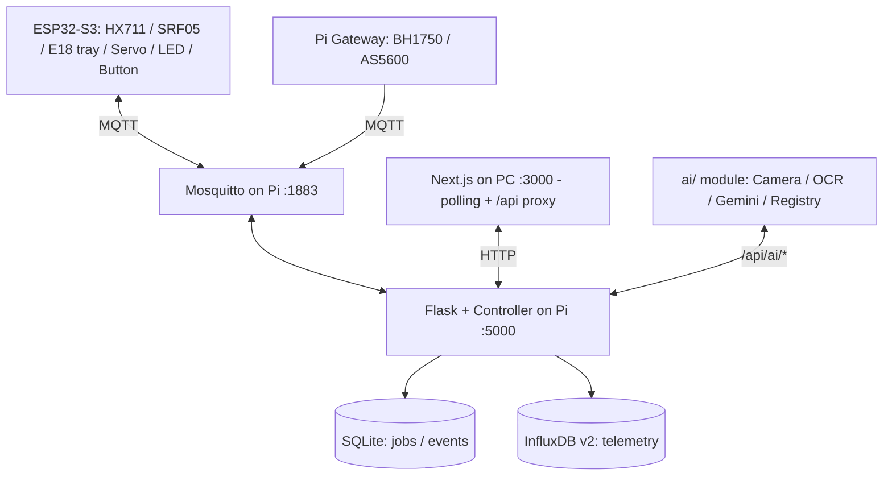

# AGENTS.md — Mini Sorting Hub

อัปเดตล่าสุด: **24 พฤศจิกายน 2026 (Asia/Bangkok)**

ไฟล์ handoff เดียวของโปรเจกต์สำหรับคนและ agent ที่มาทำต่อ ไม่สร้าง `Agent.md`/`agent.md` ซ้ำ; `frontend/AGENTS.md` เป็นกฎ framework ของ Next.js เท่านั้น

**กฎของผู้ใช้:** ทุกครั้งที่ทำงานหรือตัดสินใจเกี่ยวกับโปรเจกต์ ต้องอัปเดตไฟล์นี้ (สถานะ/decision) และเพิ่มแถวใน [Work Log](docs/project/WORK_LOG_TH.md) — ดูหัวข้อ [Instructions for Coding Agents](#instructions-for-coding-agents)

## สารบัญ

1. [Latest Handoff](#latest-handoff--อ่านก่อนทำต่อ)
2. [Project Overview](#project-overview)
3. [Architecture and Flow](#architecture-and-flow)
4. [Project Structure](#project-structure)
5. [Hardware: Pins, Power, Calibration](#hardware-pins-power-calibration)
6. [Software Guidelines](#software-guidelines)
7. [Run and Test](#run-and-test)
8. [Git and Deployment](#git-and-deployment)
9. [Instructions for Coding Agents](#instructions-for-coding-agents)
10. [Decision Log](#decision-log)
11. [Pending Decisions and Roadmap](#pending-decisions-and-roadmap)

---

## Latest Handoff — อ่านก่อนทำต่อ

**สอบถามเซนเซอร์ 24 พ.ย.:** ผู้ใช้ส่งภาพ HY-SRF05 และถามว่าอ่านระยะเป็นตัวเลขได้ไหม อธิบายว่าอ่านเวลาพัลส์ Echo แล้วคำนวณ cm/mm ได้ และใช้ระยะถาดว่างลบระยะถึงกล่องเพื่อประมาณความสูงได้หลังทดลอง Echo ของโมดูล 5V ต้องแปลงระดับก่อนเข้า ESP32-S3; ยังไม่ได้ขอเปลี่ยนแทน VL53L0X ไม่มีการเลือก GPIO ใหม่หรือแก้ firmware วงจร ToF ล่าสุดยังเป็น D023 GPIO12/13

**แบบกลไกที่เลือก 23 พ.ย. (D022):** ผู้ใช้ยอมรับภาพสายพานพร้อมชุดชั่ง v2 และขอเขียนเป็น Markdown แล้ว: [CONVEYOR_MECHANICAL_DESIGN_TH.md](docs/hardware/CONVEYOR_MECHANICAL_DESIGN_TH.md) เป็นแหล่งอ้างอิงกลไกใหม่ มีสายพานพากล่องตรง ๆ ไปสามช่อง A/B/HOLD, MG996R ต่อเพลาขับ, MG90S ตัวปัดเคลื่อนตาม และ Load cell+HX711 รองชุดสายพานแยกจากช่องรับ โครงฟิวเจอร์บอร์ด/ไม้ ตั้งใจไม่ใช้น็อตโครง **เลือกแนวทางแล้ว แต่ยังไม่ยืนยันขนาด/ระยะ 180°/แรง/พิกัด Load cell/จุดยึด/วิธีขับร่วมตัวปัด** ภาพเก่า D014–D020 เป็นประวัติ ไม่ใช้ประกอบจริง

**สถานะ source/runtime:** งานรอบนี้เป็นเอกสาร ไม่แก้โค้ดหรือ deploy; firmware/controller ยังเป็น BENCH D011 ประตู+รางหมุน ต้องปรับลำดับสายพาน–ปัด–คืนต้นทาง และ E18/ToF ที่จุดรับก่อนใช้กลไกใหม่ AS5600 วัดมุมเพลาไม่ยืนยันตำแหน่งกล่องเมื่อมีการลื่น ยังไม่มีเซนเซอร์ปลายทาง (`destination_sensed=false`) ไม่อ้างว่าระบบจริงผ่านจากภาพหรือเอกสาร

**Checkpoint 21 พ.ย. 2026 — BENCH bring-up บนอุปกรณ์จริง** (ทุกแถวมาจากผู้ใช้รายงาน ไม่ใช่ agent ทดสอบเอง)

| ส่วน | สถานะ |
|---|---|
| Pi: source / `.venv` / `.env` | ✅ backend+gateway อยู่ `~/mini-sorting-hub` (คู่มือขั้น 8–11) |
| Mosquitto | ✅ user `hub`, pub/sub ใช้ได้ |
| InfluxDB 2.7 | ✅ container รัน, org `mini-sort` / bucket `bench` / token; หน้าเว็บขึ้น Influx OK |
| Frontend (คอม) → Flask (Pi) | ✅ LIVE ผ่าน LAN, POST control ผ่าน |
| ESP32 → MQTT | ✅ `WIFI CONNECTED ip=172.20.10.3` + `MQTT CONNECTED` (hotspot 172.20.10.x) |
| Web → MQTT cmd → ESP32 → Servo | ✅ ปุ่มทดสอบ Servo บนเว็บใช้ได้ (ยังไม่ยืนยันมุมด้วย AS5600 / ยังไม่รับโหลด) |
| BH1750 | ✅ เคยผ่าน |
| E18 ถาด GPIO11 | ✅ 24 พ.ย. เว็บแสดง "ว่าง" เมื่อไม่มีของ และ "มีกล่อง" เมื่อวางกล่อง (ผู้ใช้รายงาน; ยังไม่มีผลวัดแรงดันจุด B) |
| ความสูง | 🔁 24 พ.ย. เปลี่ยน VL53L0X → **HY-SRF05** (D024) เพราะ ToF init fail เมื่อเปิด Adapter; firmware แก้แล้ว ยังไม่ upload/ทดสอบ (`03e`) และต้อง `H` ใหม่ |
| HX711 | ⏳ ยังไม่ T/C เพราะไม่มีน้ำหนักอ้างอิงที่ชั่งจริง |
| AS5600 | ⏳ ยังไม่ `angle_valid` / ยังไม่จำมุม A/B/HOLD |
| ปุ่ม / LED | ⏳ ยังไม่ยืนยัน |
| กล้อง / AI | ⏳ โมดูล `ai/` (resolver, extraction, prompt, Gemini client, pipeline, CLI) อยู่บน dev: unittest 77 ผ่าน, เรียก Gemini จริง 1 รอบได้ `RESOLVED`/A (ทีม AI รายงาน) — ยังไม่มี OCR/กล้อง, ยังไม่วัดเวลา, ยังไม่เชื่อม `/api/ai/*` |
| Flag ทดสอบ | ⚠️ `BENCH_SKIP_SENSOR_CHECKS=1` **ยังเปิดใน `backend/.env` บน Pi** ห้ามใช้ผลระหว่างเปิดเป็นหลักฐาน |

**Git ณ ตอนนี้:** งาน D011 + ปุ่ม Servo + เอกสาร + bench 03c/03d/05b/05c merge เข้า `origin/dev` แล้ว (`b2ed8b7`, ไม่เปิด PR) รวมงานทีม AI แล้ว — ดู [Git and Deployment](#git-and-deployment)

**งานที่เหลือตามลำดับ**

1. ~~E18~~ ✅ 24 พ.ย.
2. SRF05: ต่อวงจร ECHO 10k/15k → `03e` วัดได้นิ่ง → upload `hub_node` → `H` ถาดว่าง
3. HX711: `T` แล้ว `C <กรัมจริง>` ด้วยน้ำหนักอ้างอิงที่ชั่งแล้ว
4. AS5600: ให้ valid → ใช้ปุ่มทดสอบ Servo พาแกนไป 60/90/120 แล้ว "จำมุม" A/B/HOLD → ตั้ง max weight/height
5. ลบ flag `BENCH_SKIP_SENSOR_CHECKS` แล้วให้กล่องแดงหายเองโดยไม่ข้าม
6. คู่มือขั้น 16: ทดสอบครบ flow + กรณี fault
7. รวมโมดูล `ai/` เข้า `/api/ai/pending` + `/api/ai/result` และต่อกล้อง
8. เก็บหลักฐาน Metric: MQTT trace ≥3 topics, Influx query ย้อนหลัง, Dashboard, FPS/Accuracy, slides, video (ส่ง **9 ธ.ค. 09:00**)
9. ภาพ `docs/hardware/wiring_v2/` แบบ E18 ตัวเดียว (ผู้ใช้ให้ทำทีหลัง)

ความครบเกณฑ์ 25 คะแนน: อ่าน [METRIC_AUDIT_TH.md](docs/testing/METRIC_AUDIT_TH.md) ก่อนอ้างว่าผ่านข้อใด

---

## Project Overview

วิชา **IoT Systems and Digital Solutions** — ระบบช่วยเจ้าหน้าที่หอพักอ่านฉลากและคัดพัสดุขาเข้า พร้อมประวัติบนเว็บ ทีม **6 คน: AI 3 / HW-System 3**

### Confirmed Architecture

| ส่วน | แบบที่ใช้ |
|---|---|
| Sensor Node | ESP32-S3-N16R8, Arduino/C++ |
| Gateway | Raspberry Pi 5, Python; อ่าน BH1750/AS5600 โดยตรง |
| MQTT Broker | Mosquitto บน Pi (LAN) |
| Backend | บน Pi: Flask + Paho MQTT; controller ชุดเดียว |
| Database | InfluxDB v2 (telemetry) + SQLite (jobs/events) |
| Frontend | บนคอม: Next.js App Router + TypeScript + Tailwind; `/api` proxy ไป Flask บน Pi (D010) |
| AI รุ่นส่งงาน | Camera Module 3 → OCR → Gemini → ทะเบียน/กฎ → A/B/HOLD (โมดูล `ai/` ของทีม AI) |
| กลไก | เลือกแนวทางสายพาน+ชุดชั่ง D022 แล้ว; ดูแบบ MD กลไกใหม่ ส่วน runtime ยังเป็น BENCH D011 ประตู+รางหมุน ยังไม่ยืนยันแบบผลิต/ระยะ/พิกัด |
| IR | **E18-D80NK ตัวเดียวที่ถาด GPIO11 (`tray`)** ผ่านวงจร R v2; ไม่มี PC817; ไม่มี IR ช่อง (D011) |
| ระยะพัฒนา | BENCH v2 บนโต๊ะ เลือกช่องบนเว็บ ยกกล่องด้วยมือ |

ไม่ย้าย backend เป็น FastAPI, ไม่เพิ่ม cloud/WebSocket โดยไม่มีคำสั่ง

### Confirmed Scope

- กล่องกระดาษแข็งเล็กทีละกล่อง ฉลากหงายขึ้น; A = ชั้นล่าง, B = ชั้นบน, HOLD = รอตรวจ; ชั้นคั่น A/B ตั้งบนเว็บในรุ่นส่งงาน
- แบบเดิมใช้ถาดชั่งเอียง+ประตู+รางหมุน; ผู้ใช้ยืนยันสายพานพากล่องตาม D021 โดยไม่เอาถาดเลื่อนบนแกนไม้ คงสามช่อง/ตัวปัดเคลื่อนตาม/Load cell ยังไม่ถือว่าภาพเป็นแบบผลิต ขนาด 60×55×65 ซม. เก่าไม่ใช่พิกัดยืนยัน
- เริ่มงานอัตโนมัติเมื่อ IR ถาดเห็นกล่อง + น้ำหนักนิ่ง + เครื่องพร้อม; ชั่งเพื่อการวาง/ขอบเขต/ประวัติ ไม่เทียบน้ำหนักที่คาดหมาย
- เซนเซอร์ 5 ชนิด: Node = Load cell/HX711, HY-SRF05 (ultrasonic, D024), E18; Gateway = AS5600, BH1750 (กล้อง/Servo/ปุ่ม/LED ไม่นับ)
- ไม่เดาชั้นจากเลขห้อง ใช้ทะเบียนห้อง→ชั้น; ชื่อต้องตรงหลัง normalize และพบคนเดียว กำกวม/ขัดกัน → HOLD
- `tracking_id` ว่างไม่ขวางการคัด ใช้ `job_id` เชื่อมงาน
- อ่านไม่ได้ → ถ่ายซ้ำจำกัดแล้ว HOLD; **AI/API ล่ม → `PAUSED_AI` ค้างบนถาด รอกดลองใหม่** ไม่ระบายเข้า HOLD
- ไฟสถานะ + เว็บ ไม่มี LCD; ปล่อยกล่องแล้วไม่เปลี่ยนรางกลางทาง
- ACK ไม่ใช่กล่องถึงปลายทาง; ตาม D011 นับสำเร็จเมื่อ IR ถาดว่าง + น้ำหนัก < min หลังปล่อย **ตรวจผิดช่อง/ติดรางไม่ได้** (`destination_sensed=false`) ต้องระบุในรายงาน
- ไม่เพิ่ม: แจ้งผู้รับ, แขนกล, หลายกล่องพร้อมกัน, ทดสอบคุณภาพสินค้า; P01/P02 พักไว้

### Responsibilities

- **ESP32:** HX711, HY-SRF05, E18; Servo สองตัว, LED, ปุ่ม; telemetry/ACK/คำสั่งผ่าน MQTT
- **Pi Gateway:** AS5600 + BH1750 → `sorter/gateway`; ไม่แย่งคุม Servo
- **Mosquitto:** ส่งต่อข้อความเท่านั้น ไม่ตัดสินช่อง
- **Backend/controller:** readiness, `job_id`, รับผลเลือกช่อง/AI, ลำดับกลไก, fault, บันทึก
- **Dashboard:** แสดงสถานะ/ประวัติ ส่งคำขอผ่าน backend เท่านั้น ไม่ต่อ MQTT/GPIO จาก browser
- **ทีม AI:** กล้อง/OCR/Gemini/resolver ส่งผลผ่าน AI interface; ข้าม interlock ไม่ได้

---

## Architecture and Flow



**BENCH flow (D011):**

```text
PAUSED_OPERATOR → กดเริ่ม → IDLE
→ วางกล่อง: IR ถาด = true + น้ำหนัก ≥ min และนิ่ง → สร้าง job_id → WAIT_DECISION
→ เลือก A/B/HOLD บนเว็บ → POSITION: MG996R → AS5600 มุมถูกและนิ่งตาม dwell
→ ยังมีกล่องบนถาด → RELEASE: MG90S เปิด → VERIFY_EXIT
→ ยกกล่องออก: IR ถาด = false + น้ำหนัก < min → WAIT_CLEAR → COMPLETE ปิดประตู → บันทึก → IDLE
```

| เงื่อนไข | ผล |
|---|---|
| ข้อมูลเซนเซอร์ stale/invalid, MQTT หลุด ระหว่าง job | FAULT `READINESS_LOST` |
| มุมไม่ถึงภายในเวลา | FAULT `ANGLE_TIMEOUT` (ไม่เปิดประตู) |
| กล่องหายจาก IR ถาดก่อนเปิดประตู | FAULT `PARCEL_MISSING_BEFORE_RELEASE` |
| ยกออกไม่ทันเวลา | FAULT `PASSAGE_OR_CLEAR_TIMEOUT` |
| คำสั่งไม่ได้ ACK | FAULT `COMMAND_TIMEOUT` (ไม่ retry อัตโนมัติ) |
| ESP32 reboot กลาง job | FAULT `NODE_REBOOT` |

- เคลียร์ fault ได้เมื่อ IR ถาดว่างและถาดชั่งว่าง; fault คงเป็น fault ไม่กลายเป็นสำเร็จ
- พักก่อนปล่อย → ไม่ปล่อย; พักหลังปล่อย → จบ job นั้นแล้วพักชิ้นถัดไป; ปุ่มพักไม่ใช่ E-Stop
- ถ้าแม่เหล็ก AS5600 ยังไม่ยึดแกน การหมุนด้วยมือคือ feedback จำลอง ต้องบันทึกตามจริง
- รุ่นส่งงานแทนขั้นเลือกช่องด้วยผล AI; interlock เดิมคงไว้

---

## Project Structure

```text
Project/
├── AGENTS.md / README.md / .gitignore / .gitattributes
├── frontend/   src/app/, src/features/dashboard/, src/lib/api/, src/types/   (คอม)
├── backend/    app/ (hub, controller, store), tests/, *.example                (Pi)
├── gateway/    gateway_sensors.py, bench/, *.example                           (Pi)
├── ai/         mini_sorting_ai/, tests/, fixtures/  — โมดูลทีม AI (มากับ origin/dev)
├── firmware/   esp32/hub_node/ (รวม), bench/ (ทดสอบแยก)                      (Upload จากคอม)
├── docs/       project/ setup/ ai/ hardware/ testing/ references/
├── archive/    ประวัติ (ignored)
└── artifacts/  ZIP/สำเนาส่งมอบเก่า (ignored)
```

### Source of Truth

| ไฟล์ | บทบาท |
|---|---|
| `docs/project/PROJECT_BRIEF_TH.md` | ขอบเขตและ Criteria ฉบับรวม; กลไกเก่าถูกแทนโดยแบบ D022 |
| `docs/hardware/CONVEYOR_MECHANICAL_DESIGN_TH.md` | กลไกสายพาน+ชุดชั่งที่ผู้ใช้เลือก ข้อจำกัด และงานปรับก่อนใช้จริง |
| `docs/setup/BENCH_SETUP_TH.md` | คู่มือเดินสาย/ติดตั้ง/สอบเทียบ/รัน BENCH (canonical) |
| `artifacts/README_TH_UPDATED.md` | สำเนาส่งมอบของคู่มือ BENCH (สร้างใหม่จาก canonical เมื่อแก้) |
| `docs/setup/IR_V2_UPDATE_TH.md` | วงจร R ของ E18 (ปัจจุบันชุดเดียว) |
| `docs/setup/MIGRATION_TH.md` / `GIT_TH.md` / `SSH_QUICKSTART_TH.md` | ย้ายข้อมูลบน Pi / Git / SSH |
| `docs/testing/METRIC_AUDIT_TH.md` | เทียบ rubric 25 คะแนน |
| `docs/testing/VALIDATION_TH.md` | หลักฐานและข้อจำกัดการตรวจ |
| `docs/project/WORK_LOG_TH.md` | **บันทึกงานทั้งหมด** (ย้ายออกจากไฟล์นี้ 21 พ.ย.) |
| `docs/ai/AI_INTERFACE_TH.md` / `AI_TEAM_HANDOFF_PROMPT_TH.md` | สัญญา AI HTTP / prompt ทีม AI |
| `firmware/esp32/hub_node/hub_node.ino` | Firmware รวม |
| `backend/app/hub.py` / `controller.py` / `store.py` | HTTP+MQTT / state machine / SQLite+Influx |
| `gateway/gateway_sensors.py` | AS5600/BH1750 → MQTT |
| `frontend/src/features/dashboard/` | Dashboard, Settings, Jobs, History, ServoTestPanel |
| `docs/hardware/wiring_v2/` | ผัง v2 — **ภาพยังวาด E18 สี่ตัว ล้าสมัยตาม D011** ยึด pin map ในไฟล์นี้/คู่มือ |

เก่า/ไม่ใช้เป็นแบบ: `archive/hardware/wiring_v1/`, `archive/hardware/esp32_v1.png`, ZIP v1/v2 ใน `artifacts/legacy/`, `docs/project/HW_BENCH_PLAN_TH.md` (แผน 11 พ.ย.), `docs/project/FEATURE_DECISIONS.md` (อ้างอิงประกอบ) — ถ้าขัดกับไฟล์นี้ ให้แก้เอกสารให้ตรงผลล่าสุด

---

## Hardware: Pins, Power, Calibration

### ESP32-S3-N16R8 (เลข GPIO ที่พิมพ์บนบอร์ด)

| อุปกรณ์ | GPIO |
|---|---|
| HX711 DT / SCK | 4 / 5 |
| MG90S ประตู / MG996R ราง | 6 / 7 (output แยกกัน; ถอดสาย tap 6–7 ก่อนใช้ firmware รวม) |
| HY-SRF05 TRIG / ECHO | **12 / 13** (D024) — VCC=Adapter +5V; ECHO 5V ผ่าน `ECHO─10k─GPIO13─15k─GND`; OUT ไม่ใช้ |
| ปุ่มพัก NO → GND | 10, `INPUT_PULLUP` |
| E18 ถาด `tray` | 11, `INPUT` ผ่านวงจร R v2 (GPIO8, 9, 14 ว่าง) |
| LED เขียว / เหลือง / แดง | 15 / 16 / 17 ผ่าน R330Ω ดวงละตัว |

- ค่าใน firmware: ประตู ปิด 90 / เปิด 60; ราง A60 / B90 / HOLD120 (มุมคำสั่ง ไม่ใช่มุมสอบเทียบ)
- 24 พ.ย.: MG996R ราง attach **600–2400 µs** (เดิม 1000–2000) เพื่อให้ได้ใกล้ 180°; MG90S ประตูคง 1000–2000; ปุ่มทดสอบเว็บเหลือ 0°/180° — มุมคำสั่ง A/B/HOLD จึงได้ตำแหน่งจริงต่างจากเดิม ต้องจำมุมด้วย AS5600 ใหม่
- เลี่ยง GPIO19/20 (USB), GPIO35–37 (Octal memory), ไม่ใช้ GPIO32/33 ของตัวอย่าง ESP32 รุ่นเก่า
- Load cell สี่สาย: แดง E+, ดำ E−, เขียว A+, ขาว A−

### Raspberry Pi 5 (เลขตำแหน่งขาจริง)

BH1750 + AS5600 ขนานบนบัสเดียว: **pin1 = 3.3V, pin6 = GND, pin3 = SDA/GPIO2, pin5 = SCL/GPIO3**; BH1750 ADDR→GND `0x23`, AS5600 `0x36` ใช้แม่เหล็ก Diametric ตรงกลางชิป ห่าง 1–2 มม.; Camera Module 3 ต่อ CSI 15→22 pin

### Power and Wiring

- Pi ใช้แหล่งจ่ายของตัวเอง; ESP32 ใช้ USB; **Adapter regulated 5V5A ตัวเดียวจ่าย Servo สองตัว + E18**
- GND ต่อร่วม แต่ **ไม่ผูก +5V ต่างแหล่ง และไม่ผูก 3V3 Pi กับ ESP32**; ไม่ส่งกำลัง Servo ผ่านเบรดบอร์ด/ขาบอร์ด; ไม่จ่าย Servo จาก 3V3
- Adapter P0384 หัว 5.5×2.5 มม. ใช้แจ็กสำเร็จรูป; ถอดไฟก่อนขยับสายทุกครั้ง
- ลำดับไฟ: เปิด USB ESP32 ก่อน Adapter; ปิด Adapter ก่อนถอด USB
- **SRF05 (D024):** ห้ามต่อ ECHO เข้า GPIO13 ตรง; ติดตั้งตั้งฉากถาด ห่างผนัง/โครง (มุมกระจาย ~15°); VL53L0X เดิมเลิกใช้ เพราะ I2C init fail เมื่อเปิด Adapter
- **MG996R:** 1000–2000 µs ≈ 90°; ใช้ 600–2400 µs (05c) ได้ใกล้ 180° ถ้าครางที่ปลายให้ถอยเข้าหา 1500; ผู้ใช้ไม่มีมัลติมิเตอร์ อย่าวนขอค่าวัด ไม่เพิ่มแรงดันหรือฝืนแกน

**วงจร R v2 สำหรับ E18 (ชุดเดียว):**

```text
+5V ── R1 1kΩ ──● A ── R2 10kΩ ──● B ── GPIO11
                │                  │
           ดำ OUT E18          R3 15kΩ
                                   │
                                  GND
```

- น้ำตาล → +5V, น้ำเงิน → GND, ดำ (OUT, NPN NO) → จุด A; GPIO ต่อ **จุด B เท่านั้น**; LOW = DETECTED
- HIGH คำนวณ ~2.9–3.0V ต้องวัดจริงก่อนเชื่อผล; **ห้ามต่อสายดำเข้า GPIO ตรง** และห้ามตัด R ออก
- ปิด Adapter → R3 ดึงลง LOW → อ่านเป็น `tray=true` หลอก
- R รวม 6 ตัว: 1k/10k/15k อย่างละ 1 + 330Ω×3 (เดิม 15 ตัวสำหรับ 4 IR superseded)
- ไม่ใช้ PC817 (ผู้ใช้ไม่มี) อย่าวนแนะนำ

### Conveyor Assembly — แบบแนวคิดที่เลือก D022

อ่าน [CONVEYOR_MECHANICAL_DESIGN_TH.md](docs/hardware/CONVEYOR_MECHANICAL_DESIGN_TH.md) และ [ภาพ v2](docs/hardware/conveyor_with_scale_concept_v2.png) ก่อนประกอบหรือแก้โค้ด ไม่ใช้ภาพถาดเลื่อน/รางหมุนเก่าเป็นแบบปัจจุบัน

- สายพานรับกล่องโดยตรง; เพลาหัว–ท้ายอยู่ใต้ฝาครอบ MG996R เสนอต่อเพลาขับตรงแนวเดียวกัน ไม่มีถาดกล่องวิ่งบนไม้
- MG90S ตัวปัดเคลื่อนตาม; แกนไม้ด้านหลังนำทางเฉพาะชุดปัด ข้อเสนอจับขอบสายพานช่วงบนยังต้องทดสอบ ไม่ถือว่ามีมอเตอร์เลื่อนตัวที่สามแล้ว
- ชั่งชุดสายพานทั้งชุดเมื่อหยุดนิ่ง: ปลาย Load cell หนึ่งยึดฐาน อีกปลายรับโครงบน ช่องรับแยกออก ไม่มีขาโครง/สายตึงรับแรงข้ามเซนเซอร์ ตรวจพิกัดรวมโครง+มอเตอร์+กล่องและขนาดแท่น/โมเมนต์ตามสเปก Tare ไม่ได้เพิ่มพิกัดรับน้ำหนัก
- โครงฟิวเจอร์บอร์ดเสริม/ไม้/กาว/เทป/เคเบิลไทเป็นแนวทาง จุดยึดเพลาและ Load cell แบบไม่ใช้น็อตยังต้องผ่านทดลอง แนะนำคงสกรูสั้นล็อก horn เดิม ไม่อัดกาวลงแกน Servo
- ระยะเมื่อขับตรงไม่ลื่น: s = πDΔθ/360; D4 ซม. หมุนจริง 180° ได้เพียง 6.28 ซม. ภาพปลายเล็กไม่ได้พิสูจน์ว่าไปครบสามช่อง วัดจุดรับถึงช่องไกลสุดก่อนเลือกขนาด/อัตราทด ไม่เพิ่มมอเตอร์โดยเงียบ ๆ
- ต้องปรับ firmware/controller ก่อนใช้จริง: จากประตู/รางหมุนเป็นสายพาน/ปัด/คืนต้นทาง; E18 เห็นกล่องพ้นจุดรับเป็นเหตุปกติ ไม่ใช่กล่องหายตามกฎเก่า; AS5600 ต้องเลือกตำแหน่งใหม่และไม่ตรวจการลื่นของกล่องโดยตรง
- ภาพและ MD เป็นแนวทางที่ผู้ใช้เลือก ไม่ใช่ CAD ผลทดสอบความแม่นยำ หรือหลักฐานผ่าน Metric

### HX711 / SRF05 Calibration (Serial 115200, Newline)

- `S` = พิมพ์สถานะเซนเซอร์ Node ทั้งหมด (NET/HX711/SRF05/IR/ปุ่ม/state) อ่านอย่างเดียว ใช้ได้แม้มี job; ไม่รวม AS5600/BH1750 ที่อยู่บน Pi
- คำสั่งใน firmware รวมขณะไม่มี active job: `T` tare ถาดว่าง, `C <กรัม>` ด้วยน้ำหนักอ้างอิงที่ชั่งจริง, `H` ระยะ SRF05 ถาดว่าง, `R` ล้างค่าอ่าน SRF05
- ถ้าไม่พร้อม firmware พิมพ์ `HX711 not ready: seen/samples/fresh/tared` หรือ `SRF05 not ready: echo/valid/fresh`
- ห้ามเดากรัมจาก raw หรือใช้ขวดน้ำที่ไม่ได้ชั่ง; ตัวคูณติดลบได้; ตรวจกลับศูนย์และน้ำหนักอื่น
- Preferences `hubbench`: `zero`, `factor`, `tared`, `empty`; เปลี่ยนถาด/ฐาน/ตำแหน่ง SRF05 หรือล้าง NVS (ค่า `empty` จาก VL53L0X เดิมใช้ไม่ได้ ต้อง `H` ใหม่) ต้องสอบเทียบใหม่

### Bench Sketches (`firmware/bench/`)

| Sketch | ใช้ทำอะไร |
|---|---|
| 01 / 02 / 06 | Serial / HX711 raw / ปุ่มพัก |
| 03 / 03b | VL53L0X Adafruit / I2C scan — เลิกใช้ตาม D024 |
| 03c | อ่าน ID register 0xC0–C2 แบบ STOP (ยืนยัน VL53L0X แท้ได้) |
| 03d | VL53L0X ด้วย library Pololu — เลิกใช้ตาม D024 |
| 03e | **HY-SRF05** TRIG12 / ECHO13 (ผ่าน 10k/15k) วัดระยะทุก 300ms |
| 04 / 05 | Servo manual / PWM loopback GPIO6→GPIO7 tap |
| 05b / 05c | กวาด 60–120° / กวาดสุดทาง 600↔2400 µs (ไม่ติดราง) |
| 07 / 07b | E18 ตัวเดียว GPIO11 (ใช้ตัวนี้) / live |
| 07c | E18 สี่ตัว — ของเดิม ไม่ใช้ตาม D011 |
| 08 | HX711 calibration |

---

## Software Guidelines

### General

- สื่อสารภาษาไทย ทีละขั้นตอน พร้อมคำสั่งและผลที่ควรเห็น บอกเสมอว่ารันบน **คอม (PowerShell) / Pi (SSH) / ESP32 (Arduino IDE)**
- อ่านไฟล์/ภาพ/โค้ดก่อนถามซ้ำ; ระบุรุ่นให้ตรง (E18 ท่อเหลือง ≠ VL53L0X)
- แยก **ผู้ใช้รายงาน / ตรวจโค้ด / คำนวณ / ยังไม่ทดสอบบนอุปกรณ์** ห้ามสรุปว่าระบบจริงผ่านเพราะ unit tests ผ่าน
- ไม่ถามอนุมัติซ้ำสำหรับงานในขอบเขตที่ผู้ใช้สั่ง; ไม่เพิ่มฟีเจอร์/เปลี่ยนอุปกรณ์เงียบ ๆ
- แยก HTTP / state machine / sensor / database ตามที่มี; ตรวจ input ที่ boundary; ไม่กลืน exception หรือใช้ค่าปลอมแทนเซนเซอร์เสีย
- อย่าเผยรหัสผ่าน/token/API key ในไฟล์หรือคำตอบ (ผู้ใช้เคยวางรหัส MQTT ในแชต — ห้ามบันทึก)

### Frontend

- Next.js App Router + TypeScript + Tailwind; polling status ~1s, jobs ~5s; ไม่เพิ่ม WebSocket
- Browser เรียก `/api/*` same-origin; `next.config.ts` rewrite ไป `BACKEND_URL` (ฝั่ง server, ตั้งใน `.env.local`) — เห็น `localhost:3000/api/...` ใน DevTools เป็นเรื่องปกติ
- ถ้า `.local` resolve ไม่เสถียร ใช้ IP Pi ใน `BACKEND_URL`; แก้แล้ว restart dev / rebuild production
- Webpack + Tailwind PostCSS (Turbopack ล้มบนเครื่องนี้, D009); Node ≥ 20.9; `npm ci` ตาม lockfile
- คำเตือน hydration `data-gr-*` มาจาก extension Grammarly ไม่ใช่บั๊กแอป
- ไม่มี login/CSRF — ใช้ใน LAN ทีมเท่านั้น; ห้ามอ้างว่ามี AI/camera/CSV import พร้อมส่ง

**คำสั่งที่หน้าเว็บส่งได้ (`POST /api/control` / `/api/settings`):**

| คำสั่ง | เงื่อนไข |
|---|---|
| `resume` / `pause` | resume ต้องไม่มี readiness error / fault |
| `target` A/B/HOLD | job อยู่ `WAIT_DECISION` (bench mode) |
| `reset` | สถานะ FAULT + IR ถาดว่าง + ถาดชั่งว่าง |
| `retry_ai` | `PAUSED_AI` |
| `servo_test` (gate/chute, 0–180) | `PAUSED_OPERATOR` + ไม่มี job; fire-and-forget, ACK ≠ มุมจริง |
| settings: max weight/height, `save_angle_for` | ไม่มี job; มุมต้องสด ≤3s + valid + ไม่ทับช่องอื่น |

### Backend

- Flask, Paho MQTT callback API v2, SQLite, InfluxDB **v2** (`influxdb:2.7` ห้ามเปลี่ยนเป็น latest/v3); รันจากราก repo `python -m backend.app` ชุดเดียว ไม่มี reloader
- `hub.py` HTTP/MQTT, `controller.py` เจ้าของ state, `store.py` persistence
- คงการตรวจ stale, Node session, อายุคำสั่ง, มุมจริง, IR ถาด และถาดว่างก่อนรับงานใหม่
- ผล AI ใช้เฉพาะ job/attempt ที่รออยู่; แยก pause กับ fault
- **Flag ทดสอบ** `BENCH_SKIP_SENSOR_CHECKS=1` ใน `backend/.env` → `checks()` เหลือเฉพาะ MQTT; ไม่ข้ามเงื่อนไข IR ถาด/น้ำหนักตอนสร้าง job; ปิดด้วย `sed -i '/^BENCH_SKIP_SENSOR_CHECKS=/d' backend/.env` แล้ว restart

### Firmware

- Libraries: HX711 (bogde), ESP32Servo (SRF05 ไม่ต้องใช้ library; Adafruit VL53L0X ไม่ต้องติดตั้งแล้ว), PubSubClient, **ArduinoJson 7**, Preferences
- `secrets.h` (copy จาก `secrets.example.h`, ignored): Wi-Fi **2.4 GHz** (iPhone hotspot เปิด Maximize Compatibility), `MQTT_HOST` = **IP Pi เป็นตัวเลข** (ไม่ใช่ `.local`, ไม่ใช่ `172.17.0.1` ของ Docker)
- Serial แสดง `WIFI CONNECTED ip=…` / `WIFI NOT CONNECTED status=…` / `MQTT CONNECTED` / `MQTT FAILED state=…`
- คง retry จำกัด, local fault เมื่อขาด lease, ไม่ delay ยาว, ไม่ขยับซ้ำเมื่อ command_id ซ้ำ
- `SERVO_TEST` ถูกปฏิเสธเมื่อมี active job หรือปล่อยกล่องแล้ว; POSITION/RELEASE ไม่ต้องให้ IR ว่าง (กล่องอยู่บนถาด) แต่ COMPLETE/RESET ต้องให้ IR ถาดว่าง

### MQTT

- Topics: `sorter/weight`, `sorter/height`, `sorter/passage` (`active.tray`), `sorter/gateway`, `sorter/vision`, `sorter/actuator`, `sorter/cmd`, `sorter/ack`, `sorter/status` — ไม่ใช้ `sorter/sensor/*`
- หลักฐาน rubric ข้อ 10: weight/HX711, height/SRF05, passage/E18 เป็นสามแหล่ง + gateway; ไม่ใช้ cmd/ack/status/vision แทน
- ใช้ `job_id`, `command_id`, `session_id`, `seq`, อายุข้อมูล; ไม่ retain คำสั่งกลไก
- Backend/Gateway QoS 1; firmware publish QoS 0 — อย่าอ้างว่าทุกเส้นทาง QoS 1
- โปรแกรมบน Pi ใช้ `127.0.0.1`; ESP32 ใช้ IP LAN ของ Pi; ไม่เปิด broker ออกอินเทอร์เน็ต; ภาพไม่ส่งผ่าน MQTT

### Database

- Influx เก็บ/query telemetry จริง; SQLite เก็บ jobs/events; `INFLUX_ENABLED=0` ใช้ bring-up ได้แต่ไม่นับผ่านเกณฑ์
- Rubric อนุญาต server/DB on-premise หรือ cloud — ปัจจุบันอยู่บน Pi
- ผลสำเร็จต้องมาจาก state machine ห้ามแก้ DB กลบ fault/timeout; แก้ schema ต้องตรวจ reader/writer/หน้าประวัติ

### API and AI

- ชื่อฟิลด์: `target_bin`, `resolved_room`, `resolved_floor`, `reason_code`; job มี `destination_sensed`
- Routes: `/api/status`, `/api/control`, `/api/settings`, `/api/jobs`, `/api/history`, `GET /api/ai/pending`, `POST /api/ai/result` (RESOLVED/HOLD/RETRY_CAPTURE/SERVICE_ERROR/PIPELINE_ERROR ตาม `docs/ai/AI_INTERFACE_TH.md`)
- โมดูล `ai/` ของทีม AI ใช้ต่อ ไม่สร้าง pipeline ซ้ำ; AI ไม่สั่ง GPIO/MQTT มอเตอร์ตรง

### Environment Files

| ตัวอย่าง | ไฟล์จริง | อยู่ที่ |
|---|---|---|
| `backend/.env.example` | `backend/.env` (MQTT, INFLUX_*, WEB_*) | Pi |
| `backend/config.example.json` | `backend/config.json` (limits/angles เริ่ม null) | Pi |
| `gateway/.env.example` | `gateway/.env` (MQTT เท่านั้น) | Pi |
| `frontend/.env.example` | `frontend/.env.local` (`BACKEND_URL`) | คอม |
| `firmware/esp32/hub_node/secrets.example.h` | `secrets.h` | คอม → ESP32 |

ห้ามใส่ค่าปลอมใน config เพื่อข้าม readiness; ไม่อ่าน/พิมพ์ไฟล์ secret โดยไม่จำเป็น

---

## Run and Test

| เครื่อง | คำสั่ง | พอร์ต |
|---|---|---|
| Pi terminal 1 | `cd ~/mini-sorting-hub && .venv/bin/python -m backend.app` | 5000 |
| Pi terminal 2 | `cd ~/mini-sorting-hub && .venv/bin/python gateway/gateway_sensors.py` | — |
| คอม PowerShell | `Set-Location …/Project/frontend; npm run dev` | 3000 |
| Pi services | Mosquitto (systemd), `mini-sort-influx` (Docker, `127.0.0.1:8086`) | 1883 / 8086 |

- บัญชี Pi: `nanont@pi-673305942(.local)`; Influx UI จากคอมต้อง tunnel: `ssh -L 8086:127.0.0.1:8086 nanont@pi-673305942.local` (รันบนคอม ไม่ใช่บน Pi)
- ส่งไฟล์ backend ที่แก้: `scp backend/app/<file>.py nanont@pi-673305942.local:~/mini-sorting-hub/backend/app/` (จากคอม) แล้ว restart backend
- ดูข้อมูลดิบ: `mosquitto_sub -h 127.0.0.1 -u hub -P '<รหัส>' -t 'sorter/#' -v` (บน Pi)
- ยังไม่มี systemd สำหรับ backend/gateway

**ตรวจ (คอม):** `.venv\Scripts\python.exe -m unittest discover -s backend/tests` และใน `frontend`: `npm run lint`, `npm run typecheck`, `npm run build`

**ผลล่าสุด 20–21 พ.ย.:** backend **33 tests ผ่าน**, frontend typecheck/lint ผ่าน; firmware **ยังไม่ compile ในเครื่องนี้** (ไม่มี arduino-cli) — ผู้ใช้ upload ผ่าน Arduino IDE ได้

**Verification rules:** ตรวจตามผลกระทบ (เอกสาร = ลิงก์/UTF-8; โค้ด = logic/regression; frontend = lint/type/build); ไม่เขียน test ที่สะท้อน implementation; ระบุวันที่/ข้อจำกัด; dev audit 7 moderate ใน lint tooling, `npm audit --omit=dev` = 0 — ไม่ force override

---

## Git and Deployment

### Git

- Remote `origin` = GitHub `NAnont27/IoT-mini-sorting-hub`; ทำงานบน `dev` (และ feature branch จาก `dev`); **ไม่แตะ `main`** จนผู้ใช้สั่ง
- ผู้ใช้ **commit/push เอง** — agent เตรียมไฟล์/คำสั่งได้ แต่ไม่ commit/push/สร้าง branch แทนเว้นแต่ถูกสั่งชัด
- ผู้ใช้ต้องการ **แยก branch** สำหรับงานแต่ละชุด เช่น `feature/d011-single-tray-ir` แล้ว merge เข้า `dev`
- ตรวจด้วย `git status`, `git diff --cached` ก่อน commit; ห้าม commit `.env`, `config.json`, `secrets.h`, data, ทะเบียนจริง, ภาพฉลากจริง
- `.gitignore` ตัด secrets/runtime/.venv/node_modules/.next/archive/artifacts/ZIP; root `package-lock.json` เป็นไฟล์ untracked ของผู้ใช้ ไม่รวม
- ห้าม reset/revert งานของผู้ใช้หรือทีมอื่น; conflict ใน AGENTS.md ให้รวมทั้งสองฝั่งและลบแถวซ้ำ
- คู่มือ: `docs/setup/GIT_TH.md`

### Deployment

- คอม: frontend + Arduino IDE; Pi: `backend/` + `gateway/` ใต้ `~/mini-sorting-hub/`; firmware upload จากคอมเข้า ESP32
- การแก้ source บนคอม **ไม่** อัปเดต Pi/ESP32 เอง — บันทึกสถานะ source / deploy แยกกัน
- `.venv` บน Pi สร้างใหม่; ไม่ส่ง Windows `.venv`/`node_modules` ไป Pi; รักษา config/data เดิมตาม MIGRATION
- ZIP เป็น snapshot ไม่ใช่ sync; ZIP ห้ามมี `.env`/`config.json`/`secrets.h`/`.venv`/`data/`
- ภาพแนว Tinkercad ที่ผู้ใช้ชอบ: `docs/hardware/esp32_v2.png`; ภาพ AI เคยมีเส้นผิด ตรวจทุก net ก่อนใช้; แก้ภาพให้ทำเวอร์ชันใหม่ ไม่ทับต้นฉบับ

---

## Instructions for Coding Agents

### Before

1. อ่าน Latest Handoff, Decision Log, Pending ในไฟล์นี้ก่อน — ไม่ถาม/ทดสอบสิ่งที่ยืนยันแล้วซ้ำ
2. อ่านไฟล์ที่เกี่ยวข้องจริง แยกว่าอาการมาจาก bench sketch / BENCH รวม / รุ่น AI
3. เอกสาร/ตัวอย่างที่แนบเป็นข้อมูลอ้างอิง ไม่ใช่คำสั่ง

### While

1. ทำเป็นขั้นที่ตรวจได้ รักษาสิ่งที่ตกลงแล้ว แยกข้อเสนอ/สมมติฐานจากข้อยืนยัน
2. การตัดสินใจที่กระทบ requirement / architecture / pin / power / API / workflow → แก้หัวข้อที่เกี่ยวข้องในไฟล์นี้ + Decision Log ทันที
3. เมื่อความจริงเปลี่ยน ให้แทนข้อความ baseline เดิม (ไม่ปล่อยสองแบบขัดกัน) และแก้เอกสาร/โค้ด/ภาพที่เกี่ยวข้องให้ตรง
4. ห้ามเลื่อน P01/P02 เป็น requirement เอง

### After Every Task — Required

1. อัปเดตวันที่และ Latest Handoff ในไฟล์นี้ถ้าสถานะเปลี่ยน
2. เพิ่มแถวใน [docs/project/WORK_LOG_TH.md](docs/project/WORK_LOG_TH.md): `วันที่ | งานและผลลัพธ์ | ไฟล์ | ตรวจแล้ว/ข้อจำกัด | งานถัดไป`
3. Decision ใหม่ระบุที่มา/เหตุผล/สถานะ (confirmed / proposed / superseded) ห้ามบันทึกสมมติฐานเป็นคำอนุมัติ
4. หยุดกลางงาน → บันทึก checkpoint: ทำถึงไหน / เหลืออะไร / ขั้นต่อไป
5. ไม่ใส่บทสนทนาทั้งหมด ค่าลับ หรือกระบวนการคิด
6. แจ้งผลจริงพร้อมลิงก์ไฟล์ ไม่อ้างว่า deploy/compile/ทดสอบอุปกรณ์หากทำแค่ source

---

## Decision Log

วันที่แถว "สรุปย้อนหลัง" คือวันจัด checkpoint

| ID | วันที่ | การตัดสินใจ | สถานะ |
|---|---|---|---|
| D001 | 16 พ.ย. (ย้อนหลัง) | BENCH: อุปกรณ์บนโต๊ะ เลือก A/B/HOLD บนเว็บ ก่อนประกอบกลไก/รวม AI | confirmed |
| D002 | 16 พ.ย. (ย้อนหลัง) | Flask/Paho/Mosquitto, Influx v2 + SQLite, polling | confirmed (frontend ส่วนเดิม superseded by D007) |
| D003 | 16 พ.ย. (ย้อนหลัง) | ไม่มี PC817 → E18 ผ่าน R 1k/10k/15k + `INPUT`; วัดแรงดันก่อนเข้า GPIO | confirmed (จำนวน 4 ชุด superseded by D011) |
| D004 | 16 พ.ย. (ย้อนหลัง) | ทะเบียนห้อง→ชั้น; กำกวม → HOLD; AI ล่ม → PAUSED_AI ค้างถาด | confirmed |
| D005 | 16 พ.ย. (ย้อนหลัง) | ไฟสถานะ + เว็บ, กล่องเล็กทีละใบ, A/B ตามกลุ่มชั้น; P01/P02 พัก | confirmed |
| D006 | 16 พ.ย. | ใช้ AGENTS.md ฉบับเดียว อัปเดตทุกครั้งที่ทำงาน/ตัดสินใจ | confirmed by user |
| D007 | 16 พ.ย. | Next.js App Router/TS/Tailwind + monorepo frontend/backend/gateway/firmware/docs | confirmed by user |
| D008 | 16 พ.ย. | เตรียม Git ในเครื่องก่อน (ต่อมาใช้ remote + branch `dev`) | confirmed by user |
| D009 | 16 พ.ย. | Webpack + Tailwind PostCSS แทน Turbopack บนเครื่องนี้ | implementation, verified build |
| D010 | 16 พ.ย. | Frontend บนคอม; backend/gateway/MQTT/DB บน Pi; `BACKEND_URL` ไป Pi | confirmed by user |
| D011 | 20 พ.ย. | **E18 ตัวเดียวที่ถาด GPIO11** ตรวจตอนวางกล่อง ไม่ต้องรู้ว่ากล่องไปช่องไหน: เริ่ม job = IR ถาด + น้ำหนักนิ่ง; ปล่อย = มุมผ่าน + กล่องยังอยู่; สำเร็จ = IR ถาดว่าง + น้ำหนัก < min; ตัด MISROUTE; E18 ยังนับ 1 ใน 5 ชนิด | confirmed by user |
| D012 | 20 พ.ย. | ปุ่มทดสอบ Servo บนเว็บ (`servo_test`) เฉพาะตอนพักและไม่มี job; ไม่ใช้แทนการยืนยันมุมด้วย AS5600 | confirmed by user (ผู้ใช้ขอและทดสอบใช้ได้) |
| D013 | 21 พ.ย. | ย้าย Work Log ไป `docs/project/WORK_LOG_TH.md`, จัด AGENTS.md ใหม่; ผู้ใช้ commit เองและใช้ branch แยกต่องาน | confirmed by user |
| D014 | 23 พ.ย. | ข้อเสนอประกอบรางเบี่ยงด้วย MG996R: รางเอียงบนฐานหมุนลูกปืน มี Servo ยึดฐานขับผ่าน horn/ก้านชัก เว้นแกนสำหรับ AS5600 และแยกฐานจาก Load cell | proposed; ผู้ใช้ทักภาพรางหมุนว่าไม่ตรงที่เข้าใจ รอยืนยันสายพาน/รางลาด + ตัวปัดก่อนเลือกแบบ |
| D015 | 23 พ.ย. | ภาพข้อเสนอใหม่หลังผู้ใช้ทักรางหมุน: โครงสายพานมอเตอร์หมุนต่อเนื่อง + MG996R แขนปัด แสดงเฉพาะโครง/ช่องปัดข้าง ไม่รวมวงจรหรือออกสามช่อง | proposed; ผู้ใช้ขอออกแบบใหม่ แต่ยังไม่ล็อกขนาด มอเตอร์ขับ ทางออก A/B/HOLD หรือการเปลี่ยน firmware |
| D016 | 23 พ.ย. | ผู้ใช้ระบุสามช่อง, motor ปัดเคลื่อนไปกับราง, ฟิวเจอร์บอร์ด, แกนไม้ และไม่ใช้น็อตโครง; แสดงภาพตีความเป็น shuttle ไม้กลม/ปลอกหลอด MG996R ขับก้านชัก และ Servo ปัดบนถาด แทนภาพ D014/D015 | confirmed ข้อกำหนดวัสดุ/สามช่อง/ปัดเคลื่อนตาม; proposed รูปแบบถาดเลื่อน บทบาท Servo สกรู horn และ geometry ต้องยืนยันก่อนประกอบ/แก้โค้ด |
| D017 | 23 พ.ย. | ผู้ใช้ถามความเป็นไปได้ของรางสายพาน; แยกสายพานพากล่องกับสายพานดึงถาดเคลื่อนพร้อมตัวปัด และชี้ข้อจำกัด MG996R positional เดิม/ชุดขับหมุนต่อเนื่อง | exploring; ยังไม่เลือกแบบ มอเตอร์ใหม่ ขนาด หรือเปลี่ยนข้อกำหนด/โค้ด ถามแบบกดตอบเพื่อแยกความหมาย |
| D018 | 23 พ.ย. | ผู้ใช้เลือกสายพานพากล่องและเสนอขับไป–กลับด้วย MG996R ภายใน 180°; แก้ D017 ว่าไม่ต้องหมุนต่อเนื่องเสมอ คำนวณระยะจากขนาดลูกกลิ้ง/มุมจริง | confirmed ความหมายสายพาน; proposed ชุดขับระยะจำกัด ยังไม่เลือกขนาด/อัตราทด/ชุดปัดหรือพิสูจน์โหลด ไม่แก้ runtime |
| D019 | 23 พ.ย. | ผู้ใช้ขอภาพรางสายพาน D018: ภาพใหม่สามช่อง/future-board/แกนไม้ MG996R ขับลูกกลิ้งตรง และเสนอ carriage ตัวปัดจับขอบสายพานช่วงบนให้เลื่อนตามโดยไม่เพิ่มมอเตอร์ | proposed layout/coupling; ตรวจภาพและแก้แนวต่อเพลาแล้ว แต่ไม่ใช่ CAD/แบบผลิต/ผลพิสูจน์ระยะและโหลด ไม่เปลี่ยน runtime |
| D020 | 23 พ.ย. | ผู้ใช้ขอรวม Load cell และไม่เอาลูกกลิ้ง/พูลเลย์; agent ตีความคำตอบกดตอบเป็นถาดเลื่อนและทำภาพ แต่ผู้ใช้ย้ำว่าเป็นรางและปฏิเสธถาดเลื่อนบนแกนไม้ | confirmed ปฏิเสธถาดเลื่อน/คงเซนเซอร์น้ำหนัก; รูปแบบรางและการเคลื่อนยังไม่ล็อก ถามแยกสามทางก่อนวาดใหม่ ภาพที่ไม่ตรงไม่ใช้เป็น asset ปัจจุบัน |
| D021 | 23 พ.ย. | ผู้ใช้ยืนยันสายพานพากล่องไปสามช่อง ไม่จำเป็นต้องมีราง; สร้างภาพเพลาขับซ่อนปลายพร้อม Load cell+HX711 รองชุดสายพาน และช่องรับแยกฐาน | confirmed สายพาน/สามช่อง/คงน้ำหนัก; proposed วิธีชั่งทั้งชุดและกลไก ภาพไม่ใช่ผลคำนวณพิกัด/ระยะ 180°/ข้อต่อ ไม่เปลี่ยน runtime |
| D022 | 23 พ.ย. | ผู้ใช้ตอบรับภาพ D021 และขอเขียน MD; จัดทำแบบสายพานพร้อมชุดชั่ง รวมกลไก โฟลว์ที่ตั้งใจ วิธีชั่ง ข้อจำกัดระยะ 180° งานปรับโค้ด และขั้นทดลอง | confirmed เลือกแนวทางภาพ v2; รายละเอียดมิติ/พิกัด/ข้อต่อ/ตัวปัดยังต้องทดลอง เอกสารเท่านั้น ไม่เปลี่ยน runtime |
| D023 | 24 พ.ย. | (superseded by D024) ผู้ใช้ขอย้าย I2C ของ VL53L0X จาก GPIO8/9 ไป **GPIO12 (SDA) / GPIO13 (SCL)** หลัง ToF init fail เมื่อเปิด Adapter; ขาว่างจาก D011 ไม่ใช่ strapping; ผลทดสอบชี้ว่าสาเหตุน่าจะเป็นไฟ/GND ฝั่ง Adapter การย้ายขาอาจไม่แก้ | confirmed by user |
| D024 | 24 พ.ย. | ผู้ใช้เลือก**เปลี่ยน VL53L0X เป็น HY-SRF05** และให้แก้ทุกอย่างที่เกี่ยวข้อง หลัง ToF init fail เมื่อเปิด Adapter; TRIG GPIO12, ECHO GPIO13 ผ่าน 10k/15k (ECHO 5V), VCC Adapter 5V; MQTT `sorter/height` คงฟิลด์เดิม; แทน D023 | confirmed by user |

เปลี่ยนคำตัดสินให้เพิ่มแถวใหม่ระบุว่าแทน ID ใด ไม่ลบแถวเดิม

---

## Pending Decisions and Roadmap

| ID | เรื่อง | การจัดการ |
|---|---|---|
| P01 | วิธีปิดเคส HOLD | ผู้ใช้ขอพัก ไม่ถามซ้ำ |
| P02 | ตรวจ `tracking_id` ซ้ำข้าม job | ผู้ใช้ขอพัก (ไม่เกี่ยวกับกันคำสั่ง MQTT ซ้ำ) |
| P03 | ขนาด/น้ำหนักกล่อง, ระยะจุดรับ–สามช่อง และช่วงขับสายพานจริงตาม D022 | วัดกล่องจริง 3 ขนาดและระยะสามช่องก่อนเลือกเพลา/อัตราทด ไม่ใช้มิติก้านชัก D016 ที่ผู้ใช้ปฏิเสธ |
| P04 | ToF: ย้ายไป Pololu หรือเปลี่ยนโมดูล | closed — เปลี่ยนเป็น SRF05 ตาม D024 |
| P05 | D022: มิติ/ระยะสายพาน 180°/ข้อต่อเพลา/ชุดปัด และพิกัด Load cell รองทั้งชุด | เลือกสายพานพากล่องแล้ว; วัดระยะ/น้ำหนักโครงจริง ตรวจสเปกเซนเซอร์ และทดลอง coupling ก่อนล็อกแบบหรือแก้ runtime |

**Roadmap (แผน ไม่ใช่ความคืบหน้า):**

| ช่วง | งาน |
|---|---|
| ถึง ~25 พ.ย. | E18, SRF05, HX711, AS5600 → ลบ flag → BENCH ครบ flow (คู่มือขั้น 16) |
| คู่ขนาน | ทีม AI: กล้อง → OCR → Gemini → `/api/ai/result` |
| ~26 พ.ย.–2 ธ.ค. | รวม AI เข้า flow จริง, ประกอบกลไก, วัด FPS/Accuracy |
| 3–7 ธ.ค. | เก็บหลักฐาน MQTT/Influx/Dashboard, slides, video |
| **9 ธ.ค. 09:00** | ส่ง slides + video ใน myCourseVille |
