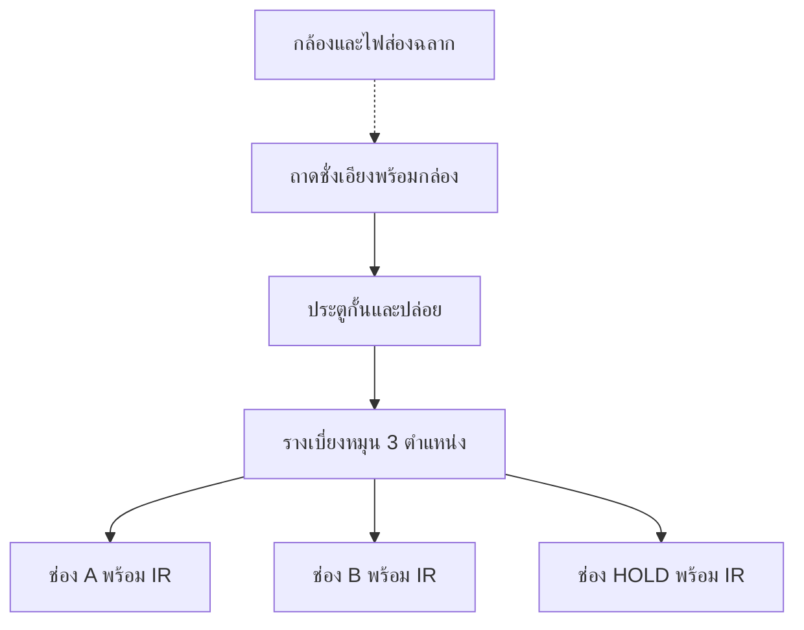
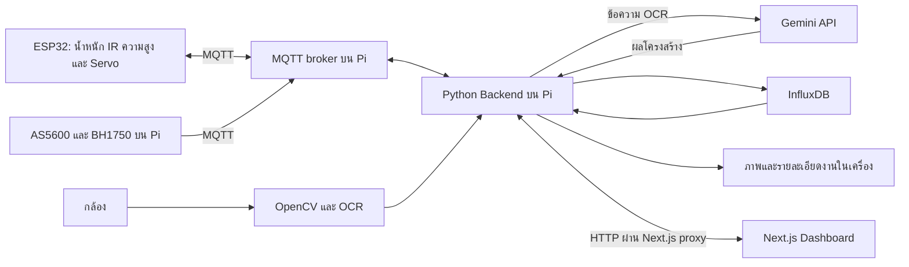

# Mini Sorting Hub — เอกสารโปรเจกต์ฉบับรวมสำหรับทีม

> อัปเดตวงจร IR 15 พ.ย. 2026: ผู้ใช้ไม่มี PC817 จึงเปลี่ยน baseline เป็นตัวต้านทาน **1kΩ pull-up ที่ OUT + 10kΩ อนุกรมไป GPIO + 15kΩ จาก GPIO ลง GND** ปัจจุบันตาม **D011 (20 พ.ย.) ใช้ E18 ตัวเดียวที่ถาด GPIO11** แบบ INPUT; ปุ่มพักยัง INPUT_PULLUP รวม R กับ LED สถานะเป็น **6 ตัว** ดู [ผัง v2](../hardware/wiring_v2/README_TH.md) และ [คู่มือ BENCH ปัจจุบัน](../setup/BENCH_SETUP_TH.md) แทนภาพ PC817 รุ่นเก่า ยังต้องวัดแรงดัน/ทดสอบจริงก่อนใช้

> อัปเดตการพัฒนา 11 พ.ย. 2026: มีชุด [BENCH รวมบนโต๊ะ](../setup/BENCH_SETUP_TH.md) พร้อมโค้ด HW/System ผู้ใช้เลือกเริ่มจากเลือก A/B/HOLD บนเว็บก่อนเชื่อมทีม AI ใช้ ESP32-S3-N16R8; ทางเดินกล่องและ feedback ที่หมุนแม่เหล็กด้วยมือยังเป็นการจำลอง ไม่ใช่หลักฐานคัดจริง ขอบเขตรุ่นส่งงานในเอกสารนี้ยังคงเดิม ดู [สถานะการตรวจโค้ด](../testing/VALIDATION_TH.md) ก่อนใช้งาน

> วิชา IoT Systems and Digital Solutions | ทีม 6 คน<br>
> ฉบับรวมหลัง grill-me: 7 พฤศจิกายน 2026<br>
> แผนหลัก 4 พ.ย.–7 ธ.ค. 2026 | หยุดทำงาน 14–19 พ.ย. รวมทั้งสองวัน<br>
> เป้าหมายส่งไฟล์ให้พร้อม 7 ธ.ค.; กำหนดส่งตาม Criteria 9 ธ.ค. 2026 เวลา 09:00 น.

เอกสารนี้รวมรายละเอียดทางเทคนิค เกณฑ์ประเมิน แผนงาน และคำตอบที่ผู้ใช้ตัดสินใจแล้วไว้ในไฟล์เดียว ใช้ฉบับนี้เป็นแหล่งอ้างอิงหลักของทีม ไม่ต้องอ่านเอกสารสรุปการสัมภาษณ์แยกอีกไฟล์

สถานะข้อมูลในเอกสาร:

- **ขอบเขตที่ตกลงแล้ว:** ฟังก์ชันที่ได้ข้อสรุปจากการสนทนาและ grill-me
- **แบบเทคนิคที่เสนอ:** โครงสร้างกลไก ซอฟต์แวร์ และตัวอย่างข้อมูลสำหรับเริ่มพัฒนา ยังต้องทดสอบ/สอบเทียบ
- **พักการตัดสินใจ:** ปิดเคส HOLD และตรวจเลขพัสดุซ้ำ ยังไม่ถือเป็นฟีเจอร์ที่อนุมัติทำ
- **ค่าที่ยังไม่ทราบ:** ขนาด/น้ำหนักกล่องจริง มุมราง thresholds จำนวนถ่ายซ้ำ timeouts และเกณฑ์ตัวเลขการประเมิน ต้องกำหนดจากงานจริง

ยังไม่มีการยืนยันว่าเครื่องสร้างเสร็จ หรือว่างานตามวันที่ที่ผ่านมาเสร็จแล้ว ตัวอย่างข้อมูลและช่วงเวลาในเอกสารไม่ใช่ผลการทดสอบ

## 1. สรุปโปรเจกต์และฟังก์ชันที่ตกลงทำ

**ผู้ใช้หลักคือเจ้าหน้าที่หอพักที่รับพัสดุเข้า** เครื่องคัดกล่องกระดาษแข็งขนาดเล็กทีละชิ้นไปยังกลุ่มชั้นล่าง/ชั้นบน โดยมีช่อง HOLD สำหรับงานที่ข้อมูลยังตัดสินไม่ได้

เจ้าหน้าที่อัปโหลดทะเบียนผู้พักแบบ CSV ตรวจรายการบนเว็บ และตั้งชั้นคั่นก่อนใช้งาน จากนั้นวางกล่องหงายฉลากขึ้น เมื่อกล่องนิ่งและเครื่องพร้อม เครื่องเริ่มชั่ง ถ่ายภาพ ทำ OCR ส่งข้อความให้ Gemini แยกข้อมูลผู้รับ ตรวจตารางอ้างอิง และคัดแยกจริง ก่อนเก็บประวัติให้ค้นบนเว็บ

| ฟังก์ชัน | ข้อสรุปที่ตกลงแล้ว |
|---|---|
| ช่อง A | กลุ่มชั้นล่าง: ชั้นที่อยู่ในตารางอ้างอิงและไม่เกินชั้นคั่น |
| ช่อง B | กลุ่มชั้นบน: ชั้นที่อยู่ในตารางอ้างอิงและสูงกว่าชั้นคั่น |
| ช่อง HOLD | ข้อมูลขัดกัน กำกวม หรือยังอ่านข้อมูลที่จำเป็นไม่ได้หลังลองซ้ำตามกำหนด |
| วิธีหาชั้น | รองรับเลขห้อง ข้อความระบุชั้น และชื่อผู้รับ โดย AI ช่วยแยกข้อมูลและ Backend ตรวจตารางอ้างอิง |
| ชื่ออย่างเดียว | คัดอัตโนมัติได้เมื่อชื่อตรงและพบเพียงคนเดียว หลังจัดรูปแบบช่องว่าง/คำนำหน้า; ชื่อคล้ายหรือกำกวมเข้า HOLD |
| ทะเบียน | อัปโหลด CSV และดูรายการบนเว็บ ยังไม่ทำหน้าเพิ่ม/แก้ผู้พักทีละคน |
| การชั่ง | ตรวจการวาง ความนิ่ง ขอบเขตน้ำหนักเครื่อง และบันทึกประวัติ |
| การวัดความสูง | ใช้ ToF วัดความสูงเฉพาะจุดบนกล่อง แสดงและบันทึกค่า; เกณฑ์ตรวจช่องรับต้องกำหนดจากกล่องจริงและสอบเทียบ |
| เริ่มงาน | อัตโนมัติเมื่อกล่องนิ่งและระบบพร้อม รับครั้งละหนึ่งกล่อง |
| ฉลาก | ฉลากขนส่งพิมพ์ชัด 2–3 รูปแบบที่เลือกไว้ ใช้ข้อมูลผู้รับสมมติในชุดทดลอง |
| อ่านภาพไม่สำเร็จ | ถ่ายซ้ำแบบจำกัดจำนวน หากยังอ่านข้อมูลระบุปลายทางไม่ได้ให้เข้า HOLD พร้อมเหตุผล |
| AI service ใช้ไม่ได้ | ค้างกล่องบนถาด พักรับงาน แสดงเหตุ และรอเจ้าหน้าที่กดลองใหม่ |
| เลขพัสดุอ่านไม่ครบ | คัดต่อได้ถ้าปลายทางผ่านกฎ ใช้ job_id ภาพ เวลา และข้อมูลผู้รับค้นย้อนหลังแทน |
| สถานะหน้าเครื่อง | ไฟสถานะและรายละเอียดบนเว็บ ไม่มีจอข้อความเพิ่มในรุ่นแรก |
| พัก/เริ่มต่อ | ทำได้ทั้งปุ่มหน้าเครื่องและเว็บ; กล่องที่ปล่อยแล้วให้จบรอบก่อน ไม่เปลี่ยนเส้นทางกลางทาง |
| กล่องติด | หยุดรับงาน แจ้งจุดที่ค้าง เจ้าหน้าที่เคลียร์ แล้วกดยืนยันเริ่มต่อหลังตรวจเส้นทางว่าง |
| ขอบเขตหลังคัด | เจ้าหน้าที่ค้นสถานะและประวัติบนเว็บ ไม่รวมแจ้งผู้พักหรือบันทึกการมารับของ |

**ลำดับหลัก:** อัปโหลดทะเบียน/ตั้งชั้นคั่น → วางกล่อง → รอนิ่ง → ถ่ายภาพ → OCR → AI → ตรวจข้อมูล → ตั้งราง → ปล่อย → ยืนยันช่อง → บันทึก

การส่งกล่องถึง HOLD หมายถึงเครื่องส่งไปช่องรอตรวจสำเร็จ ไม่ได้หมายความว่าเจ้าหน้าที่ตรวจหรือปิดเคสแล้ว วิธีปิดเคสยังพักไว้ตามหัวข้อ 21

## 2. ปัญหา ประโยชน์ และเกณฑ์ความสำเร็จ

เจ้าหน้าที่หอพักต้องอ่านข้อความบนฉลาก หาห้องหรือชั้น แยกกอง และบันทึกข้อมูลซ้ำ ๆ โจทย์ของเครื่องคือช่วยลดงานอ่านและกรอก พร้อมจัดกลุ่มพัสดุและทิ้งหลักฐานให้ค้นย้อนหลังได้

เป้าหมาย:

1. คัดกลุ่มชั้นได้ถูกต้องภายในขอบเขตกล่องและฉลากที่ประกาศรองรับ
2. ใช้ข้อมูลเลขห้อง ชั้น หรือชื่อผู้รับที่ตรวจสอบกับตารางอ้างอิงได้
3. ยืนยันปลายทางจากเซนเซอร์จริง ไม่ถือว่าคำสั่ง Servo เท่ากับคัดสำเร็จ
4. เก็บภาพ ข้อความ และเหตุผลของงานที่เข้า HOLD หรือเกิด fault
5. ให้เจ้าหน้าที่ค้นประวัติได้แม้เลขพัสดุอ่านไม่ครบ

**เกณฑ์ที่ตกลง:** รุ่นแรกยอมรับได้แม้คัดช้ากว่าคน หากคัดถูก ลดขั้นตอนอ่าน/กรอกด้วยมือ และมีประวัติครบ ต้องวัดเวลาเทียบกับคนและรายงานตามจริง ยังไม่ได้กำหนดเป้าหมาย Accuracy หรือเวลาต่อชิ้นเป็นตัวเลข

น้ำหนักไม่ใช้ตัดสินว่าของข้างในถูกต้องหรือครบ และไม่ใช้เทียบน้ำหนักที่คาดหมายจากฉลาก/รายการสินค้า

## 3. ขอบเขตงานและสิ่งที่ไม่รวม

| ส่วน | ขอบเขตรุ่นส่งงาน |
|---|---|
| สถานที่ทดลอง | บ้าน/หอ ทดลองบนโต๊ะได้ ไม่ติดตั้งกับเครื่องใช้ไฟฟ้าหรือระบบหออื่น |
| พัสดุ | กล่องกระดาษแข็งขนาดเล็กเท่านั้น |
| ขนาด/น้ำหนัก | ทีมเลือกกล่องจริง 3 ขนาด วัดและชั่ง แล้วล็อกช่วงก่อนออกแบบราง; ยังไม่มีพิกัดตัวเลขยืนยัน |
| การวาง | ทีละกล่อง หงายฉลากขึ้น อยู่ในพื้นที่รับที่กำหนด |
| รูปแบบฉลาก | เลือกฉลากขนส่งพิมพ์ชัด 2–3 รูปแบบ; รายชื่อรูปแบบ/ภาษาและชุดตัวอย่างยังต้องเลือกจริง |
| ปลายทาง | A/B ตามชั้นคั่นบนเว็บ และ HOLD สำหรับข้อมูลที่ตัดสินไม่ได้ |
| ระบบ | ESP32 + Raspberry Pi 5 + MQTT + Backend + InfluxDB + Dashboard |
| งานส่ง | ผลประเมิน สไลด์ครบ Criteria และวิดีโอประมาณ 5 นาที |

ไม่รวมในขอบเขตที่ตกลงทำ: ซอง/ถุงพัสดุ ฉลากทุกแบบและลายมือ สายพานหลายกล่องพร้อมกัน แขนกล การแจ้งผู้พัก การรับของ จอข้อความ การเทียบน้ำหนักคาดหมาย และการขยับกลไกแก้กล่องติดเอง

เรื่องปิดเคส HOLD และตรวจเลขพัสดุซ้ำเป็น **พักการตัดสินใจ** ไม่ใช่ฟีเจอร์ที่เลือกทำหรือเลือกวิธีไว้แล้ว ห้ามใส่เป็นเงื่อนไขบังคับใน flow หลักหรือ acceptance test รุ่นนี้จนกว่าจะได้ข้อสรุป

ทีมมี Raspberry Pi 5, ESP32 และ Raspberry Pi Camera Module 3 รุ่น SC0872 แล้ว งบซื้อเพิ่มที่ผู้ใช้กำหนดล่าสุดคือ 1,000–1,500 บาท ต้องตรวจสายกล้องสำหรับ Pi 5 แหล่งจ่าย Pi และ microSD ที่มีอยู่จริง รายการเลือกซื้อและเงื่อนไขงบอยู่ในหัวข้อ 23

## 4. Requirements เชิงหน้าที่และเงื่อนไขรับงาน

| รหัส | ฟังก์ชัน | หลักฐาน/เงื่อนไขรับงาน |
|---|---|---|
| FR01 | นำเข้าทะเบียน CSV และแสดงให้ตรวจ | อ่านข้อมูลห้อง/ชั้น/ชื่อได้ และแสดงรายการบนเว็บ |
| FR02 | ตั้งชั้นคั่น A/B บนเว็บ | ใช้ค่าที่ตั้งแบ่งชั้นที่มีในตารางอ้างอิงได้ |
| FR03 | เริ่มเมื่อวางกล่องนิ่ง | สร้าง job_id ของรอบปัจจุบัน ไม่ต้องกดเริ่มทุกชิ้น |
| FR04 | ชั่งและตรวจความพร้อมทางกล | ไม่ใช้ค่าขณะวางหรือกลไกสั่น เก็บน้ำหนักได้ |
| FR04H | วัดความสูงกล่องด้วย ToF | มีค่าระยะถาดว่างอ้างอิง วัดความสูงเฉพาะจุด และเทียบกับไม้บรรทัดก่อนใช้เป็นเกณฑ์ทางกล |
| FR05 | กล้อง → OCR → AI | เก็บภาพ ข้อความดิบ และข้อมูลผู้รับที่ AI แยก |
| FR06 | Resolve ห้อง/ชั้น/ชื่อกับข้อมูลอ้างอิง | ชื่อตรงคนเดียวคัดได้; ชื่อคล้าย กำกวม หรือข้อมูลขัดกันเข้า HOLD |
| FR07 | ไม่บังคับเลขพัสดุ | ข้อมูลปลายทางผ่านกฎแล้วคัดต่อได้เมื่อ tracking_id ว่าง |
| FR08 | ตั้งรางก่อนปล่อย | ตรวจมุมจริงผ่านเกณฑ์ก่อนเปิดประตู |
| FR09 | ยืนยันกล่องออกจากถาด (D011) | IR ถาดว่าง + น้ำหนักกลับศูนย์ภายในเวลา; ไม่มีเซนเซอร์ยืนยันช่องปลายทาง (`destination_sensed=false`) |
| FR10 | ถ่ายซ้ำแบบจำกัด | อ่านข้อมูลที่จำเป็นไม่ได้หลังครบจำนวนจึงส่ง HOLD |
| FR11 | พักเมื่อ AI ใช้ไม่ได้ | ค้างถาด แจ้งเหตุ ไม่ระบายกล่องเข้า HOLD อัตโนมัติเพราะบริการล่ม |
| FR12 | พัก/เริ่มต่อ | สั่งได้จากปุ่มและเว็บ ไม่ย้ายรางกลางการเดินทาง |
| FR13 | หยุดเมื่อกล่องติด/ผิดช่อง | ไม่เพิ่มตัวนับสำเร็จ เจ้าหน้าที่เคลียร์และยืนยันเมื่อเส้นทางว่าง |
| FR14 | แสดงสถานะ | ไฟหน้าเครื่องและรายละเอียดบนเว็บตรงกับ state จริง |
| FR15 | ค้นข้อมูลสด/ย้อนหลัง | ค้นผ่าน job_id ชื่อ ห้อง เวลา หรือเลขพัสดุเมื่อมีข้อมูล |
| FR16 | ไม่ทำคำสั่งทางเทคนิคซ้ำ | การส่ง MQTT ซ้ำไม่ทำให้รอบเดียวกันปล่อยหรือนับซ้ำ |

FR16 คือความถูกต้องของคำสั่งภายในรอบเดิม ไม่ใช่ฟังก์ชันตรวจว่าคนวางพัสดุเลขเดียวกันเข้ามาอีกครั้ง ฟังก์ชันตรวจเลขพัสดุซ้ำยังพักไว้

## 5. กลไกและการติดตั้ง



### 5.1 ชุดถาดชั่ง

- ใช้ถาดเอียงปรับความลาดได้ กล่องหยุดที่ประตูกั้นเพื่อชั่งและถ่ายภาพ
- ถาด ประตู และชิ้นส่วนที่รับแรงจากกล่องต้องอยู่บนชุดที่ Load cell รองรับทั้งหมด
- หลีกเลี่ยงกล่องพิงโครง/รางภายนอก เพราะแรงจะถ่ายออกจากตาชั่งและทำให้ชั่งผิด
- สายไฟต้องเผื่อความหย่อนและไม่ดึงชุดชั่ง ตรวจค่าทั้งตำแหน่งกลางและริมถาด
- Tare ตอนถาดว่างและประตูอยู่ตำแหน่งเริ่มต้นเดียวกัน ห้าม tare กล่องที่ยังค้างอยู่
- พิกัด Load cell ต้องครอบคลุมน้ำหนักถาด ประตู Servo บนถาด และกล่องรวมกัน

### 5.2 กลไกปล่อยและรางเบี่ยง

1. Servo ตัวแรกเปิด/ปิดประตูบนถาดชั่ง
2. Servo ตัวที่สองหมุนรางให้ตรง A/B/HOLD
3. ติดแม่เหล็กกับแกนรางและ AS5600 กับส่วนคงที่ เพื่ออ่านมุมจริง
4. Backend ตรวจว่ามุมเข้าช่วงที่สอบเทียบแล้วจึงสั่งเปิดประตู
5. คงรางไว้ที่เดิมจนยืนยันปลายทางหรือเข้าสู่ FAULT ห้ามเปลี่ยนรางกลางทาง

เลือกแรงบิด Servo จากน้ำหนักกล่องจริง 3 ขนาดที่ทีมเตรียม ระยะคาน และแรงเสียดทานจริง ไม่เลือกจากชื่อรุ่นหรือภาพคอนเซปต์เพียงอย่างเดียว เริ่มปรับรางให้กล่องเลื่อนสม่ำเสมอและไม่กระเด็นก่อนทำซอฟต์แวร์อัตโนมัติ

ขนาดกล่องที่รับได้ต้องยืนยันด้วยกล่องจริงและพื้นที่รับ/แนวราง เจ้าหน้าที่เลือกใช้เฉพาะกล่องในขอบเขตนี้ ToF วัดความสูงได้เฉพาะจุด ไม่ใช่ระบบวัดความกว้าง/ยาวหรือสแกนสามมิติ จึงไม่อ้างว่าตรวจกล่องใหญ่เกินทุกกรณีได้เอง

### 5.3 ตำแหน่ง ToF วัดความสูง

เปลี่ยนเซนเซอร์กระแสมอเตอร์เป็น ToF distance sensor เช่น VL53L0X โดยติดกับโครงคงที่เหนือจุดรับกล่อง หันแนววัดตั้งฉากกับพื้นถาดเอียง ให้กล่องทรงสี่เหลี่ยมวางหน้ากล่องแนบถาดและมีผิวด้านบนอยู่ในแนววัด วัดตอนกล่องนิ่งและประตูปิด

บันทึกระยะถึงถาดว่างเป็น d_empty และระยะถึงผิวบนกล่องเป็น d_top แล้วประมาณความสูงตามแนวตั้งฉากกับถาดด้วย h = d_empty - d_top วิธีนี้ต้องใช้จุดอ้างอิงเดิมและสภาพการวางที่กำหนด ไม่ใช้สูตรนี้กับแนวติดตั้งอื่นโดยไม่ปรับเรขาคณิต

ToF จึงให้ข้อมูลพัสดุโดยตรงสำหรับแสดงผล/เก็บประวัติ และช่วยตรวจความสูงเทียบช่องรับเมื่อกำหนดพิกัดแล้ว ต้องทดสอบช่วงระยะ พื้นผิว เทปสะท้อนแสง ตำแหน่งกล่อง และค่าที่อ่านไม่ได้ ห้ามตีความค่าผิดพลาดเป็นกล่องสูงศูนย์หรือผ่านเกณฑ์โดยอัตโนมัติ ไม่ใช้ค่าจุดเดียวแทนความสูงสูงสุดของกล่องที่เอียงหรือผิดรูป

การตรวจกล่องติดยังใช้ IR และเวลาเดินทาง ส่วนรางไม่ถึงตำแหน่งใช้ AS5600 และ timeout ไม่มีฟังก์ชันวัดกระแสหรืออ้างว่าตรวจแรงบิด Servo โดยตรงในแบบนี้

### 5.4 กล้องและการจัดแสง

ล็อกตำแหน่งกล้องให้มองฉลากบนถาดชั่ง จำกัดความสูงกล่องเพื่อคุมโฟกัส ใช้ไฟกระจายเพื่อลดเงาและแสงสะท้อน BH1750 ช่วยตรวจสภาพแสงและเป็นข้อมูลสำหรับปรับไฟ/สั่งถ่ายใหม่ แต่คุณภาพภาพยังต้องตรวจจากภาพเองด้วย

ภาพที่เคยสร้างในแชตเป็นคอนเซปต์ตำแหน่งอุปกรณ์ ไม่ใช่ CAD หรือแบบโครงสร้างที่ยืนยันการรับน้ำหนักแล้ว

## 6. อุปกรณ์และการนับเซนเซอร์

| ชนิด | ตัวอย่างอุปกรณ์ | ต่อกับ | หน้าที่ | จำนวนเบื้องต้น |
|---|---|---|---|---:|
| แรง/น้ำหนัก | Load cell + HX711 | ESP32 | ชั่งและตรวจน้ำหนักนิ่ง | 1 ชุด |
| ตรวจมีวัตถุ/การผ่าน | IR สะท้อน E18-D80NK แบบสายจั๊ม | ESP32 | ตรวจกล่องตอนวางบนถาด และยืนยันว่ากล่องออกจากถาด (D011) | 1 ตัว |
| ระยะ/ความสูง | ToF distance sensor เช่น VL53L0X | ESP32 ผ่าน I2C | วัดความสูงเฉพาะจุดบนกล่องจากระยะอ้างอิงถาดว่าง | 1 |
| มุมแม่เหล็ก | AS5600 | Pi ผ่าน I2C | ยืนยันมุมรางจริง | 1 |
| ความสว่าง | BH1750 | Pi ผ่าน I2C | ตรวจแสงบริเวณอ่านฉลาก | 1 |

**นับเป็น 5 ชนิด** แม้ IR มีหลายตัว โดย ESP32 มี 3 ชนิด และ Gateway มี 2 ชนิดต่อโดยตรง กล้อง Servo ไฟสถานะ และปุ่มพักไม่ใช้เพิ่มจำนวนชนิดเซนเซอร์ห้าชนิดในแผนนี้

อุปกรณ์เพิ่มเติม:

- Raspberry Pi 5, microSD/สื่อเก็บข้อมูล และแหล่งจ่ายที่เหมาะสม
- ESP32 หนึ่งบอร์ด
- Raspberry Pi Camera Module 3 SC0872 ที่มีอยู่แล้ว พร้อมสาย Camera Standard–Mini สำหรับ Pi 5 หากยังไม่มี
- Servo ตำแหน่ง 0–180 องศาสองตัว: MG90S สำหรับประตูเบา และ MG996R สำหรับราง เป็นตัวเลือกเบื้องต้นที่ต้องยืนยันแรงบิดกับกลไกจริง พร้อมชุดยึดและรางหมุน
- ไฟ LED พร้อมวงจรขับหากต้องการปรับความสว่าง
- ฐาน โครง ถาดชั่ง ราง และภาชนะรับสามช่อง
- แหล่งจ่ายไฟ Servo แยกจาก Pi เดินกราวด์ร่วมตามวงจรที่เลือก
- ไฟสถานะหน้าเครื่อง พร้อมวงจรขับ/ตัวต้านทานที่เหมาะสม
- ปุ่มพัก/เริ่มต่อหน้าเครื่อง สายไฟ ขั้วต่อ และวัสดุยึดสาย
- ตุ้มน้ำหนักหรือเครื่องชั่งอิสระสำหรับสอบเทียบ

ก่อนสั่งซื้อให้ตรวจแรงดันสัญญาณที่เข้า ESP32/Pi โดยเฉพาะ IR และวงจร breakout ของ ToF ต้องไม่ต่อสัญญาณเกินระดับที่บอร์ดรับได้ เลือกพิกัดแหล่งจ่ายตามกระแส Servo จริงและเผื่อกระแสช่วงเริ่มหมุน การคำนวณแหล่งจ่ายยังจำเป็นแม้ไม่ได้ติดเซนเซอร์กระแส

## 7. สถาปัตยกรรมและความรับผิดชอบ



| ส่วน | หน้าที่ |
|---|---|
| ESP32 | อ่านเซนเซอร์ Node ควบคุม Servo รับคำสั่งแบบมีสถานะ ตรวจเวลาและการผ่านช่อง |
| Pi: Hardware service | อ่านมุมรางและแสงผ่าน I2C ส่งค่าให้ Backend |
| Pi: Vision service | รับภาพ เตรียมภาพ OCR เก็บภาพและผลอ่าน |
| Pi: Backend | ประสานสถานะและ AI ตรวจผล เลือกกลุ่มชั้น จัดเก็บ และให้ HTTP API; ส่วน CSV/ค่าชั้นคั่นยังเป็นงานรุ่นส่งที่ต้องเพิ่ม |
| Gemini API | แยกข้อความเป็นข้อมูลผู้รับ ไม่สั่งมอเตอร์โดยตรง |
| MQTT broker | รับส่ง telemetry, คำสั่ง และ acknowledgement |
| InfluxDB | เก็บและเรียกข้อมูลตามเวลา |
| Dashboard | Next.js ตรวจงานปัจจุบัน ดูประวัติและเหตุผล ผ่าน Flask API; ยังไม่เพิ่ม WebSocket |

สถาปัตยกรรมที่ยืนยัน 16 พ.ย. 2026: ใช้ Python/Flask เป็น Backend API และแยก Dashboard เป็น Next.js App Router + TypeScript + Tailwind **รันบนคอม** ส่วน Backend/Gateway/MQTT/Database รันบน Pi ตามคำขอผู้ใช้ หน้าเว็บ :3000 ส่ง /api ไป Flask :5000 โดยยังใช้ polling; Gateway อ่านเซนเซอร์ Pi แล้วส่ง MQTT ใช้ InfluxDB v2 สำหรับ telemetry และ SQLite สำหรับ jobs/events ไม่เพิ่ม Cloud server อีกเครื่องเพื่อให้ผ่านเกณฑ์ โค้ดแยก frontend/backend/gateway/firmware แล้ว ดู README ที่ราก repo และบันทึกผลการทดสอบใน docs/testing/VALIDATION_TH.md

## 8. ทะเบียนและ OCR → AI → กลุ่มชั้น

### 8.1 ทะเบียนและตารางห้อง/ชั้น

ตกลงให้เจ้าหน้าที่อัปโหลด CSV และดูรายการบนเว็บ โดยยังไม่ทำหน้าแก้ผู้พักทีละคน ต้องมีข้อมูลสำหรับ map ห้อง→ชั้น และชื่อ→บุคคล/ห้อง/ชั้น

ตัวอย่าง schema ที่เสนอเพื่อเริ่มพัฒนา (ยังต้องตกลงรูปแบบไฟล์และ validation จริง):

```csv
resident_id,full_name,room,floor
R001,ธนา ใจดี,202,2
R002,มาลี สายใจ,502,5
R003,กิตติ ทดสอบ,302,3
R004,กิตติ ทดสอบ,602,6
```

ชื่อซ้ำอาจเป็นคนละคนจริง จึงห้ามใช้ชื่อเป็นรหัสบุคคลโดยอัตโนมัติ ตัวอย่างนี้ชื่อกิตติ ทดสอบพบสองคน เมื่อมีเฉพาะชื่อนี้ต้อง HOLD; หลายคนอยู่ห้องเดียวกันก็เป็นไปได้ แต่ห้องเดียวกันต้องไม่ map เป็นคนละชั้นโดยไม่มีการตรวจแก้

รายละเอียดการตรวจ CSV ผิดรูปแบบ การ activate ไฟล์ใหม่ และ versioning เป็นงานเทคนิคที่ยังต้องกำหนด ไม่ได้อนุมัติให้ AI แก้ทะเบียนเอง ข้อเสนอเพื่อความสอดคล้องคือใช้ทะเบียนและค่าชั้นคั่นชุดเดียวตลอดรอบกล่อง แล้วค่อยเปลี่ยนค่าก่อนรอบถัดไป

### 8.2 ถ่ายภาพและ OCR

1. รอกล่องนิ่ง เครื่องพร้อม และไม่มีมือบังพื้นที่อ่าน
2. ตรวจแสง เตรียมไฟ และถ่ายภาพใน ROI ที่ล็อกไว้
3. OpenCV ครอป/แก้เอียง/ปรับภาพตามผลทดลอง
4. ทำ OCR เช่น Tesseract เก็บข้อความดิบและภาพ
5. ส่งข้อความเข้า AI เพื่อแยกข้อมูลที่อ่านได้

หากภาพหรือข้อความไม่เพียงพอจะระบุปลายทาง ให้ถ่ายซ้ำแบบจำกัดจำนวน; ครบแล้วจึงส่ง HOLD พร้อมเหตุผล **การไม่มีเลขพัสดุอย่างเดียวไม่ถือว่าอ่านปลายทางไม่สำเร็จ** เมื่อข้อมูลอื่นผ่านกฎแล้ว

### 8.3 AI service

AI แยกข้อมูลในส่วนผู้รับออกจากผู้ส่ง และคืนเลขห้อง ข้อความระบุชั้น ชื่อผู้รับ และเลขพัสดุเมื่ออ่านได้ ใช้ข้อความ OCR เป็นข้อมูลอ้างอิง ไม่ใช่คำสั่งให้ AI เปลี่ยนกฎเครื่อง

ข้อกำหนด:

- ห้ามสร้างเลขห้อง ชั้น ชื่อ หรือเลขพัสดุที่ไม่มีหลักฐาน
- แยกผู้ส่ง/ผู้รับ; เลขห้องในส่วนผู้ส่งไม่ใช้ตัดสินชั้นของผู้รับ
- ไม่เดาชั้นจากรูปแบบเลขห้อง เช่น 302 ไม่ได้แปลว่าชั้น 3 เสมอ ต้องค้นตารางห้อง
- ชื่อคล้ายไม่ถูก AI แก้เป็นชื่อในทะเบียนแล้วคัดเอง อนุญาตเพียงการจัดรูปแบบที่ตกลง เช่น ช่องว่างและคำนำหน้า
- ฟิลด์ไม่พบให้เป็น null พร้อมปัญหา และเก็บข้อความอ้างอิง
- Backend ตรวจ schema/เนื้อหาอีกชั้น JSON ถูกโครงสร้างไม่ได้รับรองว่าข้อมูลถูก

ตัวอย่างข้อความสมมติ: “ผู้ส่ง: ร้านทดสอบ ห้อง 502 / ผู้รับ: คุณธนา ใจดี ห้อง 202”

```json
{
  "job_id": "JOB-0001",
  "tracking_id": null,
  "recipient_name_raw": "คุณธนา ใจดี",
  "recipient_room": "202",
  "recipient_floor": null,
  "source_excerpt": "ผู้รับ: คุณธนา ใจดี ห้อง 202",
  "issues": []
}
```

### 8.4 Backend ตรวจและ resolve ปลายทาง

1. เลขห้อง: ค้นห้อง→ชั้นจากตารางอ้างอิง
2. ข้อความระบุชั้น: ตรวจว่าเป็นชั้นที่หอมีในตาราง ไม่ map ตัวเลขนอกทะเบียนไป B เพียงเพราะมากกว่าชั้นคั่น
3. ชื่อ: ถ้าใช้ชื่ออย่างเดียว ต้องตรงหลังจัดรูปแบบและได้บุคคลเดียว จึงหาห้อง/ชั้นจากทะเบียน
4. ถ้าหลักฐานที่ตรวจได้ขัดกัน ให้ HOLD แทนการเลือกข้อมูลใดทับข้อมูลอื่น
5. ถ้ามีแหล่งข้อมูลที่ยืนยันได้เพียงพอและไม่มีข้อขัดแย้ง ให้คัดตามชั้น แม้ข้อมูลเสริมบางฟิลด์ว่าง
6. มีเพียงชื่อคล้าย/ชื่อกำกวม หรือยัง resolve ไม่ได้ ให้ HOLD

| ผลตรวจ | การเลือก |
|---|---|
| ได้ชั้นที่มีจริงและชั้น ≤ ค่าชั้นคั่น | A |
| ได้ชั้นที่มีจริงและชั้น > ค่าชั้นคั่น | B |
| ข้อมูลขัดกัน/กำกวม/ระบุชั้นไม่ได้ | HOLD พร้อมเหตุผล |
| AI service ใช้งานไม่ได้ | ค้างบนถาด พักรับงาน รอเจ้าหน้าที่กดลองใหม่ |

ตัวอย่างต่อเนื่องใช้ค่าชั้นคั่น **3 เพื่ออธิบายเท่านั้น ไม่ใช่ค่าหอจริงที่ตกลงใช้**: ชื่อธนา ใจดีตรง R001 และห้อง 202 อยู่ชั้น 2 จึงได้ A แม้ tracking_id เป็น null หากชื่อธนา ใจดีปรากฏร่วมกับห้อง 502 จะขัดกับทะเบียนและต้อง HOLD

ตัวอย่างผลภายในหลัง Backend ตรวจ ไม่ใช่คำสั่งมุมจาก AI:

```json
{
  "job_id": "JOB-0001",
  "resolved_room": "202",
  "resolved_floor": 2,
  "target_bin": "A",
  "reason_code": "RESOLVED_ROOM_AND_NAME",
  "tracking_id": null
}
```

### 8.5 การชั่งในรุ่นนี้

น้ำหนักมีหน้าที่ตรวจการวาง/ความนิ่ง ตรวจขอบเขตที่เครื่องรับได้ และบันทึกประวัติ ไม่ต้องมีน้ำหนักพัสดุคาดหมายในทะเบียน CSV ถ้าเกินขอบเขตเครื่องต้องไม่ปล่อยอัตโนมัติระหว่างยังไม่ยืนยันว่าทางกลรองรับ วิธีให้คนจัดการกล่องเกินขอบเขตระบุเป็นรายละเอียดรอทีมล็อกในหัวข้อ 21

## 9. สถานะการทำงานและการจัดการปัญหา

ตารางนี้เป็นแบบ state machine ที่เสนอเพื่อ implement ฟังก์ชันที่ตกลงแล้ว:

| สถานะ | การทำงาน | เงื่อนไขไปต่อ |
|---|---|---|
| IDLE | ประตูกั้นปิด รอถาดว่าง/ระบบพร้อม | พบกล่องใหม่ |
| WAIT_STABLE | อ่านน้ำหนักและรอการเคลื่อนไหวสงบ | ผ่านเกณฑ์ความนิ่งและขอบเขตเครื่อง |
| CAPTURE_OCR | เตรียมแสง ถ่ายภาพ OCR | ได้ข้อความ หรือครบจำนวนลองซ้ำ |
| PARSE_AI | ส่งข้อความให้ Gemini | ได้ข้อมูล หรือเข้าสู่การพักบริการ |
| VALIDATE | resolve ห้อง/ชั้น/ชื่อ ตรวจข้อขัดแย้ง | ได้ A/B/HOLD พร้อมเหตุผล |
| POSITION | สั่งรางและอ่าน AS5600 | มุมจริงอยู่ในช่วงเป้าหมาย |
| RELEASE | เปิดประตู รักษารางเดิม | กล่องออกจากถาด |
| VERIFY_EXIT | รอกล่องออกจากถาด (IR ถาดว่าง + น้ำหนักกลับศูนย์) | ไม่ยืนยันช่องปลายทางตาม D011 |
| COMPLETE | เก็บผล ปิดประตู ตรวจทางว่าง | ถ้ามีคำสั่งพักไป PAUSED_OPERATOR; หากไม่มีและระบบพร้อมจึงกลับ IDLE |
| PAUSED_OPERATOR | พักรับกล่องใหม่ | เจ้าหน้าที่สั่งเริ่มต่อและระบบพร้อม |
| PAUSED_AI | ค้างกล่องบนถาด แสดง AI ใช้ไม่ได้ | เจ้าหน้าที่กดลองใหม่ แล้วตรวจผลจริงก่อนปล่อย |
| FAULT | พักงาน แสดงปัญหากลไก/เส้นทาง | เจ้าหน้าที่เคลียร์ ตรวจว่าง และยืนยันเริ่มต่อ |

การพักตามปุ่ม/เว็บเป็นการพักรับงานใหม่ ไม่ใช่การตัดไฟฉุกเฉิน กล่องที่ปล่อยแล้วต้องติดตามให้จบรอบหรือเข้า FAULT โดยไม่ย้ายรางกลางทาง ถ้ายังไม่ปล่อยให้รักษาประตูกั้นและสถานะของงานไว้ ไม่ให้ Resume ข้ามผล AI/validation ที่จำเป็น

| เหตุการณ์ | การตอบสนอง |
|---|---|
| ภาพอ่านข้อมูลจำเป็นไม่ได้ | ถ่ายซ้ำจำนวนจำกัด แล้วย้าย HOLD เมื่อกลไกพร้อม |
| ข้อมูลผู้รับขัดกัน/ชื่อคล้ายหรือกำกวม | HOLD พร้อมเหตุผล |
| เลขพัสดุอ่านไม่ครบแต่ปลายทางผ่านกฎ | คัดต่อ เก็บค่าว่างและหลักฐาน |
| API/อินเทอร์เน็ตทำให้ AI ใช้ไม่ได้ | PAUSED_AI ค้างบนถาด รอเจ้าหน้าที่กดลองใหม่ ไม่ใช้ timeout เป็นเหตุให้ปล่อยเข้า HOLD |
| AI ตอบแต่ข้อมูลไม่สามารถ resolve ได้ | ใช้กฎข้อมูลไม่พอ/ขัดกันและ HOLD; แยกจากบริการล่ม |
| มุมรางไม่ตรง/ตัวขับไม่ถึงตำแหน่ง | ไม่เปิดประตู แสดง FAULT |
| กล่องไม่ออก/ไม่ถึงช่องตามเวลา | FAULT ไม่เพิ่มตัวนับสำเร็จ |
| กล่องผ่านช่องผิด | ตาม D011 ตรวจไม่ได้เพราะไม่มี IR ช่อง — ระบุเป็นข้อจำกัด |
| Node/Backend ติดต่อไม่ได้ | ไม่ปล่อยงานใหม่จากคำสั่งค้าง; ถ้าปล่อยแล้วคงรางและเก็บเหตุการณ์ที่ Node เพื่อคืนสถานะ |

หลังเจ้าหน้าที่เอากล่องติดออก บันทึกรอบนั้นตามผลที่ยืนยันได้ ไม่แก้เป็นคัดอัตโนมัติสำเร็จเพียงเพราะเส้นทางว่าง กลับมารับงานใหม่ได้หลังตรวจและยืนยันตามที่ตกลง

การตรวจเลขพัสดุซ้ำข้ามรอบยังพักไว้ ไม่มี state บังคับให้หยุดเพราะอ่านเลขเดียวกับงานเก่า การป้องกัน MQTT สั่งซ้ำภายใน job เดิมยังจำเป็นและเป็นคนละเรื่อง

## 10. MQTT และสัญญาข้อมูล

ตารางนี้อัปเดตเทียบ source ปัจจุบัน 16 พ.ย. 2026 ทุกฝั่งต้องใช้ชื่อเดียวกัน Backend/Gateway เป็น MQTT clients ผ่าน Mosquitto บน Pi ส่วน frontend บนคอมเรียก HTTP API ดู [ผลตรวจ Metric/MQTT](../testing/METRIC_AUDIT_TH.md)

| Topic | ผู้ส่ง → ผู้รับ | เนื้อหา/หน้าที่ |
|---|---|---|
| sorter/weight | ESP32 → Backend | น้ำหนัก ความนิ่ง และคุณภาพค่าชั่ง |
| sorter/height | ESP32 → Backend | ระยะที่วัด ความสูงเฉพาะจุด และสถานะความน่าใช้ของค่า |
| sorter/passage | ESP32 → Backend | สถานะตรวจพบวัตถุที่ถาดและช่อง A/B/HOLD |
| sorter/vision | Backend → MQTT subscribers | ผล vision ที่ backend รับจากทีม AI ทาง HTTP แล้ว publish ต่อ; ยังไม่มีผลกล้อง/AI จริงใน BENCH ปกติ |
| sorter/gateway | Pi sensor service → Backend | มุม AS5600 และแสง BH1750 |
| sorter/actuator | ESP32 → Backend | สถานะกลไก ผลคำสั่ง และ fault |
| sorter/cmd | Backend → ESP32 | เลือกราง ปล่อย ปิดประตู และ reset ที่อนุญาต |
| sorter/ack | ESP32 → Backend | รับ/ปฏิเสธคำสั่งและผลคำสั่ง |
| sorter/status | ESP32 → Backend | เหตุปุ่ม/สถานะตาม branch ของ firmware; ความสด/ออนไลน์ตรวจจาก telemetry weight/passage/gateway ไม่ใช่อาศัย topic นี้เป็น heartbeat เดียว |

หลักฐานเกณฑ์ข้อ 10 ใช้ sorter/weight จาก Load cell+HX711, sorter/height จาก VL53L0X และ sorter/passage จาก E18 ซึ่งเป็นข้อมูลจากเซนเซอร์คนละแหล่ง พร้อม sorter/gateway จาก AS5600/BH1750 เพิ่มอีก topic ไม่ต้องรอ sorter/vision เพื่อให้ครบสาม และไม่ใช้ cmd/ack/status มาทดแทนข้อมูล IoT จริง

ตัวอย่าง telemetry และคำสั่ง เป็นรูปแบบภายในที่เสนอ ไม่ใช่โค้ดควบคุมที่พร้อมใช้งาน:

```json
{
  "schema_version": 1,
  "device_id": "node-01",
  "session_id": "BOOT-01",
  "job_id": "JOB-0001",
  "seq": 12,
  "uptime_ms": 12000,
  "weight_g": 251.4,
  "stable": true
}
```

```json
{
  "schema_version": 1,
  "job_id": "JOB-0001",
  "command_id": "JOB-0001-POSITION-01",
  "action": "POSITION",
  "target_bin": "A"
}
```

หลักในการใช้ข้อความ:

- ใช้ job_id เชื่อมข้อมูลทุกส่วน และ command_id ป้องกันการทำคำสั่งเดิมซ้ำ
- ACK การรับคำสั่งยังไม่เท่ากับกล่องถึงปลายทาง ต้องรอเหตุการณ์ยืนยันจริง
- Node รับคำสั่งตามสถานะที่อนุญาต เช่น RELEASE ได้หลัง POSITION พร้อมแล้วเท่านั้น
- ตรวจอายุคำสั่ง/session และอย่า retain คำสั่งเคลื่อนกลไกเพื่อให้เครื่องทำซ้ำหลังเชื่อมต่อใหม่
- กำหนดให้การตัดสินสถานะเกิดจากผู้ควบคุมหลักที่ชัดเจน ไม่ให้หลาย service สั่ง Servo แข่งกัน
- Backend ประทับเวลารับเป็น UTC และแสดงผลเวลา Asia/Bangkok เก็บ uptime/seq ของ Node ไว้ตรวจลำดับ

## 11. ฐานข้อมูล Dashboard และการแสดงสถานะ

### 11.1 ที่เก็บข้อมูลที่เสนอ

| ข้อมูล | ที่เก็บ |
|---|---|
| น้ำหนัก ความสูง/ระยะ มุม แสง และเซนเซอร์ทางผ่านตามเวลา | InfluxDB |
| เหตุการณ์สถานะพร้อม job_id | InfluxDB และ job record |
| job_id, tracking_id ที่อาจว่าง, OCR/AI, ชื่อ/ห้อง/ชั้น, เป้าหมาย, ผลจริง, เหตุผล, เวลาต่าง ๆ | JSON หรือ SQLite ใน Pi |
| ภาพฉลาก | ไฟล์ในเครื่อง เก็บ path ใน job record |
| ทะเบียนห้อง/ผู้พัก | นำเข้าจาก CSV; วิธีเก็บ/activate/version ยังต้องล็อกทางเทคนิค |
| ค่าชั้นคั่น | การตั้งค่าบนเว็บก่อนใช้งาน พร้อมบันทึกค่าที่ใช้กับรอบงาน |

ใช้ job_id เป็นตัวเชื่อมหลัก ไม่ใช้ tracking_id เป็นคีย์บังคับหรือเงื่อนไข unique ของงาน เพราะอาจอ่านไม่ได้ และยังไม่ทำฟังก์ชันตรวจเลขพัสดุซ้ำ ภาพไม่ต้องเก็บทั้งก้อนในฐานข้อมูลเวลา ต้อง query ข้อมูลเซนเซอร์ย้อนหลังจาก InfluxDB จริง

### 11.2 หน้าเว็บที่อยู่ในขอบเขต

1. หน้านำเข้า CSV และแสดงรายการให้ตรวจ ไม่มีหน้าเพิ่ม/แก้ผู้พักรายคน
2. หน้าตั้งชั้นคั่น A/B ก่อนใช้งาน
3. หน้าสด: ภาพ ข้อความ OCR ข้อมูลผู้รับที่ AI แยก ห้อง/ชั้นที่ resolve น้ำหนัก ช่องเป้าหมาย และขั้นตอนปัจจุบัน
4. สถานะ Node มุมราง แสง ความสูง/ระยะ และเซนเซอร์ทางผ่าน
5. ค้นประวัติผ่าน job_id ชื่อ ห้อง เวลา และ tracking_id เมื่อมี
6. ตัวนับแยก SORTED_A, SORTED_B, HOLD_DELIVERED และ FAULT (MISROUTE ตรวจไม่ได้ตาม D011)
7. กราฟน้ำหนัก ความสูง มุม แสง และเวลางานย้อนหลัง
8. ปุ่มพัก/เริ่มต่อ และกดลองใหม่เมื่อ AI กลับมาพร้อม รวมการยืนยันหลังเคลียร์ fault โดยไม่ข้าม interlock

แสดงผลว่า “ถึงช่อง HOLD แล้ว — รอตรวจ” ได้ แต่ยังไม่ทำปุ่มเลือกห้องใหม่ ปิดเคส หรือคัดซ้ำจาก HOLD เพราะ workflow นั้นยังไม่เลือก ไม่ทำหน้าแจ้งผู้พัก/รับพัสดุ

### 11.3 ไฟและปุ่มหน้าเครื่อง

ตกลงใช้ไฟสถานะ + เว็บ และปุ่มพัก/เริ่มต่อหน้าเครื่อง ไม่มีจอข้อความเพิ่มเติม แนวทาง mapping สีที่เสนอคือ เขียว=พร้อม เหลือง=กำลังทำงาน/พักตามสั่ง แดง=ต้องจัดการ โดยต้องทำให้สถานะพักและกำลังทำงานแยกกันได้ เช่น รูปแบบติด/กระพริบ และมีข้อความเว็บชัดเจน รายละเอียดสี/จังหวะยังไม่ล็อก

ไฟต้องสะท้อนความพร้อมจริง เช่น AI ขัดข้องหรือกลไกยังไม่เคลียร์ต้องไม่แสดงว่ารับกล่องใหม่ได้ ปุ่มพักทั่วไปไม่ใช้แทนการตัดกำลังฉุกเฉินของงานออกแบบไฟฟ้า

## 12. การสอบเทียบและค่าที่ต้องหา

| ค่า | วิธีหา |
|---|---|
| Scale factor / tare / drift | ใช้น้ำหนักอ้างอิงหลายค่า วางหลายตำแหน่ง และอ่านซ้ำตามเวลา |
| ช่วงน้ำหนักนิ่งและเวลารอ | เก็บ noise ตอนว่าง ตอนวางกล่อง และหลัง Servo หยุด |
| ช่วงน้ำหนักที่เครื่องรับได้ | ทดลองร่วมกับพิกัดโครง ถาด Load cell และ Servo |
| มุม A/B/HOLD และ tolerance | สั่งแต่ละช่อง อ่านมุมจริง และปล่อยกล่องซ้ำ |
| มุมลาดและผิวราง | ทดลองกล่องหลายขนาดในขอบเขต วัดเวลาลื่นและจำนวนติด |
| ความสูงจาก ToF | สอบเทียบ d_empty และ h เทียบไม้บรรทัดกับกล่องจริงหลายตำแหน่ง/พื้นผิว ตรวจค่าที่อ่านไม่ได้ |
| Passage timeout | วัดเวลาจากปล่อยถึงปลายทางในหลายรอบแล้วเผื่อ margin |
| แสง/โฟกัส/ROI | ถ่ายฉลากจริงหลายสภาพและตรวจ OCR |
| จำนวนครั้งถ่ายซ้ำ / AI timeout | วัด latency และกำหนดเวลารวมที่ทีมยอมรับ |

เก็บค่าที่สอบเทียบใน configuration กลาง พร้อมวันที่และผู้สอบเทียบ ห้ามรายงานค่าตัวอย่างหรือเป้าหมายเป็นผลจริง

## 13. การทดสอบและเกณฑ์ประเมิน

### 13.1 ชุดข้อมูล

- ใช้ทะเบียนผู้พักสมมติพร้อมเฉลยห้อง/ชั้น และฉลากขนส่งพิมพ์ชัด 2–3 รูปแบบ
- มีชุดที่ระบุห้อง ชั้น หรือชื่ออย่างเดียว และชุดที่ข้อมูลขัดกัน
- มีชื่อซ้ำ ชื่อคล้าย และเลขพัสดุว่างโดยที่ปลายทางยังชัด
- แยกฉลากที่ใช้ปรับระบบออกจากฉลากประเมินสุดท้าย
- เริ่มแผนประมาณ 30 ฉลากแล้วทดสอบซ้ำตามเวลาที่มี จำนวนนี้เป็นข้อเสนอของทีม ไม่ใช่ข้อบังคับวิชา
- เก็บ configuration ทะเบียน และค่าชั้นคั่นที่ใช้แต่ละรอบ เพื่ออธิบายผลย้อนหลัง

### 13.2 ตัวชี้วัด

| ด้าน | สิ่งที่วัด |
|---|---|
| กล้อง | FPS พร้อมความละเอียดและวิธีวัดจริงบน Pi |
| OCR | Exact-match ของชื่อ/ห้อง/ชั้นที่อ่านได้; เลขพัสดุรายงานแยกเพราะไม่ใช่ฟิลด์บังคับ |
| AI | ความถูกต้องของการแยกผู้ส่ง/ผู้รับและฟิลด์ชื่อ/ห้อง/ชั้น |
| Routing | ความถูกต้องของการใช้ตารางและชั้นคั่น เลือก A/B/HOLD |
| ชุดชั่ง | Error เทียบเครื่องชั่งอิสระ/น้ำหนักอ้างอิง และความแปรปรวน |
| ToF | Error ความสูงเฉพาะจุดเทียบไม้บรรทัด ความแปรปรวน และสัดส่วนอ่านค่าไม่ได้ |
| กลไก | ถึงช่องถูกจริง ผิดช่อง กล่องติด มุมเป้าหมายเทียบมุมวัด |
| ประสิทธิภาพ | เวลา capture/OCR/AI/กลไก/รวมต่อชิ้น และเวลาเทียบการคัดด้วยมือ |
| ลดงานมือ | จำนวนขั้นตอนที่ต้องอ่าน/กรอก/ยืนยันต่อชิ้น และงานที่เจ้าหน้าที่ต้องแทรกแซง |
| ประวัติ | ความครบของ job_id ภาพ เวลา ผลคัด และเหตุผล; ยอมรับ tracking_id ว่างตามกฎ |

เกณฑ์สำเร็จเชิงเป้าหมายคือคัดถูก ลดงานอ่าน/กรอก และประวัติครบ แม้ช้ากว่าคนได้ โดยรายงานความเร็วตรง ๆ เป้าหมายตัวเลข Accuracy/เวลายังต้องตั้งก่อนประเมินสุดท้าย ไม่กำหนดตัวเลขย้อนหลังเพื่อให้ผลผ่าน

### 13.3 Test cases หลัก

ตัวอย่างใช้ตารางและชั้นคั่น=3 ในหัวข้อ 8 เพื่อให้เฉลยตรวจได้ ไม่ใช่ค่าของหอจริง

| ID | สถานการณ์ | ผลคาดหวัง |
|---|---|---|
| T01 | ผู้รับห้อง 202 อยู่ชั้น 2 | ถึง A และ IR ยืนยัน |
| T02 | ผู้รับห้อง 502 อยู่ชั้น 5 | ถึง B และ IR ยืนยัน |
| T03 | ห้องผู้ส่ง 502 ผู้รับ 202 | เลือก A จากผู้รับ |
| T04 | มีเพียงข้อความผู้รับระบุชั้น 5 ที่หอมีจริง | B หากไม่มีหลักฐานขัดกัน |
| T05 | มีเพียงชื่อธนา ใจดี ตรงทะเบียนคนเดียว | A |
| T06 | มีเพียงชื่อกิตติ ทดสอบ ซึ่งตรงหลายคน | HOLD พร้อมเหตุผลกำกวม |
| T07 | มีเพียงชื่อสะกดคล้ายแต่ไม่ตรงทะเบียน | HOLD ไม่ใช้ AI เดาว่าเป็นคนใด |
| T08 | ชื่อธนา ใจดี แต่ห้อง 502 | HOLD เพราะข้อมูลขัดกัน |
| T09 | ไม่มีข้อมูลระบุผู้รับเพียงพอ | ถ่ายซ้ำตามจำนวน แล้ว HOLD |
| T10 | เลขพัสดุว่าง แต่ห้อง/ชั้นยืนยันได้ | คัดต่อ ค้นประวัติด้วย job_id/ภาพ/เวลา/ผู้รับได้ |
| T11 | น้ำหนักไม่นิ่ง | รอก่อนเริ่มอ่าน/ปล่อย |
| T12 | ฉลากเอียงหรือสะท้อนจนอ่านไม่ได้ | ลองใหม่แบบจำกัด แล้ว HOLD ถ้ายังไม่สำเร็จ |
| T13 | AI service ใช้ไม่ได้ | ค้างถาด พักรับงาน รอกดลองใหม่ |
| T14 | รางไม่ถึงมุม | ประตูปิด ไม่ปล่อย และแจ้ง fault |
| T15 | กล่องค้าง/ไม่ถึงปลายทาง | หยุดรับ แจ้งจุดที่ค้าง เจ้าหน้าที่เคลียร์และยืนยัน |
| T16 | กล่องเข้าช่องผิด | ตาม D011 ระบบตรวจไม่ได้ — ไม่ใช้เป็นกรณีทดสอบผ่าน ให้ระบุข้อจำกัด |
| T17 | พักจากปุ่มหรือเว็บ | ไม่รับชิ้นใหม่ กล่องที่ปล่อยแล้วไม่ถูกเปลี่ยนเส้นทางกลางทาง |
| T18 | ส่งคำสั่ง MQTT เดิมซ้ำใน job เดียว | ไม่ปล่อย/นับซ้ำ เป็นเรื่องคำสั่งภายใน ไม่ใช่ตรวจเลขพัสดุซ้ำ |
| T19 | ชั่งกล่องเดิมหลายตำแหน่ง | Error อยู่ในช่วงที่ทีมกำหนดจากการสอบเทียบ |
| T20 | เปลี่ยนชั้นคั่นก่อนเริ่มรอบ | ใช้ค่าที่ตั้งกับชั้นที่มีจริงได้ถูกต้อง |
| T21 | วัดความสูงกล่องจริง 3 ขนาดในจุดวางที่กำหนด | เทียบค่า h กับไม้บรรทัดและรายงาน Error |
| T22 | ผิวเทปสะท้อน/กล่องเอียง/ToF อ่านไม่ได้ | แสดงคุณภาพค่า ไม่ตีความเป็นผ่านพิกัด; ทดลองเพื่อกำหนดเกณฑ์รับค่าก่อนใช้ควบคุมกลไก |

ไม่ทำ test บังคับปิดเคส HOLD หรือตรวจเลขพัสดุซ้ำจนกว่าจะได้ข้อสรุป การทดสอบข้อมูล CSV ผิดรูปแบบและกล่องเกินพิกัดต้องเติมหลังทีมล็อกรายละเอียดเหล่านั้น

### 13.4 การนับผลอย่างตรงไปตรงมา

- A/B สำเร็จต้องถึงช่องเป้าหมายจริง; คำสั่ง Servo หรือผล AI ยังไม่ใช่ความสำเร็จปลายทาง
- กล่องที่ควรเข้า A แต่ไป HOLD ไม่ใช่คัดถูก A ให้รายงานเป็นงานปกติที่ระบบยังคัดอัตโนมัติไม่ได้
- HOLD ที่ถูกต้องรายงานเป็นการส่งเข้ารอตรวจถูก ไม่ใช่เคสเจ้าหน้าที่ตรวจเสร็จ
- กล่องติด ผิดช่อง และ service outage ต้องแสดงจำนวนแยก ไม่ตัดออกเงียบ ๆ
- รายงานตัวส่วนของ metric ชัด เช่น ทุกงานที่เริ่ม กับงานที่บริการพร้อม และแสดงจำนวนที่ถูกพักด้วย
- เปรียบเทียบเวลาคัดด้วยคนกับชุดเดียวกัน โดยรวมขั้นตอนอ่าน/บันทึกที่เทียบกันได้
- แสดงกรณีสำเร็จ/ผิดพลาดและข้อจำกัดจริง ไม่ใช้เพียงฉลากที่ปรับระบบจนผ่านแล้ว

## 14. ตาราง Project Criteria — 25 คะแนน

อ้างอิง [Term Project Criteria ที่ทีมได้รับ](../references/IoT_Project___Metric_2026_1-1525379-17867481594565.pdf) เอกสารต้นฉบับเป็นแหล่งเกณฑ์ประเมิน ไม่ใช่หลักฐานว่าต้นแบบทำสำเร็จแล้ว

| ข้อ | Requirement | แผนของ Mini Sorting Hub / หลักฐานที่ต้องมี | คะแนน |
|---|---|---|---:|
| 1 | เซนเซอร์อย่างน้อย 5 ชนิด | น้ำหนัก ตรวจมีวัตถุ/ผ่าน ระยะ/ความสูง มุมแม่เหล็ก แสง; แสดงอุปกรณ์และค่าจริง | 1 |
| 2 | I2C อย่างน้อย 1 | ToF อ่านผ่าน ESP32 และ AS5600/BH1750 อ่านผ่าน Pi | 1 |
| 3 | Sensor Node อย่างน้อย 2 sensors | ESP32 อ่าน Load cell, IR และ ToF | 1 |
| 4 | Gateway อย่างน้อย 2 sensors | Pi อ่าน AS5600 และ BH1750 โดยตรง | 1 |
| 5 | Actuator อย่างน้อย 1 | Servo ประตูและราง พร้อมสาธิตเคลื่อนจริง | 1 |
| 6 | Camera/video capture | ภาพฉลากจากกล้องในเครื่อง | 1 |
| 7.1 | Image processing | OpenCV เตรียมภาพและ OCR อ่านข้อความ | 1 |
| 7.2 | AI service | Gemini API รับข้อความ OCR และแยกชื่อ/ห้อง/ชั้นของผู้รับ | 1 |
| 8 | ผลภาพเปลี่ยนพฤติกรรมระบบ | เลือกกลุ่มชั้น A/B หรือ HOLD และสั่งกลไกตามข้อมูลที่ตรวจแล้ว | 1 |
| 9.1 | Quantitative: FPS และ Accuracy | ผลวัดบน Pi และชุดประเมินที่มีเฉลย | 1 |
| 9.2 | Qualitative: สำเร็จและไม่สำเร็จ | รูป/คลิปของทั้งสองแบบพร้อมวิเคราะห์ | 1 |
| 10 | Message queue ≥3 topics จากแหล่งข้อมูลต่างกัน พร้อมอธิบาย | sorter/weight (HX711), sorter/height (ToF), sorter/passage (E18) พร้อม sorter/gateway (AS5600/BH1750); เก็บ payload จริงและหน้าที่ ไม่ใช้ vision ที่ยังไม่ต่อ AI หรือ cmd/ack แทนสามแหล่งข้อมูล | 3 |
| 11 | Server รับและประมวลผล message queue | Mosquitto + Backend บน Pi พร้อมเส้นทางข้อมูลจริง | 1 |
| 12 | Time-series database เก็บและเรียกย้อนหลัง | InfluxDB พร้อม query และกราฟจากข้อมูลเก็บจริง | 1 |
| 13 | Dashboard real-time และ history | เดโมสถานะสดและเปิดรอบงานย้อนหลัง | 2 |
| 14.1 | วัตถุประสงค์และ 2–3 SDGs | ระบุวัตถุประสงค์และเชื่อม SDG 8, 9 อย่างมีเหตุผล | 1 |
| 14.2 | System architecture | แผนภาพ hardware, MQTT, backend, AI, database, UI | 1 |
| 14.3 | Input/Output | ตารางเซนเซอร์ ข้อมูลภาพ และเอาต์พุตกลไก/เว็บ | 1 |
| 14.4 | Strengths/limitations | ขอบเขตกล่อง ฉลาก ความเร็ว เครือข่าย และผลพลาดจริง | 1 |
| 14.5 | Commercial comparison | เทียบกับสินค้าอ้างอิงด้วยข้อมูลแหล่งจริง | 1 |
| 15.1 | Video content ~5 นาที | แสดง Hardware, Application และ Systems ครบ | 1 |
| 15.2 | Video quality | ภาพ/เสียงชัด ลำดับเข้าใจง่าย เห็นผลเครื่องจริง | 1 |
| | **รวม** | **Hardware 5 + Application 6 + System 7 + Presentation/Video 7** | **25** |

## 15. SDGs และการเปรียบเทียบงานเดิม

### 15.1 SDGs ที่เลือก

- **SDG 8:** เป้าหมายช่วยงานคัดแยกซ้ำและสนับสนุนประสิทธิภาพการทำงาน ต้องใช้ผลทดลองรองรับหากอ้างว่าลดเวลา
- **SDG 9:** พัฒนาต้นแบบระบบอัตโนมัติที่เชื่อมการอ่านข้อมูล การตัดสินใจ และกลไกจริง

นี่คือความเชื่อมโยงของวัตถุประสงค์ ไม่ใช่หลักฐานผลกระทบทางเศรษฐกิจที่ยืนยันแล้ว

### 15.2 งานพื้นฐานที่ศึกษาได้

งาน [Automation of Logistic Services using OCR](https://www.ijert.org/automation-of-logistic-services-using-optical-character-recognition-ocr) อธิบาย IR กระตุ้นกล้องบน Raspberry Pi, Tesseract อ่านรหัส และ Servo คัดแยก งานของทีมใช้เป็นฐานแนวคิด แต่เปลี่ยนเป็นรางแรงโน้มถ่วง เพิ่ม AI แยกข้อมูลผู้รับ การชั่ง ยืนยันปลายทาง และประวัติ IoT ตัวเลขผลของงานอื่นไม่ใช่ผลของทีมเรา

### 15.3 สินค้าเชิงพาณิชย์อ้างอิง

ใช้ [OPEX Sure Sort X](https://www.opex.com/en-gb/product/sure-sort-x/) เป็นตัวอย่างระบบอุตสาหกรรม ข้อมูลผู้ผลิตระบุระบบสแกนหลายด้านและยานขนส่ง iBOT ไปยังช่องคัดแยก

| ประเด็น | Mini Sorting Hub ที่เสนอ | Sure Sort X ตามข้อมูลผู้ผลิต |
|---|---|---|
| ขนาดงาน | ต้นแบบตั้งโต๊ะ ทีละกล่อง | ระบบอุตสาหกรรมแบบขยายได้ |
| กลไก | ประตู + รางเบี่ยงแรงโน้มถ่วง | ระบบขนส่งและ iBOT |
| การรับข้อมูล | กล้องด้านบน OCR → AI ข้อความ | ระบบอ่านบาร์โค้ดหลายด้านและเครื่องอ่านสนับสนุน |
| ช่องออก | A/B/HOLD | ช่องคัดแยกปรับจัดได้หลายแบบ |
| ความเร็ว/ความแม่นยำ | ต้องวัดจากต้นแบบจริง | อ้างอิงสเปกผู้ผลิตพร้อมวันที่ที่ใช้ |

เปรียบเทียบตามชั้นงานและข้อจำกัด ไม่อ้างว่าต้นแบบมีประสิทธิภาพเทียบเท่าระบบอุตสาหกรรม หรือกล่าวว่าสินค้าไม่มีคุณสมบัติใดเพียงเพราะหน้าเว็บไม่ได้ระบุ

## 16. แผนเวลา

แผนเดิมเริ่ม 4 พ.ย. ขณะรวบรวมเอกสารเป็นวันที่ 7 พ.ย. 2026 ทีมต้องตรวจสถานะงานจริงของช่วง 4–7 พ.ย. หากยังไม่ทำให้เร่งล็อกแบบ/รายการอุปกรณ์ในวันที่ 7 พ.ย. โดยไม่ถือว่าขั้นตอนนั้นเสร็จแล้ว

| ช่วง | งานหลัก | ผลส่งมอบ |
|---|---|---|
| 4–7 พ.ย. | ล็อกขอบเขต วัดกล่องจริง 3 ขนาด แบบราง รายการอุปกรณ์ และสัญญาข้อมูล | แบบเครื่อง BOM และ MQTT/AI schema พร้อม |
| 8–13 พ.ย. | สร้างกลไก ชุดชั่ง เซนเซอร์ พร้อมทดลอง OCR/AI และฐานข้อมูลแยกส่วน | สั่งคัด A/B/HOLD ได้ ชั่งได้ IR ยืนยัน; OCR/AI กับทะเบียนสมมติพร้อม |
| **14–19 พ.ย.** | **หยุดทำงานทั้งช่วง** | ไม่มีงานพัฒนาหรือประชุมที่บังคับไว้ในช่วงนี้ |
| 20–24 พ.ย. | รวม OCR → AI → resolve ทะเบียน/ชั้นคั่น → คัดกล่อง พร้อม CSV, MQTT, InfluxDB และเว็บ | ครบวงจรจากวางกล่องจนยืนยันและบันทึก |
| 25–29 พ.ย. | ทดสอบฉลากชุดใหม่ ชื่อซ้ำ ข้อมูลขัดกัน AI ใช้ไม่ได้ และกลไก แก้ปัญหา | ผลทดสอบเบื้องต้นและรายการข้อจำกัด |
| 30 พ.ย.–3 ธ.ค. | เก็บ FPS/Accuracy/เวลา สรุปผลและปรับ UI | เครื่องเดโมและข้อมูลประเมินพร้อม หยุดเพิ่มฟีเจอร์ |
| 4–7 ธ.ค. | ทำสไลด์ ถ่าย/ตัดวิดีโอ ซ้อม สำรองไฟล์ ตรวจ Criteria | ไฟล์ส่งและชุดเดโมพร้อม |
| 8 ธ.ค. | เวลาสำรองฉุกเฉิน นอกแผนทำงานหลัก | ใช้เมื่อจำเป็น ไม่วางฟีเจอร์หลักไว้วันนี้ |
| **9 ธ.ค. 09:00 น.** | **กำหนดส่งสไลด์และวิดีโอตาม Criteria ผ่าน myCourseVille** | ตรวจการอัปโหลดและเปิดไฟล์ได้ |

Milestones:

1. **13 พ.ย.: กลไกพร้อม** — ชั่ง เลือกช่อง ปล่อย และตรวจ IR ได้ ก่อนพักต้องบันทึกโค้ด ผังสาย และงานค้าง
2. **24 พ.ย.: ครบวงจร** — ฉลาก → OCR → AI → กลไก → ฐานข้อมูล/เว็บ ทำงานจริง
3. **3 ธ.ค.: เดโมพร้อม** — มีผลทดสอบชุดสุดท้าย แก้เฉพาะบั๊กจำเป็นและทำหลักฐานต่อ
4. **7 ธ.ค.: ส่งมอบทีมพร้อม** — โค้ด configuration สไลด์ วิดีโอ และขั้นตอนเดโมครบ

หลัง 30 พ.ย. ไม่เพิ่มกลไกหรือฟีเจอร์ใหม่ที่ไม่จำเป็นต่อ Criteria หากล่าช้าให้ลดความหลากหลายของฉลาก/ขนาดกล่องที่รองรับอย่างเปิดเผย ไม่ตัด OCR, AI service, เซนเซอร์ที่บังคับ, ฐานข้อมูล หรือผลประเมินออก

## 17. แบ่งงานทีม 6 คน

| คน | งานหลัก | สิ่งที่ต้องส่งต่อทีม |
|---|---|---|
| 1 | โครง ถาด ราง ประตู และ Servo | ขนาดกล่องที่รับได้ จุดยึด และมุม/ภาพกลไก |
| 2 | Load cell และการติดตั้ง/สอบเทียบเซนเซอร์ | ค่า calibration, wiring และผลชั่งหลายตำแหน่ง |
| 3 | ESP32 กลไก ทางผ่าน ToF และ fault | firmware, command/ACK และ sequence ของเซนเซอร์ |
| 4 | กล้อง แสง OpenCV และ OCR | ภาพตัวอย่าง ข้อความดิบ ผล OCR และวิธีรัน |
| 5 | Gemini, validation, routing, Backend/MQTT | schema, reason codes, state machine, resolver ทะเบียน และการประสานทุก service |
| 6 | InfluxDB, Dashboard และรวบรวมผลประเมิน | UI สด/ย้อนหลัง นำเข้า CSV ตั้งชั้นคั่น query กราฟ และชุดผลทดสอบ |

ทุกคนช่วย integration การทดสอบ และสไลด์/วิดีโอ ไม่โยนงานส่งทั้งหมดให้คนที่ 6 งานคน 5/6 เชื่อมกันมาก จึงต้องตกลง API/data contract ตั้งแต่แรก และช่วยลดภาระกันเมื่อรวมระบบ

จังหวะประสานงานที่เสนอ: ก่อนแก้ interface ให้แจ้งทีมและอัปเดต schema; ทุกครั้งที่รวมระบบให้เก็บคลิปสั้นและบันทึกปัญหา; ก่อนพัก 13 พ.ย. ให้เพื่อนเปิดเอกสารแล้วรู้วิธีทำต่อได้

## 18. ความเสี่ยงและวิธีลดงานแก้ซ้ำ

| ความเสี่ยง | แนวทาง |
|---|---|
| กล่องติด/กระเด็น | ทำกลไกและทดสอบซ้ำก่อน OCR จำกัดรูปแบบกล่อง |
| ชั่งผิดเพราะแรงถ่ายโครง | แยกชุดชั่ง ตรวจจุดสัมผัสและสายไฟ สอบเทียบหลายตำแหน่ง |
| ฉลากหลุดโฟกัส/สะท้อน | ล็อกความสูงและตำแหน่ง จัดไฟกระจาย เลือกฉลากพิมพ์ชัด 2–3 รูปแบบตามที่ตกลง |
| AI แยกผู้ส่งเป็นผู้รับ | เก็บ evidence แยกผู้ส่ง/ผู้รับ ตรวจทะเบียนห้อง/ผู้พัก และใส่กรณีนี้ในชุดประเมิน |
| Servo เปิดก่อนรางพร้อม | interlock ที่ state machine และตรวจมุมจริง |
| ระบบนับซ้ำจากข้อความซ้ำ | job_id + command_id + seq และบันทึกผลแบบ idempotent |
| ส่วนประกอบมาช้า | ตรวจของที่มีและสั่งก่อนพัก หาตัวทดแทนที่คงชนิดเซนเซอร์/Criteria |
| งานรวมไปกองท้าย | 13 พ.ย. เดโมกลไก, 24 พ.ย. ครบวงจร, 3 ธ.ค. freeze |
| อ้างความแม่นยำจากชุดที่ปรับระบบ | ใช้ชุดฉลากประเมินแยก เก็บรอบพลาดด้วย |

## 19. สไลด์และวิดีโอ

### 19.1 โครงสไลด์ที่เสนอ

1. ปัญหา ผู้ใช้ และวัตถุประสงค์
2. ขอบเขตเครื่องและ SDG 8/9
3. System architecture และตำแหน่ง Node/Gateway
4. เซนเซอร์ I2C และ Input/Output
5. กลไกและ state machine
6. OCR → AI → ทะเบียนผู้พัก/ชั้นคั่น → route พร้อมตัวอย่างข้อความ
7. MQTT, database และ Dashboard
8. ผลประเมิน FPS/Accuracy/เวลา/กลไก
9. กรณีสำเร็จและผิดพลาด พร้อมข้อจำกัด
10. เทียบสินค้าเชิงพาณิชย์และสิ่งที่พัฒนาต่อได้

### 19.2 โครงวิดีโอประมาณ 5 นาที

| เวลาโดยประมาณ | เนื้อหา |
|---|---|
| 0:00–0:30 | ปัญหาและภาพรวม |
| 0:30–1:15 | ฮาร์ดแวร์ เซนเซอร์ และ Node/Gateway |
| 1:15–2:30 | เดโม A และ B เห็นภาพฉลาก ข้อความ OCR และผล AI |
| 2:30–3:15 | HOLD หรือ fault และการตรวจยืนยัน |
| 3:15–4:15 | MQTT, ข้อมูลสด ฐานข้อมูลและประวัติย้อนหลัง |
| 4:15–5:00 | ผลประเมิน ข้อจำกัด และเปรียบเทียบสินค้า |

เวลาเป็นแนวจัดลำดับ ปรับตามงานจริงและทำให้ภาพ/เสียงชัด ถ่ายหลักฐานระหว่างพัฒนาไว้ตั้งแต่ต้น

## 20. Checklist ส่งมอบ

- [ ] กล่องจริง 3 ขนาดวัด/ชั่งแล้ว และประกาศช่วงที่ผ่านการทดลอง
- [ ] เลือกฉลากพิมพ์ชัด 2–3 รูปแบบ และมีชุดประเมินแยกจากชุดปรับระบบ
- [ ] CSV แสดงทะเบียนได้ ค้นชื่อ/ห้อง/ชั้นและตั้งชั้นคั่นได้
- [ ] เซนเซอร์ห้าชนิดทำงานจริง Node ≥2 และ Gateway ≥2 พร้อม I2C
- [ ] วางกล่องนิ่งแล้วเริ่มเอง OCR → AI service → ตรวจทะเบียน → คัด A/B/HOLD
- [ ] ไม่มีเลขพัสดุแต่ปลายทางถูกต้องยังคัดและค้นประวัติได้
- [ ] ข้อมูลขัดกัน/ชื่อกำกวมเข้า HOLD พร้อมเหตุผล
- [ ] อ่านไม่ได้ลองซ้ำจำกัด ส่วน AI ใช้ไม่ได้ค้างถาดและพัก ไม่ใช้ fallback เดียวกัน
- [ ] มุมรางและ IR ยืนยันจริงก่อนบันทึกคัดสำเร็จ
- [ ] ไฟสถานะ ปุ่มพัก/เริ่มต่อ และเว็บตรงกับ state
- [ ] กล่องติดหยุดให้เจ้าหน้าที่เคลียร์และตรวจว่างก่อนเริ่มต่อ
- [ ] MQTT ≥3 Topics จริง Server รับ/ประมวลผล และป้องกันคำสั่งเดิมทำซ้ำ
- [ ] InfluxDB query ได้ Dashboard สดและย้อนหลังครบ
- [ ] มี FPS, Accuracy, เวลาเทียบคน ขั้นตอนงานมือ และกรณีสำเร็จ/ผิดพลาด
- [ ] มีผลสอบเทียบและ configuration ของรอบประเมิน
- [ ] Slides ครบวัตถุประสงค์ SDGs Architecture I/O ข้อดี/ข้อจำกัด และสินค้าเปรียบเทียบ
- [ ] วิดีโอประมาณ 5 นาทีครบ Hardware/Application/Systems ภาพ/เสียงชัด
- [ ] สำรองโค้ด dependencies configuration wiring และผลทดสอบ; ไม่เผยแพร่ API key
- [ ] เพื่อนอีกคนเริ่มระบบและเดโมตามเอกสารได้
- [ ] ไม่ใส่ปิดเคส HOLD หรือตรวจเลขพัสดุซ้ำเป็นฟีเจอร์สำเร็จ ทั้งสองเรื่องยังพักไว้
- [ ] เตรียมไฟล์พร้อม 7 ธ.ค. และตรวจส่ง 9 ธ.ค. 2026 เวลา 09:00 น.

## 21. เรื่องที่พักไว้และรายละเอียดที่ต้องกำหนด

### 21.1 พักตามคำขอผู้ใช้ — ยังไม่เลือกฟังก์ชัน

| รหัส | เรื่อง | สถานะ |
|---|---|---|
| P01 | หลังเจ้าหน้าที่ตรวจ HOLD แล้ว จะปิดเคส/ย้ายเอง/นำกลับเข้าคัดอย่างไร | ยังไม่ตัดสินใจ ผู้ใช้ยืนยันให้พักต่อ ไม่วนถามจนกว่าพร้อม |
| P02 | ตรวจพบเลขพัสดุเดียวกับรอบเก่าแล้วจะทำอย่างไร | ผู้ใช้เห็นเป็น edge case และให้พัก ไม่ใส่กฎหยุด/คัดซ้ำอัตโนมัติ |

P01 มีแนวทางที่เคยเสนอแต่ยังไม่เลือก ได้แก่ ย้ายเองแล้วบันทึกปิดเคส, เลือกห้องแล้วนำกลับคัด, หรือยังไม่ทำขั้นตอนปิดเคสบนเว็บ ไม่ใช้ข้อใดเป็นค่าเริ่มต้นแทนคำตอบผู้ใช้

### 21.2 รายละเอียดทางเทคนิคที่ต้องกำหนดก่อนพัฒนา/ประเมิน

1. วัดกล่องจริง 3 ขนาด ชั่งน้ำหนัก และกำหนดช่วงรับได้ก่อนล็อกแบบราง/Servo
2. ตรวจอุปกรณ์ที่มี รุ่น/ช่วงระยะ ToF แหล่งจ่าย และผังสายจริง
3. ระบุฉลาก 2–3 รูปแบบและภาษาที่ใช้ในชุดทดสอบ
4. ล็อก CSV schema การตรวจไฟล์ผิด/ซ้ำ การยืนยันนำเข้า และเวลาที่ทะเบียนใหม่มีผล
5. เตรียมตารางห้อง/ชั้น/บุคคลสมมติและเฉลย พร้อมเลือกชั้นคั่นสำหรับเดโม
6. สอบเทียบความนิ่ง น้ำหนัก ความสูง/ระยะ มุม แสง จำนวนถ่ายซ้ำ และ timeouts
7. ล็อกไฟสถานะ ปุ่ม และพฤติกรรมพัก/เริ่มต่อในแต่ละ state ให้ตรงกัน
8. กำหนดรายละเอียดกรณีเกินขอบเขตทางกล โดยไม่ปล่อยกล่องที่เครื่องยังไม่ยืนยันว่ารองรับ
9. ล็อก schema MQTT/AI และค่าการประเมินก่อนเก็บผลสุดท้าย
10. ตรวจสถานะงานจริงที่ทำแล้วและชื่อคนรับผิดชอบ ไม่ถือว่าแผนตามวันที่คือความคืบหน้าจริง

รายละเอียดเหล่านี้ไม่เปิดให้กลับไปเปลี่ยนฟังก์ชันที่ตกลงแล้วโดยเงียบ ๆ และไม่ใช้เป็นเหตุเพิ่มระบบแจ้งผู้พัก/รับของหรือ workflow ที่พักไว้

## 22. แหล่งอ้างอิงสำหรับอ่านต่อ

เอกสารโปรเจกต์นี้เป็นข้อเสนอออกแบบของทีม อ้างอิงต่อไปนี้ใช้ศึกษาแนวคิด/อุปกรณ์ ไม่ยืนยันว่าทุกแหล่งทำระบบตาม Criteria นี้ครบแล้ว

1. [Term Project Criteria](../references/IoT_Project___Metric_2026_1-1525379-17867481594565.pdf) — เกณฑ์คะแนน วันส่ง และสิ่งที่ต้องแสดง
2. [Automation of Logistic Services using OCR — IJERT](https://www.ijert.org/automation-of-logistic-services-using-optical-character-recognition-ocr) — งานพื้นฐาน Raspberry Pi, OCR, IR และ Servo
3. [Tesseract documentation](https://tesseract-ocr.github.io/tessdoc/) — คู่มือ OCR และข้อมูลภาษา
4. [Gemini Structured Outputs](https://ai.google.dev/gemini-api/docs/structured-output) — การคืนข้อมูลตาม schema; ตรวจ syntax/รุ่น API ปัจจุบันก่อนเขียนโค้ด
5. [Adafruit AS5600 guide](https://learn.adafruit.com/adafruit-as5600-magnetic-angle-sensor) — การติดตั้งแม่เหล็กและอ่านมุมผ่าน I2C
6. [OPEX Sure Sort X](https://www.opex.com/en-gb/product/sure-sort-x/) — ตัวอย่างสินค้าอุตสาหกรรมสำหรับเปรียบเทียบ
7. [โครงงาน Automated Parcel Sorting Conveyor บน GitHub](https://github.com/DELGADO-CHRISTIAN/AUTOMATED-PARCEL-SORTING-CONVEYOR-) — แหล่งที่ทีมเปิดศึกษาในแชต ระบบมีขอบเขตใหญ่กว่าและต้องตรวจไฟล์/สิ่งที่นำกลับใช้ได้ก่อนเลือกใช้จริง
8. [Adafruit VL53L0X guide](https://learn.adafruit.com/adafruit-vl53l0x-micro-lidar-distance-sensor-breakout/overview) — การวัดระยะ ToF และการเลือกตำแหน่งวัดเฉพาะผิวที่อยู่ด้านหน้าเซนเซอร์

ใช้เอกสารฉบับรวมนี้เป็น baseline เมื่อเปลี่ยนขอบเขตหรือ interface ให้บันทึกเหตุผลและปรับกฎ ตัวอย่างข้อมูล state machine ชุดทดสอบ และสไลด์ให้ตรงกัน เรื่องที่ยังพักไว้ต้องได้ข้อสรุปก่อนจึงเพิ่มเป็นฟังก์ชัน


## 23. ชุดเลือกซื้อภายใต้งบ 1,000–1,500 บาท

### 23.1 ของที่มีและความเหมาะสมของกล้อง

มี Pi 5, ESP32 และ Camera Module 3 SC0872 แล้ว จึงไม่ซื้อกล้องใหม่ กล้องมีความละเอียดประมาณ 12 MP และ Phase Detection Autofocus สเปกระบุโหมด 1080p50 แต่ไม่ใช่การรับรองเวลาตอบสนองของทั้งระบบ OCR/AI การใช้กับเครื่องนี้เป็นการหยุดกล่องแล้วถ่าย จึงเหมาะสมในเชิงแบบงานและต้องวัด latency จริง

ใช้ preview ความละเอียดพอเหมาะและถ่ายฉลากความละเอียดสูงเมื่อกล่องนิ่ง รอให้โฟกัส/แสงพร้อมก่อนใช้ภาพ ไม่สั่ง autofocus ใหม่ทุกเฟรมโดยไม่จำเป็น เวลา OCR บน Pi และเวลาเรียก AI อาจเป็นส่วนใหญ่ของรอบงาน ต้องวัดแยก

Pi 5 ใช้ช่องกล้อง 22-pin ส่วน Camera Module 3 เป็น 15-pin จึงต้องมีสาย Camera Standard–Mini 15→22 pin ที่ถูกชนิด หากต่อกล้องกับ Pi 5 อยู่แล้วไม่ต้องซื้อซ้ำ ห้ามสับสนกับสายจอที่ดูคล้ายกัน

อ้างอิง [สเปก Camera Module 3](https://datasheets.raspberrypi.com/camera/camera-module-3-product-brief.pdf) และ [เอกสารพอร์ตกล้อง](https://www.raspberrypi.com/documentation/accessories/camera.html)

### 23.2 การปรับแบบเพื่อคุมงบ

ชุดเลือกซื้อนี้ใช้ E18-D80NK แบบสายจั๊มแทน IR break-beam แยกตัวส่ง/รับในแนวคิดแรก ทั้งสองแบบให้ข้อมูลการผ่านได้ แต่ E18 เป็นการสะท้อนจากกล่อง ไม่ใช่การตัดลำแสง ต้องปรับ sensitivity กับกล่องทั้ง 3 ขนาด ทดสอบสี/เทป/แสงและตำแหน่งติดตั้ง ไม่มีการอ้างว่าทดแทนได้เที่ยงตรงทุกสภาพโดยไม่ทดสอบ

ต่อกับ ESP32 ต้องตรวจไฟเลี้ยงและระดับเอาต์พุตของล็อตสินค้าจริงก่อน หากเป็น open-collector ที่ไม่มี pull-up ภายในให้จัด pull-up ที่ 3.3V ตามวงจรจริง หากเอาต์พุตมีระดับเกิน GPIO ต้องแปลงระดับก่อน ไม่ใช้ตัวอย่างวงจร Arduino 5V ต่อกับ ESP32 ตรง ๆ โดยไม่ตรวจ

ยังนับเป็น 5 ชนิด: น้ำหนัก, ตรวจมีวัตถุ/ผ่าน, ระยะ ToF, มุมแม่เหล็ก, ความสว่าง โดย Node มี 3 และ Gateway มี 2 ตามเดิม

### 23.3 BOM ที่เลือกเบื้องต้น

ราคาด้านล่างเป็นราคาหน้าเว็บ/ผลค้นที่ตรวจในรอบจัดรายการ ไม่ใช่ใบเสนอราคาหรือการยืนยัน stock ก่อนจ่ายเงิน เลือกสินค้าตามรุ่น/ตัวเลือกที่ระบุ ห้ามสลับ Servo เป็นแบบหมุนต่อเนื่อง 360 องศา

| รายการ | จำนวน | บาท/หน่วย | รวม | หลักฐาน/สถานะ |
|---|---:|---:|---:|---|
| Load cell 5 kg + HX711 รหัส M1267 | 1 ชุด | 75 | 75 | [Cybertice](https://www.cybertice.com/product/4567/load-cell-%E0%B9%82%E0%B8%AB%E0%B8%A5%E0%B8%94%E0%B9%80%E0%B8%8B%E0%B8%A5%E0%B8%A5%E0%B9%8C-5kg-%E0%B8%9E%E0%B8%A3%E0%B9%89%E0%B8%AD%E0%B8%A1%E0%B8%9A%E0%B8%AD%E0%B8%A3%E0%B9%8C%E0%B8%94%E0%B8%82%E0%B8%A2%E0%B8%B2%E0%B8%A2-hx711-%E0%B9%80%E0%B8%8B%E0%B9%87%E0%B8%99%E0%B9%80%E0%B8%8B%E0%B8%AD%E0%B8%A3%E0%B9%8C%E0%B8%A7%E0%B8%B1%E0%B8%94%E0%B8%99%E0%B9%89%E0%B8%B3%E0%B8%AB%E0%B8%99%E0%B8%B1%E0%B8%81-0-5kg); ไม่รวมฐานสำเร็จรูป |
| VL53L0X GY-530 V2 รหัส M0765 | 1 | 150 | 150 | [Cybertice](https://www.cybertice.com/product/2807/vl53l0x-gy-530-v2-laser-ranging-distance-sensor-%E0%B9%80%E0%B8%8B%E0%B9%87%E0%B8%99%E0%B9%80%E0%B8%8B%E0%B8%AD%E0%B8%A3%E0%B9%8C%E0%B8%A7%E0%B8%B1%E0%B8%94%E0%B8%A3%E0%B8%B0%E0%B8%A2%E0%B8%B0%E0%B8%97%E0%B8%B2%E0%B8%87%E0%B9%81%E0%B8%AA%E0%B8%87%E0%B9%80%E0%B8%A5%E0%B9%80%E0%B8%8B%E0%B8%AD%E0%B8%A3%E0%B9%8C-0-3-120-cm) |
| AS5600 พร้อมแม่เหล็ก SKU-01435 | 1 ชุด | 65 | 65 | [GenLogic](https://www.genlogic.co.th/product/1435/as5600-magnetic-angle-sensor-encoder-module-%E0%B9%80%E0%B8%8B%E0%B9%87%E0%B8%99%E0%B9%80%E0%B8%8B%E0%B8%AD%E0%B8%A3%E0%B9%8C%E0%B8%95%E0%B8%A3%E0%B8%A7%E0%B8%88%E0%B8%A7%E0%B8%B1%E0%B8%94%E0%B8%A1%E0%B8%B8%E0%B8%A1%E0%B8%95%E0%B8%B3%E0%B9%81%E0%B8%AB%E0%B8%99%E0%B9%88%E0%B8%87%E0%B8%82%E0%B8%AD%E0%B8%87%E0%B9%81%E0%B8%A1%E0%B9%88%E0%B9%80%E0%B8%AB%E0%B8%A5%E0%B9%87%E0%B8%81); ตรวจว่าได้แม่เหล็กสำหรับรุ่นนี้ในชุด |
| BH1750 GY-30 | 1 | 35 | 35 | [AllNewStep](https://www.allnewstep.com/product/224/%E0%B9%82%E0%B8%A1%E0%B8%94%E0%B8%B9%E0%B8%A5%E0%B8%A7%E0%B8%B1%E0%B8%94%E0%B9%81%E0%B8%AA%E0%B8%87-%E0%B8%A7%E0%B8%B1%E0%B8%94%E0%B8%84%E0%B8%A7%E0%B8%B2%E0%B8%A1%E0%B9%80%E0%B8%82%E0%B9%89%E0%B8%A1%E0%B9%81%E0%B8%AA%E0%B8%87-gy-30-bh1750fvi-digital-light-intensity-light-module-module-1750-light-se); ตรวจ stock/ราคาก่อนซื้อ |
| E18-D80NK แบบสายจั๊ม M1048 | 4 | 65 | 260 | [Cybertice](https://www.cybertice.com/product/3887/e18-d80nk-infrared-photoelectric-sensor-%E0%B9%80%E0%B8%8B%E0%B9%87%E0%B8%99%E0%B9%80%E0%B8%8B%E0%B8%AD%E0%B8%A3%E0%B9%8C%E0%B8%95%E0%B8%A3%E0%B8%A7%E0%B8%88%E0%B8%88%E0%B8%B1%E0%B8%9A%E0%B8%A7%E0%B8%B1%E0%B8%95%E0%B8%96%E0%B8%B8%E0%B8%AD%E0%B8%B4%E0%B8%99%E0%B8%9F%E0%B8%A3%E0%B8%B2%E0%B9%80%E0%B8%A3%E0%B8%94-%E0%B8%9B%E0%B8%A3%E0%B8%B1%E0%B8%9A%E0%B8%A3%E0%B8%B0%E0%B8%A2%E0%B8%B0%E0%B8%95%E0%B8%A3%E0%B8%A7%E0%B8%88%E0%B8%88%E0%B8%B1%E0%B8%9A%E0%B9%84%E0%B8%94%E0%B9%89-3-80cm-%E0%B9%81%E0%B8%9A%E0%B8%9A); ไม่ใช่รุ่น M0076 ที่หน้า category บางช่วงระบุหมด |
| MG90S 0–180 องศา RA005 สำหรับประตูเบา | 1 | 75 | 75 | [หมวด Servo ของ Cybertice](https://www.cybertice.com/category/35/servo-motor-robot/servo) |
| MG996R 0–180 องศา RA004 สำหรับราง | 1 | 175 | 175 | [Cybertice](https://www.cybertice.com/product/63/mg996r-servo-motor-0-180-%E0%B8%AD%E0%B8%87%E0%B8%A8%E0%B8%B2-%E0%B9%80%E0%B8%9F%E0%B8%B7%E0%B8%AD%E0%B8%87%E0%B9%82%E0%B8%A5%E0%B8%AB%E0%B8%B0%E0%B8%97%E0%B8%B1%E0%B9%89%E0%B8%87%E0%B8%AB%E0%B8%A1%E0%B8%94) |
| Adapter กล่องปิด 5V 5A P0384 สำหรับ Servo | 1 | 235 | 235 | [Cybertice](https://www.cybertice.com/product/4769/power-adapter-5v-5a-%E0%B8%AD%E0%B8%B0%E0%B9%81%E0%B8%94%E0%B8%9B%E0%B9%80%E0%B8%95%E0%B8%AD%E0%B8%A3%E0%B9%8C-5v-%E0%B8%81%E0%B8%A3%E0%B8%B0%E0%B9%81%E0%B8%AA-5a-%E0%B8%AB%E0%B8%B1%E0%B8%A7%E0%B9%81%E0%B8%88%E0%B9%87%E0%B8%84-5-5x2-5mm) |
| **รวมรายการหลัก** | | | **1,070** | ยังไม่รวมรายการประมาณการด้านล่าง |

พิกัด Load cell รวมถาด/ประตู/กล่อง ไม่ได้แปลว่าเครื่องประกาศรับพัสดุ 5 kg รุ่น Servo เป็นตัวเลือกสำหรับต้นแบบที่ถาด/รางรับน้ำหนักด้วยโครงและแกนรองรับ ห้ามให้เพลา Servo รับน้ำหนักโครงทั้งหมด ต้องวัดแรงจริง ถ้า MG90S รับแรงประตูไม่พอ เปลี่ยนเป็น MG996R อีกตัวเพิ่มประมาณ 100 บาทตามราคานี้

### 23.4 วงเงินส่วนที่เหลือและข้อสมมติ

| รายการ | วงเงินประมาณการ (บาท) | สิ่งที่รวม/เงื่อนไข |
|---|---:|---|
| อุปกรณ์ไฟฟ้าย่อย | 100 | สายสัญญาณ/สายกำลัง ขั้วต่อ DC, LED ส่องฉลากและสถานะ, ตัวต้านทาน, ปุ่มพัก, capacitor และการแปลงระดับที่จำเป็น ต้องเช็กของจากแลปก่อน |
| วัสดุโครง/ราง/ถาดและชิ้นส่วนยึด | 120 | ใช้เศษไม้/พลาสวูด/กล่องเดิมเป็นหลัก เผื่อแกนรองรับ บานพับ สกรู/สเปเซอร์ ไม่ใช่งบชุดอะคริลิกตัดเลเซอร์หรืออลูมิเนียมใหม่ทั้งเครื่อง |
| ค่าส่งสำรอง | 100 | ยังไม่ใช่ค่าส่งจริง ขึ้นกับจำนวนร้านและที่อยู่ |
| **รวมเป้าหมายเมื่อมีสายกล้องแล้ว** | **1,390** | 1,070 + 100 + 120 + 100 |
| สายกล้อง Pi 5 หากยังไม่มี | เพิ่ม 100–150 | วงเงินเผื่อ ยังไม่ได้ยืนยันร้าน/ราคา |
| **รวมกรณีต้องซื้อสายกล้องเพิ่ม** | **1,490–1,540** | อาจเกินงบ 1,500 เล็กน้อย ต้องใช้ของเดิม/ลดค่าโครงหรือค่าส่งอย่างน้อยส่วนต่าง |

งบ 1,000 บาทไม่พอกับรายการหลักชุดนี้ งบใกล้ 1,500 บาททำได้แบบมีเงื่อนไขว่ามีแหล่งจ่าย Pi, microSD, อุปกรณ์ช่าง และใช้วัสดุโครง/สายบางส่วนจากแลปอยู่แล้ว ไม่ได้รวมค่าเครื่องมือ ค่าจ้างทำโครง การซื้ออุปกรณ์ทั้งหมดใหม่ ค่าอะไหล่เสีย หรือค่า AI API ที่อาจเกิดขึ้น ถ้าต้องซื้อทุกชิ้นใหม่ให้รวมใบเสนอราคาจริงก่อนสั่ง ไม่ลดแหล่งจ่ายที่เหมาะสมหรือเซนเซอร์ที่บังคับเพื่อทำให้ยอดดูอยู่ในงบ

รวมยอดและค่าส่งจากร้านจริงก่อนชำระ ยังไม่ได้มีการสั่งซื้อใด ๆ รายการแพงที่ควรตรวจร่วมกับกล่องจริงก่อนซื้อคือ Servo/โครง ส่วนกล้องใช้ตัวที่มีแล้ว
