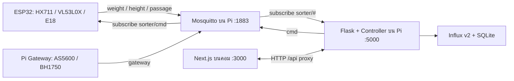

# ตรวจ Mini Sorting Hub เทียบ Term Project Criteria

วันที่ตรวจ: **16 พฤศจิกายน 2026**

เกณฑ์อ้างอิง: [PDF ต้นฉบับ หน้า 1](../references/IoT_Project___Metric_2026_1-1525379-17867481594565.pdf) อ่านทั้งข้อความและภาพตารางครบหน้า รวม **25 คะแนน** ตรวจเฉพาะ source/เอกสาร/หลักฐานที่มีใน workspace นี้ ไม่ถือว่า source ของทีม AI ที่อาจทำแยกกันถูกนำมารวมแล้ว

## ผลสรุป

**โครงปัจจุบันยังรองรับการทำให้ครบเกณฑ์ได้ และการให้ frontend รันบนคอมไม่ทำให้ผิดเกณฑ์ แต่ implementation และหลักฐานตอนนี้ยังไม่ครบสำหรับอ้างว่าผ่านทั้งหมด**

- Hardware 5 คะแนน: เลือกอุปกรณ์/ผัง/โค้ดรองรับครบหมวด ต้องยืนยันการ integrate จริง
- Application 6 คะแนน: ยังขาด pipeline กล้อง/OCR/AI ที่รวมใช้งานจริงและผลประเมินใน workspace นี้
- System 7 คะแนน: มี source MQTT/server/Influx/Dashboard รองรับ ต้องสาธิตข้อมูลจริงครบเส้นทาง โดยเฉพาะ write/query Influx และ MQTT จากอุปกรณ์
- Presentation/Video 7 คะแนน: มีแผนและเนื้อหาตั้งต้น ยังไม่พบ slides/video ส่งงานในชุด source ที่ตรวจ

ตัวเลขข้างต้นคือสัดส่วนคะแนนของ rubric **ไม่ใช่คะแนนที่ประเมินว่าได้รับแล้ว** Mock, BENCH แบบย้ายกล่องด้วยมือ และ unit tests ไม่ใช่หลักฐานฮาร์ดแวร์/AI ทำงานจริง

## ตารางครบทุกข้อ

สถานะ “มีโค้ด” หมายถึงพบ implementation ไม่ใช่ยืนยันผ่านการเดโม; “มีแผน” หมายถึง requirement ถูกออกแบบไว้ แต่ยังใช้แทน implementation ไม่ได้

| ข้อ | คะแนน | เกณฑ์ | สิ่งที่พบ / สถานะ | หลักฐานที่ยังต้องมี |
|---|---:|---|---|---|
| 1 | 1 | เซนเซอร์ต่างชนิดอย่างน้อย 5 | มีแบบ/โค้ด: Load cell, E18, VL53L0X, AS5600, BH1750; E18 4 ตัวนับชนิดเดียว ไม่ใช้กล้อง/Servo/ปุ่มเพิ่มจำนวน | อ่านค่าจริงทั้งห้าชนิดในระบบเดียว |
| 2 | 1 | I2C อย่างน้อย 1 | มีโค้ด: ToF บน ESP32, AS5600/BH1750 บน Pi | แสดงวงจรและอ่านข้อมูลจริง ไม่ใช้ scan address อย่างเดียว |
| 3 | 1 | Sensor Node อย่างน้อย 2 sensors | ESP32 มี Load cell+HX711, ToF และ E18; มีเกินขั้นต่ำ | Node ส่งข้อมูลเซนเซอร์จริงเข้า backend |
| 4 | 1 | Gateway อย่างน้อย 2 sensors | Pi อ่าน AS5600 และ BH1750 โดยตรงใน gateway_sensors.py | แสดงค่าจริงของสองตัวผ่าน Gateway พร้อมกัน |
| 5 | 1 | Actuator อย่างน้อย 1 | มี Servo ประตู/ราง; ผู้ใช้ยืนยันขยับแยกตัวแล้ว | คำสั่งระบบทำให้ actuator ทำงานจริงตาม flow |
| 6 | 1 | ใช้ camera/video capture | มีกล้องในรายการ แต่ไม่พบ capture pipeline ที่รวมใน source นี้ | ภาพจากกล้องของเครื่องพร้อม job_id/เวลา ไม่ใช่ภาพสำเร็จรูปอย่างเดียว |
| 7.1 | 1 | Image processing เช่น OCR ด้วย OpenCV/pretrained model | มีแผน/AI handoff; ไม่พบ pipeline ที่รันจริงใน source นี้ | ภาพก่อน/หลังประมวลผล ข้อความ OCR และโค้ดที่รันได้ |
| 7.2 | 1 | ใช้ AI service | มีแผน Gemini และ HTTP interface; hook ไม่ใช่การเรียก AI service จริง | คำขอ/ผลตอบกลับจาก AI service โดยปิดบัง key พร้อมเชื่อม job จริง |
| 8 | 1 | ผลประมวลภาพมีผลต่อระบบ | controller รับผล AI แล้ว choose/สั่งกลไกได้ แต่ BENCH ปัจจุบันเลือกช่องเอง | ภาพ → OCR → AI/resolve → A/B/HOLD → คำสั่ง/ผลกลไกจริง ห้ามใช้ปุ่มเลือกช่องแทนหลักฐานข้อนี้ |
| 9.1 | 1 | ประเมินเชิงปริมาณ: FPS และ Accuracy | มีแผนประเมิน ยังไม่พบผลวัดจริง | FPS ที่วัดจาก pipeline ที่ระบุขอบเขต พร้อม Accuracy จากชุดมีเฉลย/จำนวนตัวอย่าง |
| 9.2 | 1 | ประเมินเชิงคุณภาพ: สำเร็จและไม่สำเร็จ | มี test cases/เหตุ fault แต่ไม่พบชุดภาพ/คลิปผลจริงครบ | ตัวอย่างภาพอ่านสำเร็จ/ล้มเหลว ผลที่เกิด และวิเคราะห์เหตุผล |
| 10 | 3 | Message queue อย่างน้อย 3 topics สำหรับข้อมูลต่างแหล่ง พร้อมอธิบาย | มี source publish weight/height/passage จากเซนเซอร์คนละแหล่ง และ gateway เพิ่มอีก topic; โครงตรงข้อความเกณฑ์ | Broker trace จากอุปกรณ์จริงอย่างน้อยสาม topics อธิบายต้นทางและการใช้งาน ไม่ใช้ mock/ชื่อ topic อย่างเดียว |
| 11 | 1 | On-premise/cloud server รับและประมวลผลจาก queue | backend บน Pi subscribe sorter/# แล้วส่ง controller/store; Mosquitto อยู่ Pi | แสดง MQTT ที่รับแล้วทำให้ state/ข้อมูลใน backend เปลี่ยนจริง |
| 12 | 1 | Time-series DB เก็บและเรียกข้อมูลย้อนหลัง | store.py มี Influx v2 write และ Flux query; SQLite เป็น jobs/cache ไม่ใช้แทน Influx ข้อนี้ | INFLUX_ENABLED=1, write สำเร็จ และ query ข้อมูล IoT จริงย้อนหลัง |
| 13 | 2 | Dashboard แสดงข้อมูลสดและย้อนหลัง | Next บนคอมมี status/jobs polling และกราฟ history ผ่าน Flask API | ค่าจริงเปลี่ยนตาม sensor และกราฟย้อนหลังมี source=InfluxDB; ให้เห็นช่วงเวลา/ข้อมูลที่เก็บไว้ |
| 14.1 | 1 | วัตถุประสงค์และ 2–3 SDGs | มีวัตถุประสงค์และ SDG 8/9 ใน Project Brief; สองข้ออยู่ในช่วงที่กำหนด | ใส่ใน slides พร้อมเหตุผลที่สัมพันธ์กับงาน |
| 14.2 | 1 | อธิบาย/discuss architecture | มีผังระบบ ต้องใช้ฉบับล่าสุด PC frontend / Pi backend+gateway / ESP32 | Slides อธิบายหน้าที่ อุปกรณ์ เครือข่าย และเส้นทางข้อมูลตรงของจริง |
| 14.3 | 1 | อธิบาย Input/Output | มีตาราง sensor/camera/actuator และข้อมูล | Slides แสดง I/O และหน่วย/ผลลัพธ์ที่ใช้งานจริง |
| 14.4 | 1 | Strengths/limitations | มีขอบเขตกล่อง/ฉลากและข้อจำกัด BENCH | เติมข้อจำกัดจากผลทดลองจริง ไม่ใช้ข้อคาดหมายอย่างเดียว |
| 14.5 | 1 | เทียบกับ commercial solutions | มีตารางตั้งต้นเทียบ OPEX Sure Sort X ในแผน | Slides เทียบสินค้าที่มีขายจริงพร้อมแหล่ง/วันที่ ไม่ใช้แค่งานวิจัยหรืออ้างความเร็วที่ยังไม่วัด |
| 15.1 | 1 | เนื้อหาวิดีโอประมาณ 5 นาที ครบ Hardware/Application/Systems | มีโครงวิดีโอในแผน ยังไม่พบวิดีโอส่งงานใน source นี้ | คลิปเดโมของจริงครบสามด้าน |
| 15.2 | 1 | คุณภาพวิดีโอ | ยังประเมินไม่ได้จาก source | ภาพ/เสียง/ตัวอักษรและลำดับเรื่องชัด |
| รวม | **25** | | **ยังไม่กำหนดคะแนนที่ได้จริง** | |

PDF ระบุส่ง slides และ video ใน myCourseVille **9 ธันวาคม 2026 เวลา 09:00** ใช้เป็นเงื่อนไขส่งมอบของวิชา ไม่ได้ส่งไฟล์หรือสร้าง reminder ให้อัตโนมัติ

## MQTT — ตรวจเชิงลึก

### สิ่งที่เกณฑ์ระบุและสิ่งที่ไม่ได้บังคับ

ข้อ 10 ระบุ message queue เช่น MQTT, อย่างน้อยสาม topics ที่รองรับข้อมูลจากต่างแหล่ง และอธิบายหน้าที่ ข้อ 11 อนุญาต server แบบ on-premise หรือ cloud

- **Mosquitto บน Pi ใช้ได้ตามแบบ on-premise** ไม่จำเป็นต้องย้ายเป็น cloud broker
- ไม่พบข้อบังคับให้มีสามบอร์ด หรือให้แต่ละ sensor มีบอร์ดแยก การใช้เซนเซอร์คนละแหล่งบน ESP32 บอร์ดเดียวแยก topics เป็นการ mapping ที่สอดคล้องกับข้อความ rubric นี้
- ไม่พบข้อบังคับให้ browser ต่อ MQTT, ใช้ WebSocket, ใช้ QoS 1 ทุกเส้นทาง หรือส่งภาพทั้งภาพผ่าน MQTT
- การย้าย frontend ไปคอมไม่ย้าย/ตัด MQTT ออก เพราะ MQTT/server/database ยังทำงานบน Pi

### Topics ที่ใช้เป็นหลักฐานข้อ 10

| Topic | ต้นทางข้อมูล | Publisher → Subscriber | หน้าที่/สิ่งที่แสดงในการเดโม |
|---|---|---|---|
| sorter/weight | Load cell ผ่าน HX711 | ESP32 → Pi backend | น้ำหนัก g, valid, stable; วาง/ยกน้ำหนักให้ค่าจริงเปลี่ยน ใช้สร้าง job เมื่อนิ่ง |
| sorter/height | VL53L0X | ESP32 → Pi backend | distance_mm/height_mm/valid; เปลี่ยนระยะหรือกล่องเพื่อให้เห็นต้นทางอิสระจากน้ำหนัก |
| sorter/passage | E18-D80NK | ESP32 → Pi backend | active ของ tray_exit/A/B/HOLD และ events; บังเซนเซอร์แล้วให้ backend รับการเปลี่ยนจริง |
| sorter/gateway | AS5600 + BH1750 | Pi gateway process → Pi backend ผ่าน broker | angle_deg/light_lux และ valid; หมุนแม่เหล็ก/เปลี่ยนแสงให้เห็นข้อมูล Gateway จริง |

สามรายการแรกมาจาก sensor sources คนละชนิด ไม่ใช่สร้างสามชื่อให้ค่าตัวเดียว นี่เป็นหลักฐานหลักที่แข็งแรงกว่าการนับ sorter/cmd, sorter/ack หรือ sorter/status ซึ่งเป็น control/status topics

### Topics สนับสนุน ไม่ใช้แทนสามแหล่งข้อมูลเซนเซอร์

| Topic | เส้นทาง | สถานะในโค้ด |
|---|---|---|
| sorter/cmd | backend → ESP32 | POSITION/RELEASE/COMPLETE/FAULT/RESET/PING ตาม flow; Node subscribe อยู่ |
| sorter/ack | ESP32 → backend | ตอบคำสั่ง; ACK ไม่ใช่หลักฐานกล่องถึงช่อง |
| sorter/actuator | ESP32 → backend | released/target_bin/node_fault/display_state |
| sorter/status | ESP32 → backend | เหตุจากปุ่ม/สถานะที่ firmware ส่งตาม branch |
| sorter/vision | backend publish หลังรับ AI result ผ่าน HTTP | มีจุด publish แต่ยังไม่ใช่หลักฐานกล้อง/AI จริงหรือแหล่ง MQTT ที่ทำงานใน BENCH ปกติ |

### เส้นทางที่ต้องคงไว้

| Client | ปลายทางที่ต้องตั้ง |
|---|---|
| ESP32 MQTT | IP LAN **จริง** ของ Pi :1883; 192.168.1.100 ใน secrets.example.h เป็นตัวอย่าง ไม่ใช่ IP ที่ตรวจยืนยัน |
| Pi backend/gateway MQTT | 127.0.0.1:1883 เพราะ broker อยู่เครื่องเดียวกัน; ตั้ง user/password ให้ตรง broker |
| Next.js บนคอม | BACKEND_URL=http://pi-673305942.local:5000 หรือ IP LAN จริงเมื่อ .local ไม่ resolve |
| Browser บนคอม | http://localhost:3000 ไม่ใช่ MQTT :1883 |

Source ที่ยืนยันเส้นทาง: [firmware](../../firmware/esp32/hub_node/hub_node.ino), [Gateway](../../gateway/gateway_sensors.py), [Backend MQTT](../../backend/app/hub.py), [Controller](../../backend/app/controller.py), [Store](../../backend/app/store.py), [Dashboard](../../frontend/src/features/dashboard/Dashboard.tsx), [History](../../frontend/src/features/dashboard/HistoryPanel.tsx)

### QoS และข้อจำกัดที่ต้องอธิบายตามจริง

- Firmware ใช้ PubSubClient publish QoS 0 และ subscribe คำสั่ง QoS 1; backend/Gateway publish QoS 1 ไม่มีเหตุจาก rubric นี้ให้เปลี่ยน library เพื่อบังคับ QoS 1 ทุกเส้นทาง
- Node ส่ง passage ring 16 events ซ้ำใน snapshot; backend ป้องกันซ้ำตาม event/session และตรวจ stale/command expiry แต่ไม่ได้เป็นการรับรองว่าจะไม่สูญหายทุกกรณี
- ไม่ retain คำสั่งขยับ และการ ACK คำสั่งไม่ใช่การยืนยันว่ากล่องถึงช่อง ต้องรอ IR/มุมจริง
- โค้ดพร้อมให้ต่อ broker ไม่เท่ากับมีหลักฐานรันบน Pi แล้ว ยังไม่มี MQTT capture จากอุปกรณ์ครบชุดในรอบ audit นี้

## หลักฐานที่ต้องเก็บก่อนอ้างว่าข้อ 10–13 ผ่าน

1. เปิด Node/Gateway/backend กับ broker จริงบน Pi ใช้ source ปัจจุบัน ไม่ใช้ fake publisher แทนอุปกรณ์
2. เก็บ topic + payload + เวลารับจาก weight/height/passage ให้เห็นค่าจริงเปลี่ยนจากคนละ sensor แสดง valid=true ของน้ำหนัก/ToF หลัง calibration พร้อม active ของ IR
3. เก็บ sorter/gateway ให้เห็น AS5600 และ BH1750 ใช้งานจริง เพื่อรองรับข้อ 4 ด้วย
4. อธิบายแต่ละ topic ว่ามาจากอะไร ใช้ทำอะไร และแสดง backend รับแล้วเปลี่ยน state/ข้อมูล ไม่ใช่แค่ list ชื่อ topics
5. เปิด INFLUX_ENABLED=1 และเก็บผล write/query ข้อมูล IoT จริง หน้า history ต้องแสดง source=InfluxDB การเปิด fallback ไม่ทำให้ผ่านข้อ 12
6. เปิดเว็บบนคอม ดูค่าที่เปลี่ยนตาม sensor และโหลดกราฟช่วงก่อนหน้า แยกหลักฐาน live กับ history ให้เห็น
7. ในรอบเดโมสุดท้าย ให้กล้อง/OCR/AI กำหนด route แล้วกลไกทำงานจริง ไม่ใช้ปุ่ม A/B/HOLD เป็นหลักฐาน Application

## งานที่ต้องปิดก่อนส่ง

- รวมงาน AI team: camera capture, OCR, Gemini service, resolver และ job artifacts เข้ากับ HTTP hook ของ backend ไม่มีความจำเป็นต้องเปลี่ยน hook เป็น MQTT เพื่อให้ครบสาม topics
- วัด FPS และ Accuracy จากชุดมีเฉลย; ระบุว่าวัด capture, processing หรือ end-to-end ช่วงใด ไม่ใช้ความถี่ telemetry 2 Hz หรือสเปก FPS กล้องแทนผลประเมินภาพจริง
- เก็บภาพ/คลิปสำเร็จและล้มเหลวพร้อมอธิบาย เช่น ฉลากชัด/อ่านไม่ได้/ข้อมูลขัดกัน และผล A/B/HOLD ที่เกิด
- ทำ slides/video โดยใช้ architecture PC/Pi ล่าสุด มี SDG 8/9, I/O, strengths/limitations และ commercial comparison
- CSV import/preview และตั้งชั้นคั่นเป็นฟังก์ชันที่เคยตกลงไว้ ยังไม่พบใน BENCH UI แม้ไม่ใช่บรรทัดแยกของ rubric ไม่ควรถือว่าตัดออกเอง ส่วนวิธีปิด HOLD และ tracking duplicate ยังพักไว้ตามผู้ใช้

## สิ่งที่ทำในรอบ audit นี้

อ่าน PDF ต้นฉบับครบหน้าและตรวจภาพตาราง; ตรวจ source MQTT/sensor/server/store/dashboard กับเอกสารหลัก ไม่ติดตั้ง broker ไม่ SSH เข้า Pi ไม่เปลี่ยน firmware/ระบบที่รันอยู่ และไม่รัน unit tests ซ้ำสำหรับรายงานนี้ ผล tests/build เดิมยังเป็นผลเดิม ไม่ใช่หลักฐาน MQTT/AI/ฮาร์ดแวร์ที่เพิ่มขึ้นจาก audit
